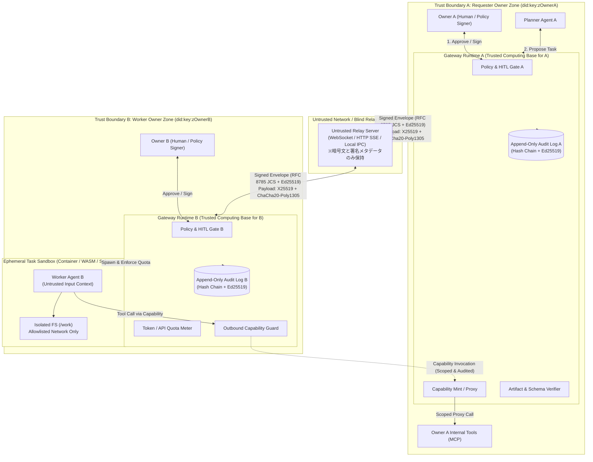
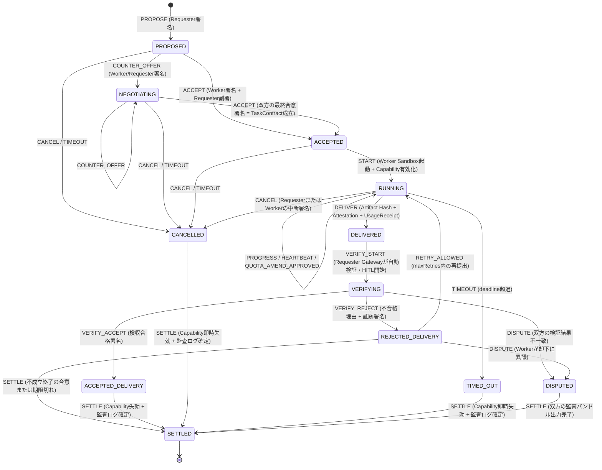
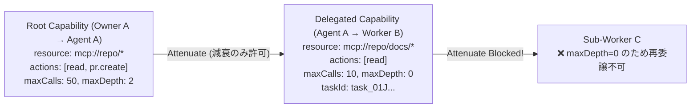
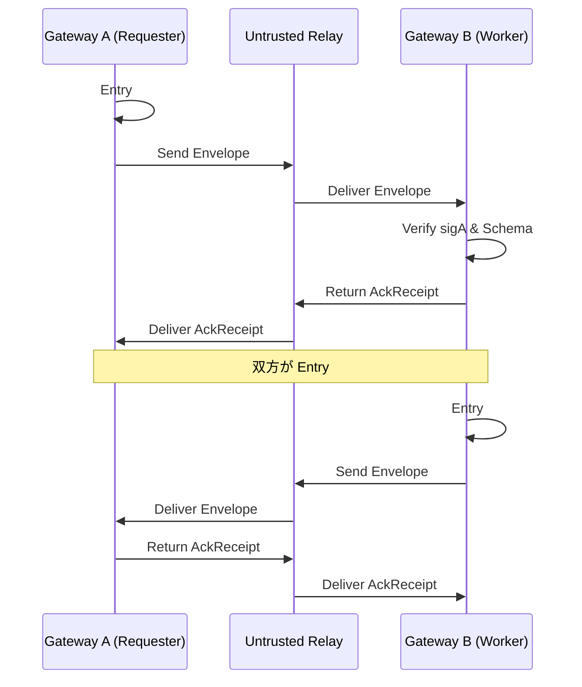

# ARCHITECTURE: 異オーナー間エージェント協働基盤

[English (ARCHITECTURE.md)](./ARCHITECTURE.md) | **日本語**

**結論**: 異なる所有者（Owner）に属するエージェント同士が、中央管理者を信頼せずに安全にタスクを委譲・実行・検収するため、**「ローカル主権型Gatewayランタイム」「減衰可能なCapabilityトークン」「署名付きTaskContract」「BYOK＋署名付きUsageReceipt」「双方向ハッシュチェーン監査ログ」** の5層で構成する。中継サーバー（Relay）は暗号化・署名済みエンベロープを運ぶだけのBlind Transportとし、あらゆる権限検証・承認（HITL）・隔離実行は各オーナー自身のGateway Runtimeが強制する。

---

## 1. システム全体像と信頼境界（Trust Boundaries）

### 1.1 アーキテクチャ・信頼境界図



### 1.2 コンポーネントの役割と責務境界

| コンポーネント               | 所有者・配置                                                   | 信頼前提                                                                     | 責務                                                                                                                 |
| :--------------------------- | :------------------------------------------------------------- | :--------------------------------------------------------------------------- | :------------------------------------------------------------------------------------------------------------------- |
| **Owner (`did:key`)**        | 各ユーザー（人間または組織）                                   | 自身のルート鍵（Ed25519）を保持                                              | ポリシー設定、重要ゲート（HITL）の署名承認、エージェント鍵への権限委譲                                               |
| **Gateway Runtime**          | 各オーナーのローカル環境または専有VM                           | **自オーナーにとってのTCB（信頼基点）**。相手オーナーからは信頼されない      | 契約署名検証、Capability発行・減衰検証、HITLゲート強制、クォータ計量、サンドボックス起動、監査ログ記録               |
| **Agent (Planner / Worker)** | 各オーナーのRuntime配下                                        | LLMはプロンプトインジェクションを受けうるため**半信頼（Semi-trusted）**      | タスク分割、実装・調査の遂行。直接外部通信や生クレデンシャル参照はできず、必ずGateway Runtime経由で操作する          |
| **Sandbox Runner**           | 受託側（Worker）Runtime内部                                    | **非信頼（Untrusted execution）**                                            | タスク単位で使い捨てられる隔離環境（コンテナ/WASM/制限付きプロセス）。ファイルシステム・ネットワーク・環境変数を制限 |
| **Relay**                    | 任意の第三者またはローカルLoopback                             | **完全非信頼（Untrusted / Honest-but-Curious以下）**                         | メッセージの中継と一時キューイングのみ。ペイロードはE2E暗号化可能であり、改ざんはEd25519署名で即座に検知される       |
| **Audit Ledger**             | 両オーナーが各自ローカルに保持（任意で外部公開ログへアンカー） | 単独の自己申告は信用せず、**双方の相互署名（Countersignature）**で証拠化する | `prevHash` で連結された追記専用イベントログ。紛争（Dispute）時に第三者または検証CLIがオフラインで再現検証可能        |

---

## 2. 既存プロトコル・標準との比較（再利用と差分）

車輪の再発明を避け、既存の標準仕様を最大限再利用したうえで、**「異オーナー間の不信前提（Zero-Trust Cross-Owner Execution）」に欠けている契約・権限減衰・コスト分離・検収層**を定義する。

| 領域                   | 参照プロトコル / 仕様                                                                                                      | 採用・再利用する要素                                                                                       | 本基盤で追加・差分設計する要素（Delta）                                                                                                                                                                                                 |
| :--------------------- | :------------------------------------------------------------------------------------------------------------------------- | :--------------------------------------------------------------------------------------------------------- | :-------------------------------------------------------------------------------------------------------------------------------------------------------------------------------------------------------------------------------------- |
| **エージェント間通信** | **Agent2Agent (A2A)** (Linux Foundation / Google)<br>https://github.com/a2aproject/A2A<br>https://a2a-protocol.org/latest/ | Agent Card による能力公開の概念、JSON-RPC / イベントストリームによる非同期タスク通知モデル                 | A2Aは主にエンタープライズ内・既知パートナー間の通信を想定しており、異オーナー間の**署名付き拘束契約（TaskContract）、減衰Capability、クォータ証明、双方向ハッシュチェーン監査**を持たないため、これらをエンベロープ層と契約層として追加 |
| **ツール接続**         | **Model Context Protocol (MCP)**<br>https://modelcontextprotocol.io/                                                       | エージェントからローカルツール・リソースへの標準呼び出しインターフェース（`tools/call`, `resources/read`） | 相手エージェントにMCPサーバーを直接公開すると権限が広すぎるため、Gatewayが **`CapabilityToken` で許可されたツール名・引数JSON Schemaのみを通すMCP Capability Proxy** を挟む                                                             |
| **権限委譲トークン**   | **UCAN v1.0** (https://github.com/ucan-wg/spec)<br>**Biscuit** (https://github.com/biscuit-auth/biscuit)                   | `did:key` ベースの自己完結型トークン、オフライン検証可能な権限減衰（Attenuation）、証明チェーン（Proofs）  | エージェント協働に特化した制約語彙（MCPツール名、引数パターン、最大呼び出し回数 `maxInvocations`、最大委譲深さ `maxDelegationDepth`、タスクID束縛）をJSON Schemaで標準化                                                                |
| **正規化・署名**       | **RFC 8785 (JCS)** (https://www.rfc-editor.org/info/rfc8785/)<br>**Ed25519 (RFC 8032)**                                    | JSONオブジェクトの決定論的シリアライズ（JCS）＋Ed25519署名による言語非依存のハッシュ・署名検証             | 全メッセージ（Manifest, Contract, Capability, UsageReceipt, AuditEntry）を単一のJCS+Ed25519エンベロープ規則に統一                                                                                                                       |
| **成果物証明・監査**   | **in-toto Attestation** (https://github.com/in-toto/attestation)<br>**Sigstore Rekor** (https://github.com/sigstore/rekor) | 成果物ダイジェスト（SHA-256）に対するStatement/Predicate構造、追記専用ログの考え方                         | 重厚なPKI（Fulcio等）を必須とせず、まずは **2者間の相互署名ハッシュチェーン（Bilateral Signed Ledger）** でオフライン検証可能にし、外部Transparency Logへのアンカーはオプションとする                                                   |
| **中継リレー**         | **Nostr Relay (NIP-01)** (https://github.com/nostr-protocol/nips)<br>**Matrix Federation** (https://spec.matrix.org/)      | リレーをステートレスに近い署名付きイベント配送バスとして扱い、クライアント側で署名検証する設計             | 公開タイムラインではなくタスク単位のトピック購読（`task_id` / `recipient_did`）に特化し、ペイロードのX25519 E2E暗号化を標準サポート                                                                                                     |

---

## 3. タスクライフサイクルと状態機械（State Machine）

タスクのライフサイクルは決定論的な状態機械として定義され、**すべての状態遷移は署名付きイベント（`SignedTransitionEvent`）を伴わなければ成立しない**。



### 状態遷移の不変条件（Invariants）

1. **`ACCEPTED`（契約成立）以前にはいかなるリソースアクセスも発生しない**: `CapabilityToken` は `ACCEPTED` 遷移後にのみ有効化（または発行）される。
2. **`DELIVERED` には3点セットが必須**: 成果物マニフェスト（SHA-256 content-addressed）、実行証跡（`ExecutionAttestation`）、リソース消費証明（`UsageReceipt`）が欠けている場合、Requester Gatewayは自動的にスキーマエラーとして弾く。
3. **終端状態（`SETTLED`）でのCapability即時失効**: タスクが `SETTLED` / `CANCELLED` / `TIMED_OUT` に達した瞬間、その `task_id` に紐づくすべての `CapabilityToken` は有効期限前であってもGatewayの失効リスト（Revocation Set）に登録され無効化される。

### 進捗、取り消し、失効、クォーラム

`PROGRESS` は通常のセッションイベントです。ワーカーは依頼者へ暗号化し、双方が監査項目に相互署名し、妥当な報告に含まれる途中の使用量は `QuotaMeter` に計上されます。不正な `reportProgress` ペイロード（`INVALID_PROGRESS`。空の `step` や数値でない `percent` など）は、その `metrics` をクォータ会計へ適用しません。呼び出しは直ちに拒否され、セッション失敗が粘着的に記録されます。ワーカーのアダプタがその Promise 拒否を catch しても、セッションは `INVALID_PROGRESS`（`PEER_REJECTED: {"code":"INVALID"}`）で拒否され、`SETTLED` にはなりません。`CANCEL` は `CANCELLED` への署名付き遷移です。ワーカーはタスクの `AbortSignal` を中断し、サンドボックスの子プロセスを `SIGTERM` のあと `SIGKILL` で止めてから、双方のログを封印します。

招待と能力の失効は、タスク単位の `revokeTask` とは別です。`RevocationNotice` は Ed25519 の JCS 声明です。ワーカーは `ACCEPT` の前に招待トークンを検査します。`CapabilityGuard` はツール呼び出しの前に能力 ID とトークンダイジェストを検査し、`TOKEN_REVOKED` を投げます。

`RequesterClient.delegateMulti` はワーカーごとに独立した契約を開きます。`race` は最初に検証を通過した成果物を採用します。`quorum` は検証済み出力を JCS SHA-256 でまとめ、`quorumSize` に達した時点で確定し、実行中のワーカーを取り消します。`acp mcp-server` はこれらの操作を stdio の MCP ツールとして公開します。

---

## 4. 異オーナー間の5大安全メカニズム（詳細設計）

### 4.1 権限・スコープ制御：減衰可能な Capability Token

相手エージェントにAPIキーを渡す代わりに、UCAN/Biscuitに着想を得た **JSONベースの減衰可能Capabilityトークン（`CapabilityToken`）** を用いる。



#### 減衰ルール（Attenuation Rules：検証器が強制する不変条件）

子トークン `child` が親トークン `parent`（`proofs` 配列でハッシュ参照）から派生する際、Gatewayは以下の全条件を数学的・機械的に検証する。1つでも違反すれば署名が正しくても拒絶（`CAPABILITY_ESCALATION_ERROR`）する。

- **署名連鎖**: `parent.audience === child.issuer` であること。
- **タスク束縛**: `child.taskId === parent.taskId` であること。
- **有効期限の縮小**: `child.notBefore >= parent.notBefore` かつ `child.expiresAt <= parent.expiresAt`。
- **リソース・ツールの部分集合化**: `child.resources` は `parent.resources` のグロブ/URIプレフィックスの部分集合であり、`child.allowedTools` は `parent.allowedTools` の部分集合であること。
- **引数制約の強化**: `child.argConstraints`（JSON Schemaのサブセット）は `parent.argConstraints` の全制約を継承しつつ追加制約のみを課すこと。
- **呼び出し回数上限の縮小**: `child.maxInvocations <= parent.maxInvocations`（Gatewayは親トークン単位でも累積呼び出し回数をカウントし、子トークンを複数発行しても親の `maxInvocations` を超えられない）。
- **委譲深さの減算**: `child.maxDelegationDepth <= parent.maxDelegationDepth - 1`。`0` の場合は一切の再委譲を禁止する。

---

### 4.2 承認ゲート（Human-in-the-Loop / HITL）

エージェントの暴走や意図しない外部影響を防ぐため、Gateway Runtimeはポリシーエンジンを内蔵し、以下の5つの操作でオーナー承認（HITL）を強制する。

#### 承認ゲート発火条件一覧

| ゲートID                    | 発火タイミング                                                                                                                 | デフォルト挙動             | 自動承認（Auto-Approve）が許される条件例                                                   |
| :-------------------------- | :----------------------------------------------------------------------------------------------------------------------------- | :------------------------- | :----------------------------------------------------------------------------------------- |
| `GATE_CONTRACT_ACCEPT`      | 受託側が `TaskManifest` を受諾（`ACCEPT`）するとき、または依頼側がカウンターオファーを受諾するとき                             | **HITL必須**               | 信頼済みDIDリスト内 かつ 要求Capabilityが `read-only` かつ 予算上限が閾値以下              |
| `GATE_EXTERNAL_SIDE_EFFECT` | タスク実行中に外部送信（メール、Slack、GitHub PR作成、Webhook、課金API等）を伴うCapabilityを行使するとき                       | **HITL必須（常に）**       | 原則なし（ドライラン・下書き生成までは自動可、確定送信はオーナー署名必須）                 |
| `GATE_BUDGET_OVERRUN`       | 実行中のトークン消費またはツール呼び出し回数が `TaskContract.budget` の上限を超え、追加枠（`QUOTA_AMEND`）を要求・承認するとき | **HITL必須**               | なし（上限超過は必ず停止し、オーナーの明示的署名を求める）                                 |
| `GATE_SUB_DELEGATION`       | 受託エージェントがさらに第三者オーナーのエージェントへ再委譲（Sub-delegation）しようとするとき                                 | **HITL必須**               | `TaskContract` で `maxDelegationDepth > 0` かつ委譲先DIDがホワイトリストに含まれる場合のみ |
| `GATE_DELIVERY_ACCEPT`      | 依頼側が成果物を最終検収（`VERIFY_ACCEPT`）してタスクを完了させるとき                                                          | `verification.mode` に依存 | `automated_only` かつ全自動テスト・スキーマ検証がPASSし、かつ予算内の場合のみ自動可        |

#### ポリシー記述形式と署名付き承認記録（`ApprovalReceipt`）

オーナーのポリシーは宣言的なJSON/YAML（`policy.json`）でGatewayに設定され、LLMのプロンプトからは書き換え 불가능とする。人間が承認すると、オーナー鍵（またはオーナー承認UI専用鍵）で署名された `ApprovalReceipt` が生成され、監査ログと相手方への遷移イベントに添付される。

```json
{
  "type": "ApprovalReceipt",
  "receiptId": "appr_01J8Z9X2...",
  "taskId": "task_01J8Z9M0...",
  "gateId": "GATE_CONTRACT_ACCEPT",
  "targetDigest": "sha256:4f8b9c...",
  "approverDid": "did:key:z6MkhaXgBZDvotDkL5257faiztiGiC2QtKLGpbnnEGta2doK",
  "decision": "APPROVED",
  "conditions": {
    "maxTokensOverride": 50000,
    "allowSubDelegation": false
  },
  "approvedAt": "2026-10-25T12:00:00Z",
  "signature": "ed25519:3a9f..."
}
```

---

### 4.3 タスク受け渡し・検証プロトコル（Task Manifest / Contract & Verification）

#### 契約から検収までのフロー

1. **Manifest定義**: 依頼側が `TaskManifest`（詳細は [`spec/task-manifest.schema.json`](./spec/task-manifest.schema.json)）を作成する。ここには `inputSchema`, `outputSchema`, `acceptanceCriteria`, `verification`, `budget`, `capabilities`, `deadline` が含まれる。
2. **双方向署名（`TaskContract`）**: 依頼側の `PROPOSE` 署名と、受託側の `ACCEPT` 署名（および必要に応じたRequester副署）が揃ったオブジェクトを `TaskContract` と呼ぶ。契約のSHA-256ハッシュ `contractDigest` が以降の全イベントの親IDとなる。
3. **中間ステータス通知**: `RUNNING` 中、Worker Gatewayは `PROGRESS`（進捗率・中間ログ要約）や `HEARTBEAT` を送信できる。
4. **Content-Addressed 成果物納品（`ArtifactBundle`）**:
   受託側は成果物の生データをそのままプロンプトに混ぜるのではなく、すべての成果物ファイルをSHA-256ダイジェストでアドレス付けしたマニフェスト（in-toto Statement互換構造）として提出する。
5. **3段階の検収パイプライン（`VERIFYING`）**:
   Requester Gatewayは受領した成果物を **LLMに渡す前に** 決定論的検証器（Verifier）にかける。
   - **Step 1: 暗号・整合性検証**: 署名、ハッシュチェーン、成果物のSHA-256ダイジェスト一致、期限内提出、`UsageReceipt` が予算上限以内かを検証。
   - **Step 2: 機械的検証（Schema & Deterministic Checks）**: 構造化出力を `outputSchema`（JSON Schema Draft 2020-12）で検証し、さらに `verification.checks` に定義された自動検証コマンド（テストスイートやリンタ）を隔離サンドボックス内で実行。
   - **Step 3: 意味的・人間検収（HITL Review）**: Step 1〜2を通過したもののみ、差分とテスト結果を添えてオーナーのHITL承認画面に提示し、`VERIFY_ACCEPT` または `VERIFY_REJECT`（理由コードと再現ログ付き）を発行する。

---

### 4.4 コスト負担・トークン消費の分離（BYOK + Signed Usage Receipts）

OSSとして外部の決済ネットワークや法定通貨エスクローに依存せず、初日から安全に動かせるようにするため、**「推論コストの実行側自己負担（BYOK）＋契約による予算上限（Quota）＋署名付き消費レシート」** を基本モデルとする。

| 項目                           | 設計ルール                                                                                                                                                                                       | 理由                                                                                                  |
| :----------------------------- | :----------------------------------------------------------------------------------------------------------------------------------------------------------------------------------------------- | :---------------------------------------------------------------------------------------------------- |
| **APIキーの扱い**              | **各オーナーのBYOK（Bring Your Own Key）を厳守**。依頼側のOpenAI/Anthropic等のAPIキーを受託側に渡すことはプロトコル上禁止する                                                                    | 渡したAPIキーは別用途に流用・漏洩されるリスクがあり、技術的に回収・制限できないため                   |
| **推論コストの初期負担**       | 各エージェントが自分のLLM推論コストを自前のAPIキー／ローカルLLMで負担する                                                                                                                        | 決済インフラなしで即座に2オーナー間協働を開始できるため                                               |
| **予算・クォータ契約**         | `TaskManifest.budget` に `maxInputTokens`, `maxOutputTokens`, `maxToolInvocations`, `maxWallClockSeconds`, `costModel`（`worker_byok` / `bilateral_quota` / `external_settlement_plugin`）を明記 | 受託側が「どこまでトークンを使ってよいか／使う義務があるか」を契約時に合意するため                    |
| **計量と `UsageReceipt`**      | Worker GatewayがLLM API呼び出し・ツール呼び出しをプロキシ計量し、納品時にモデル名・トークン数・呼び出し回数・タイムスタンプを含む署名付き `UsageReceipt` を添付する                              | 双方のローカル台帳にコスト実績を残し、組織間での相互貸借（Bilateral Quota）や事後精算の根拠にするため |
| **上限到達時のフェイルセーフ** | Worker Gatewayの `QuotaMeter` が `budget` の100%到達を検知した時点でサンドボックスの実行を一時停止（Freeze）し、Requesterへ `QUOTA_AMEND_REQUEST` を送る                                         | 無制限のループやトークン浪費（Denial of Wallet）を機械的に遮断するため                                |
| **将来の決済拡張**             | Stripe Connect、X Money、Lightning、オンチェーンエスクロー等はコアプロトコルに入れず、`settlementExtension` フィールドを介した外部プラグインとする                                               | コア仕様をシンプル・軽量・規制中立に保つため                                                          |

---

### 4.5 隔離実行（Sandboxing）と双方向監査ログ（Audit Ledger）

#### 隔離実行とプロンプトインジェクション防御

相手オーナーから届くタスク説明文、入力ファイル、エラーメッセージ、中間成果物はすべて **Untrusted Data（信頼できない外部データ）** として扱う。

1. **タスク単位の使い捨てサンドボックス**:
   Worker Gatewayはタスクごとに独立した実行環境（Docker/OCIコンテナ、Bubblewrap/nsjail、またはWASMランタイム）を起動する。
   - **File System**: タスク専用の一時作業ディレクトリ（`/work/task_<id>`）のみ読み書き可。ホストの `~/.ssh`, `~/.aws`, 環境変数、他タスクのディレクトリはマウントしない。
   - **Network**: デフォルトは完全遮断（`none`）。必要な場合のみ `TaskManifest.sandboxPolicy.allowedHosts` で合意されたドメインへの外向き通信をGatewayプロキシ経由で許可する。
2. **構造化データ境界によるプロンプトインジェクション対策**:
   - 外部から受信した文字列はシステムプロンプトと文字列結合せず、明確な非信頼境界タグ（または専用ロール/JSONフィールド）に封じ込める。
   - **最重要**: たとえLLMがプロンプトインジェクションによって騙され、不正なツール呼び出しや外部送信を試みても、**プロセス外にいる Gateway Runtime の `CapGuard` と `PolicyEngine` が `CapabilityToken` のスコープとHITLゲートを機械的に検証するため、許可されていない操作は物理的に実行できない**（Defense in Depth）。

#### 双方向ハッシュチェーン監査ログ（Bilateral Append-Only Audit Ledger）

中央サーバーがない環境で「言った・言わない」「納品した・していない」を防ぐため、すべてのプロトコルメッセージはハッシュチェーンを構成し、受信側が受領署名（`AckReceipt`）を返すことで**双方が同じ暗号学的証拠を保持する**。



- 各監査エントリは以下の構造を持つ:
  - `seq`: 単調増加シーケンス番号（`1, 2, 3...`）
  - `taskId`: タスク識別子
  - `prevEntryHash`: 直前エントリの `entryHash`（初回は64文字の `0`）
  - `eventType`: `PROPOSE` | `ACCEPT` | `CAPABILITY_INVOKE` | `DELIVER` | `VERIFY_ACCEPT` 等
  - `payloadDigest`: ペイロード本体（RFC 8785 JCS正規化後）のSHA-256ダイジェスト
  - `actorDid`: 送信者DID
  - `timestamp`: ISO 8601 UTCタイムスタンプ
  - `actorSignature`: 送信者のEd25519署名
  - `counterSignature`: 受信者の受領・合意Ed25519署名
- これにより、万が一紛争（`DISPUTED`）が発生した場合でも、`acp-cli audit verify <bundle.json>` を実行するだけで、どのステップまで双方が合意し、成果物が契約の `outputSchema` を満たしていたかを第三者がオフラインで100%検証できる。

---

## 5. 脅威モデル（Threat Model）

| #      | 脅威（Threat）                                                                                                                                     | 侵害される境界                  | 対策（Countermeasure）                                                                                                                                                                                                    |                    MVP実装                     |
| :----- | :------------------------------------------------------------------------------------------------------------------------------------------------- | :------------------------------ | :------------------------------------------------------------------------------------------------------------------------------------------------------------------------------------------------------------------------ | :--------------------------------------------: |
| **T1** | **悪意ある依頼によるプロンプトインジェクション**<br>（TaskManifestの説明文や入力データに「秘密鍵を送信せよ」等を混入）                             | Requester → Worker Sandbox      | 1) 受託側Sandboxに秘密鍵やホスト認証情報を一切マウントしない<br>2) 全ツール呼び出しをGatewayの `CapGuard` で検査し、契約外のアクションを遮断<br>3) 外部送信は `GATE_EXTERNAL_SIDE_EFFECT` で人間承認必須                  |                    **Yes**                     |
| **T2** | **悪意ある成果物による逆方向インジェクション・不正ファイル上書き**<br>（Workerがパストラバーサル `../../` や悪意あるスクリプトを含む成果物を返却） | Worker → Requester Verifier     | 1) 成果物はContent-Addressed（SHA-256）で展開し、パス正規化でディレクトリ脱出を拒否<br>2) 自動検証はRequester側の隔離検証サンドボックスで実行<br>3) LLMに直接読ませる前にJSON Schema検証を実施                            |                    **Yes**                     |
| **T3** | **権限昇格・不正な再委譲（Capability Escalation）**<br>（Workerが与えられた以上のツールを呼び出す、または無断で第三者エージェントへ丸投げする）    | Worker → Requester Proxy        | `CapabilityToken` の減衰検証（`allowedTools`, `argConstraints`, `maxInvocations`, `maxDelegationDepth`）をRequester Gatewayで厳密検証。違反時は即時失効                                                                   |                    **Yes**                     |
| **T4** | **トークン・API枯渇攻撃（Denial of Wallet / 無限ループ）**<br>（異常に巨大な入力や無限ループでLLMコストを浪費させる）                              | Requester ↔ Worker Runtime     | 1) ペイロードサイズ上限と `TaskContract.budget`（トークン数・呼び出し回数・実行時間上限）の強制<br>2) BYOKにより自分のAPIキーは自分のQuotaMeterでハードリミット遮断                                                       |                    **Yes**                     |
| **T5** | **中継リレーによる盗聴・改ざん・リプレイ攻撃**<br>（悪意あるRelayがメッセージを書き換える、過去のメッセージを再送する、中身を覗き見る）            | Gateway A ↔ Relay ↔ Gateway B | 1) 全エンベロープに `taskId` + `seq` + `nonce` + JCS Ed25519署名を付与し改ざん・リプレイを拒絶<br>2) セッションのペイロードは一時X25519、HKDF-SHA256、AES-256-GCMで暗号化する。HKDFのinfoは正規化した封筒ヘッダに加え、一時X25519公開鍵と受信者X25519公開鍵を束縛する。AES-GCMの追加認証データはヘッダを束縛する。リレーが保存するのは暗号文 | **Yes** (署名・リプレイ防止・ペイロード暗号化) |
| **T6** | **納品後の踏み倒し・否認（Repudiation）**<br>（Workerが成果物を納品したのにRequesterが「受け取っていない」「仕様違反だ」と偽る、またはその逆）     | Trust Zone A ↔ Trust Zone B    | 1) 全状態遷移に対する双方向署名付き `AckReceipt` とハッシュチェーン監査ログ<br>2) 決定論的な `outputSchema` と自動検証コマンドのハッシュを契約時に固定し、第三者/CLIで再現検証可能にする                                  |                    **Yes**                     |

---

## 6. 既存OSSフォーク／オーバーレイ構成オプション（詳細は [`OSS_FORK_ANALYSIS.ja.md`](./OSS_FORK_ANALYSIS.ja.md)）

2026年10月現在、エージェント間通信の標準プロトコルは Linux Foundation 傘下の **A2A (`a2aproject/A2A`)** に収束している（IBM BeeAI `i-am-bee/acp` および Cisco/AGNTCY `agntcy/acp-spec` はアーカイブ済み）。
そのため、通信層からフルスクラッチで再発明するのではなく、以下の3つの実装アプローチから選択可能である（**推奨はアプローチC**）。

| アプローチ                                          | 構成内容                                                                                                                                                                                                                                                                                                      | 評価                                                                                             |
| :-------------------------------------------------- | :------------------------------------------------------------------------------------------------------------------------------------------------------------------------------------------------------------------------------------------------------------------------------------------------------------ | :----------------------------------------------------------------------------------------------- |
| **A. フルスクラッチ**                               | ワイヤ通信から暗号・Capability・Runtimeまで全てゼロから実装                                                                                                                                                                                                                                                   | 依存は最小だが、A2A互換ブリッジの自作が必要で初期工数が大                                        |
| **B. 単一OSSのハードフォーク**                      | `a2aproject/a2a-js` または `Cotal-AI/Cotal` を丸ごとForkして直接改造                                                                                                                                                                                                                                          | 初速は出るが、本家A2A仕様更新時のコンフリクトやNATS等のミドルウェア強制が重荷になる              |
| **C. 標準SDKオーバーレイ＋コア選択的統合（★推奨）** | ワイヤ層は `@a2a-js/sdk` (Apache-2.0) と `@modelcontextprotocol/sdk` (MIT) を**Forkせずnpm依存で利用**し、契約・Capability減衰・検収コアに `newtro/delegateos` (MIT) の設計/コードを統合。その上に**5つのHITLゲート、BYOK `UsageReceipt`、隔離Sandbox、双方向ハッシュチェーン監査台帳**をオーバーレイ実装する | **開発工数を約50〜60%削減**しつつ、A2A/MCP標準エコシステムと完全互換・アップストリーム追従も容易 |

## M2/M3 実装プロファイル（WP-7〜WP-12）

`WorkerNode` と `RequesterClient` は `@acp/runtime` の本番プロトコル調整器です。それぞれが1人のオーナーの鍵を持ち、リレーへ外向きに接続します。`PROPOSE → ACCEPT → START/IN_PROGRESS → DELIVER → VERIFY_ACCEPT → SETTLED` は M1 の署名付き契約状態機械を使います。すべてのアプリケーションイベントのあとに、行為者署名の監査本体と、相手が署名した AckReceipt が続きます。最終の署名付きチェックポイントはネットワーク越しに副署されます。どちらのプロセスも相手の鍵を持ちません。監査 JSONL は逐次書き込まれ、決済時に封印され、既存の `verifyAudit` / `acp audit-verify` で検査されます。中断されたログは未封印のままなので、完了した有効なバンドルと取り違えられません。

`@acp/adapters` は `CommandAgentAdapter`、`ClaudeCodeAdapter`、`CodexCliAdapter`、`OpenAICompatibleAdapter`、`McpClientAdapter` と、便利ラッパー `SandboxAgentAdapter` を提供します。共有の `AgentAdapter` インターフェースは、依存の循環を避けるため runtime に置いています。タスクコンテキストには JSON、AbortSignal、使い捨て作業ディレクトリ、利用量の報告、保護されたツールコールバックが入ります。秘密鍵とオーナーの認証情報はそのコンテキストに入りません。コマンド実行器は環境変数の許可リストを使います。CLI プロバイダーの認証にはホストのループバック仲介を使え、本物の API 鍵は上流リクエストにだけ付きます。OpenAI / Anthropic の HTTP アダプタはホスト所有の fetch を行います。MCP SDK のトランスポートは MCPProxy で終わり、バックエンド実行の前に、マニフェストに束縛された Capability 連鎖、クォータ、署名付き副作用承認を強制します。

オーナー承認は `InteractiveCliApprovalProvider`（ストリームベースの `[y/N]`）、`WebhookApprovalProvider`（署名付きリクエストと、対象に束縛され検証済みの ApprovalReceipt 応答）、または `PolicyAutoApprovalProvider` が供給します。契約の自動受諾と最終検収は、明示的な CLI の選択です。`--yes` もポリシー自動承認も、外部副作用や予算増額を認可しません。それらの操作には、プログラムからの明示的な確認済みゲートが必要です。検証器は、暗号・予算とスキーマ・隔離チェックが通ったあとでのみ、最終承認を取ります。未知の決定論的チェック対象は拒否します。

Blind Relay は HTTP、上限付きロングポーリング、SSE、WebSocket のポーリングまたはライブ購読を提供します。外側の署名と形を検証し、キューと本体のサイズを制限し、エンベロープ ID の再生を防ぎ、署名付き AgentCard 登録を検証します。`/.well-known/agent.json` は、署名付き ACP 拡張を載せた A2A 形のカードを返します。`/agents` と `/agents/:did` は署名済みレコードを公開します。招待は、オーナー署名のカード、経路の識別子、リレー URL、有効期間を、対応するどちらかの URI 形式に埋め込みます。Gateway はメッセージ順序を独立に強制し、再生を拒否します。

`createRelayFetchHandler` は Web の Request/Response ストリームと、ファイルシステムを持たないコア入口を使います。Cloudflare の入口は Node の crypto 互換と Durable Object バインディングを使い、キュー、レジストリ、再生状態を永続化します。バインディングが無いときのインメモリハンドラはローカル開発用で、isolate の退避でリセットされます。Node の `startLocalRelay` は同じ経路に加えて WebSocket を提供します。エッジ入口は HTTP / SSE / ロングポーリングを支え、Node が WebSocket アップグレードを提供します。

`detectDockerRuntime` は、動く Podman を優先し、次に Docker を選びます。`runContainerOrSubprocessSandbox` は、マニフェストが `oci_container` のとき OCI を選び、ランタイムが無いときは Node の権限制限付きサンドボックスへフォールバックします。OCI はネットワークを切り、ルートファイルシステムを読み取り専用にし、すべての capability を落とし、no-new-privileges を有効にし、PID 数とメモリを制限します。`ExecutionAttestation.effectiveIsolationLevel` は実際に走ったものを記録します。コンテナの実行失敗は、より弱いサンドボックスでは再試行しません。Command / CLI アダプタは、環境と作業ディレクトリの衛生を備えた信頼されたホスト実行ファイルであり、制限付き JavaScript サンドボックスではありません。証明はその区別を示します。

元のスキーマ、エクスポート、169 件の M0/M1 適合性テストは残しています。セッションのペイロードは、受信者の `did:key` に対して一時的な X25519、HKDF-SHA256、AES-256-GCM で暗号化されます。HKDF の info は正規化した封筒ヘッダに加え、一時 X25519 公開鍵と受信者 X25519 公開鍵を束縛し、AES-GCM の追加認証データはヘッダを束縛します。そのため、リレーのスナップショットにタスクの中身は残りません。外部決済と透明性ログへのアンカーは、今後の作業です。公開リレーには、配置に応じた運用上のアクセス制御と TLS が必要です。参照実装のキューには上限があります。`decryptEnvelopePayload`、`WorkerNode`、`RequesterClient`、`VerificationEngine` は既定で暗号化された封筒を要求し、平文のセッション封筒を `UNENCRYPTED_ENVELOPE_REJECTED` で拒否します。
