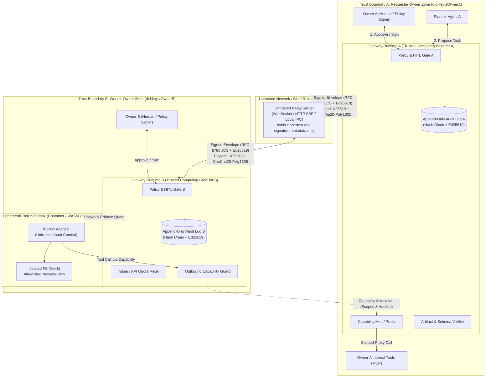
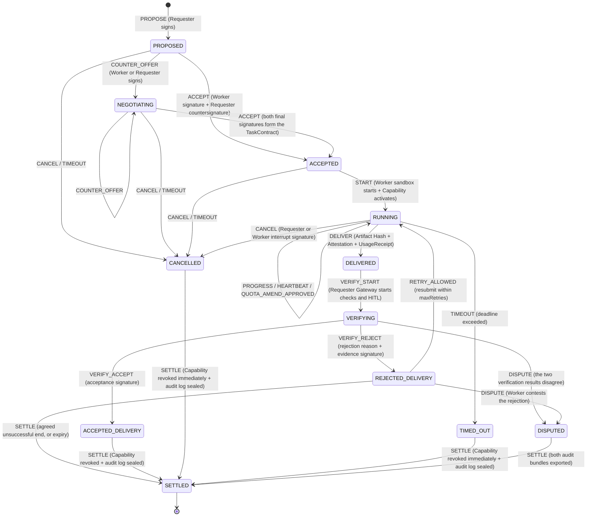
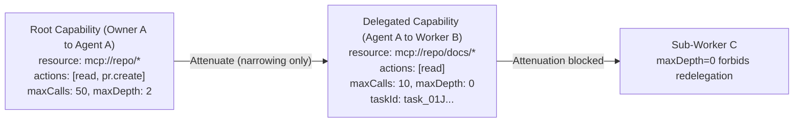
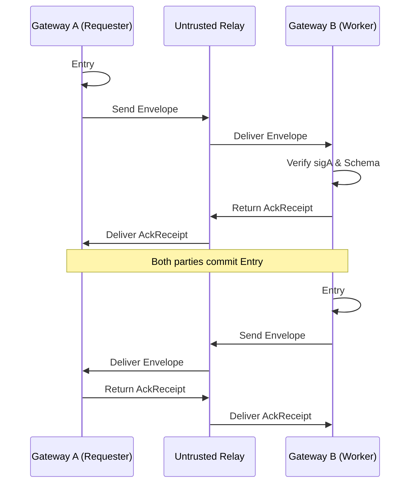

# ARCHITECTURE: Cross-Owner Agent Collaboration Platform

**English** | [日本語 (ARCHITECTURE.ja.md)](./ARCHITECTURE.ja.md)

**Conclusion**: Agents that belong to different owners delegate, run, and accept tasks without trusting a central administrator. The system has five layers: a **locally sovereign Gateway runtime**, **attenuating Capability tokens**, a **signed TaskContract**, **BYOK plus a signed UsageReceipt**, and a **bilateral hash-chain audit log**. The Relay is a Blind Transport that only carries encrypted and signed envelopes. Every authorization check, human approval (HITL), and isolated execution is enforced by each owner's own Gateway Runtime.

---

## 1. System shape and trust boundaries

### 1.1 Architecture and trust-boundary diagram



### 1.2 Component roles and responsibility boundaries

| Component                    | Owner and placement                                                         | Trust assumption                                                                       | Responsibility                                                                                                                                           |
| :--------------------------- | :-------------------------------------------------------------------------- | :------------------------------------------------------------------------------------- | :------------------------------------------------------------------------------------------------------------------------------------------------------- |
| **Owner (`did:key`)**        | Each user (a person or an organization)                                     | Holds their own root key (Ed25519)                                                     | Sets policy, signs approvals at important HITL gates, and delegates authority to agent keys                                                              |
| **Gateway Runtime**          | Each owner's local environment or dedicated VM                              | **Trusted computing base for its own owner.** The other owner does not trust it        | Verifies contract signatures, issues and checks attenuated Capabilities, enforces HITL gates, meters quotas, starts sandboxes, and records the audit log |
| **Agent (Planner / Worker)** | Under each owner's Runtime                                                  | An LLM can be prompt-injected, so the agent is **semi-trusted**                        | Splits tasks and carries out implementation or research. It cannot talk to the outside world or read raw credentials except through the Gateway Runtime  |
| **Sandbox Runner**           | Inside the worker Runtime                                                   | **Untrusted execution**                                                                | A disposable isolated environment per task (container, WASM, or a restricted process). Limits the filesystem, network, and environment variables         |
| **Relay**                    | Any third party, or local loopback                                          | **Fully untrusted (untrusted / honest-but-curious or worse)**                          | Relays messages and queues them briefly. Payloads can be end-to-end encrypted, and Ed25519 signatures detect tampering immediately                       |
| **Audit Ledger**             | Kept locally by both owners (optionally anchored to an external public log) | A one-sided claim is not trusted. Evidence is a **countersignature from both parties** | An append-only event log linked by `prevHash`. On dispute, a third party or the verification CLI can reproduce the check offline                         |

---

## 2. Comparison with existing protocols (reuse and delta)

The design reuses existing standards wherever it can, and adds the **contract, capability attenuation, cost separation, and acceptance layers** that a zero-trust cross-owner execution model still lacks.

| Area                                | Reference protocol / specification                                                                                         | Elements adopted or reused                                                                                            | Elements this platform adds (delta)                                                                                                                                                                                                                                   |
| :---------------------------------- | :------------------------------------------------------------------------------------------------------------------------- | :-------------------------------------------------------------------------------------------------------------------- | :-------------------------------------------------------------------------------------------------------------------------------------------------------------------------------------------------------------------------------------------------------------------- |
| **Agent-to-agent communication**    | **Agent2Agent (A2A)** (Linux Foundation / Google)<br>https://github.com/a2aproject/A2A<br>https://a2a-protocol.org/latest/ | The Agent Card capability advertisement, and the asynchronous task-notification model over JSON-RPC / event streams   | A2A mainly assumes communication inside an enterprise or between known partners. It has no **signed binding TaskContract, attenuating Capability, quota proof, or bilateral hash-chain audit** across owners. Those layers are added as the envelope and the contract |
| **Tool connection**                 | **Model Context Protocol (MCP)**<br>https://modelcontextprotocol.io/                                                       | The standard call interface from an agent to local tools and resources (`tools/call`, `resources/read`)               | Publishing an MCP server directly to the other agent grants too much authority. The Gateway inserts an **MCP Capability Proxy** that admits only the tool names and argument JSON Schemas allowed by a `CapabilityToken`                                              |
| **Delegation tokens**               | **UCAN v1.0** (https://github.com/ucan-wg/spec)<br>**Biscuit** (https://github.com/biscuit-auth/biscuit)                   | Self-contained `did:key` tokens, offline-verifiable attenuation, and proof chains                                     | A constraint vocabulary specialized for agent collaboration, standardized as JSON Schema: MCP tool names, argument patterns, `maxInvocations`, `maxDelegationDepth`, and task-id binding                                                                              |
| **Canonicalization and signatures** | **RFC 8785 (JCS)** (https://www.rfc-editor.org/info/rfc8785/)<br>**Ed25519 (RFC 8032)**                                    | Deterministic JSON serialization (JCS) plus Ed25519 signatures, so hash and signature checks are language-independent | Every message (Manifest, Contract, Capability, UsageReceipt, AuditEntry) uses one JCS + Ed25519 envelope rule                                                                                                                                                         |
| **Artifact proof and audit**        | **in-toto Attestation** (https://github.com/in-toto/attestation)<br>**Sigstore Rekor** (https://github.com/sigstore/rekor) | Statement/Predicate structure over an artifact digest (SHA-256), and the idea of an append-only log                   | A heavy PKI (Fulcio and similar) is not required. A **bilateral signed ledger** is offline-verifiable first. Anchoring to an external transparency log is optional                                                                                                    |
| **Relay**                           | **Nostr Relay (NIP-01)** (https://github.com/nostr-protocol/nips)<br>**Matrix Federation** (https://spec.matrix.org/)      | Treat the relay as a near-stateless signed-event delivery bus, and verify signatures on the client                    | Specialize in per-task topic subscription (`task_id` / `recipient_did`) rather than a public timeline, and support X25519 end-to-end encryption of the payload as a standard                                                                                          |

---

## 3. Task lifecycle and state machine

The task lifecycle is a deterministic state machine. **No state transition is valid unless it carries a signed event (`SignedTransitionEvent`).**



### State-transition invariants

1. **No resource access happens before `ACCEPTED` (contract formation).** A `CapabilityToken` is activated, or issued, only after the `ACCEPTED` transition.
2. **`DELIVERED` requires a three-part bundle.** The artifact manifest (SHA-256 content-addressed), the execution evidence (`ExecutionAttestation`), and the resource-consumption proof (`UsageReceipt`) are all required. If any piece is missing, the Requester Gateway rejects the delivery as a schema error.
3. **Capabilities die at the terminal state (`SETTLED`).** The moment a task reaches `SETTLED`, `CANCELLED`, or `TIMED_OUT`, every `CapabilityToken` bound to that `task_id` is entered in the Gateway revocation set and invalidated, even if it has not yet expired.

---

## 4. Five cross-owner safety mechanisms

### 4.1 Authority and scope: attenuating Capability tokens

Instead of handing the other agent an API key, the platform uses a **JSON attenuating Capability token (`CapabilityToken`)** inspired by UCAN and Biscuit.



#### Attenuation rules (invariants the verifier enforces)

When a child token `child` is derived from a parent token `parent` (the `proofs` array references the parent by hash), the Gateway checks every condition below mechanically. One violation rejects the token even if the signature is valid (`CAPABILITY_ESCALATION_ERROR`).

- **Signature chain**: `parent.audience === child.issuer`.
- **Task binding**: `child.taskId === parent.taskId`.
- **Narrower validity window**: `child.notBefore >= parent.notBefore` and `child.expiresAt <= parent.expiresAt`.
- **Resource and tool subset**: `child.resources` is a subset of the parent glob or URI prefix, and `child.allowedTools` is a subset of `parent.allowedTools`.
- **Stronger argument constraints**: `child.argConstraints` (a JSON Schema subset) inherits every parent constraint and may only add constraints.
- **Lower invocation cap**: `child.maxInvocations <= parent.maxInvocations`. The Gateway also counts calls against the parent token, so several children together cannot exceed the parent's `maxInvocations`.
- **Delegation depth decreases**: `child.maxDelegationDepth <= parent.maxDelegationDepth - 1`. A depth of `0` forbids any further delegation.

---

### 4.2 Approval gates (human-in-the-loop / HITL)

The Gateway Runtime contains a policy engine that forces owner approval (HITL) on five operations, so a runaway agent cannot cause an unintended external effect.

#### Gate trigger conditions

| Gate ID                     | When it fires                                                                                                             | Default behavior               | Example conditions that allow auto-approve                                                                                       |
| :-------------------------- | :------------------------------------------------------------------------------------------------------------------------ | :----------------------------- | :------------------------------------------------------------------------------------------------------------------------------- |
| `GATE_CONTRACT_ACCEPT`      | The worker accepts a `TaskManifest` (`ACCEPT`), or the requester accepts a counter-offer                                  | **HITL required**              | The DID is on the trusted list, the requested Capability is `read-only`, and the budget cap is at or below the threshold         |
| `GATE_EXTERNAL_SIDE_EFFECT` | During execution, a Capability sends something outside (email, Slack, a GitHub PR, a webhook, a billing API, and similar) | **HITL required (always)**     | None in principle. A dry run or a draft may be automatic. A committed send requires the owner's signature                        |
| `GATE_BUDGET_OVERRUN`       | Token use or tool-call count exceeds `TaskContract.budget`, and the run requests or approves extra room (`QUOTA_AMEND`)   | **HITL required**              | None. Crossing the cap always stops the run and asks for the owner's explicit signature                                          |
| `GATE_SUB_DELEGATION`       | The worker agent tries to redelegate to an agent owned by a third party                                                   | **HITL required**              | Only when `TaskContract` sets `maxDelegationDepth > 0` and the delegatee DID is on the allowlist                                 |
| `GATE_DELIVERY_ACCEPT`      | The requester performs final acceptance (`VERIFY_ACCEPT`) and completes the task                                          | Depends on `verification.mode` | Automatic only when the mode is `automated_only`, every automatic test and schema check passes, and the run stayed inside budget |

#### Policy form and the signed approval record (`ApprovalReceipt`)

The owner's policy is declarative JSON or YAML (`policy.json`) configured on the Gateway. An LLM prompt cannot rewrite it. When a person approves, the owner key (or a key dedicated to the approval UI) signs an `ApprovalReceipt`. That receipt is attached to the audit log and to the transition event sent to the peer.

```json
{
  "type": "ApprovalReceipt",
  "receiptId": "appr_01J8Z9X2...",
  "taskId": "task_01J8Z9M0...",
  "gateId": "GATE_CONTRACT_ACCEPT",
  "targetDigest": "sha256:4f8b9c...",
  "approverDid": "did:key:z6MkhaXgBZDvotDkL5257faiztiGiC2QtKLGpbnnEGta2doK",
  "decision": "APPROVED",
  "conditions": {
    "maxTokensOverride": 50000,
    "allowSubDelegation": false
  },
  "approvedAt": "2026-10-25T12:00:00Z",
  "signature": "ed25519:3a9f..."
}
```

---

### 4.3 Task handoff and verification (Task Manifest / Contract)

#### Flow from contract to acceptance

1. **Manifest.** The requester writes a `TaskManifest` (see [`spec/task-manifest.schema.json`](./spec/task-manifest.schema.json)). It includes `inputSchema`, `outputSchema`, `acceptanceCriteria`, `verification`, `budget`, `capabilities`, and `deadline`.
2. **Two signatures (`TaskContract`).** The requester's `PROPOSE` signature and the worker's `ACCEPT` signature (plus a requester countersignature when required) together form the `TaskContract`. The SHA-256 hash `contractDigest` is the parent id of every later event.
3. **Intermediate status.** While `RUNNING`, the Worker Gateway may send `PROGRESS` (a progress ratio and a summary of intermediate logs) and `HEARTBEAT`.
4. **Content-addressed delivery (`ArtifactBundle`).** The worker does not mix raw artifact bytes into a prompt. It submits a manifest that addresses every artifact file by its SHA-256 digest, in a structure compatible with an in-toto Statement.
5. **Three-step acceptance pipeline (`VERIFYING`).** The Requester Gateway runs a deterministic verifier **before** it gives the artifact to an LLM.
   - **Step 1: cryptographic and integrity checks.** Signatures, the hash chain, SHA-256 digest agreement, submission before the deadline, and a `UsageReceipt` inside the budget cap.
   - **Step 2: mechanical checks (schema and deterministic checks).** Structured output is checked against `outputSchema` (JSON Schema Draft 2020-12). Commands listed in `verification.checks` (a test suite or a linter) run inside an isolated sandbox.
   - **Step 3: semantic and human acceptance (HITL review).** Only output that passed steps 1 and 2 is shown to the owner, with the diff and the test results. The owner issues `VERIFY_ACCEPT` or `VERIFY_REJECT` (a reason code plus a reproduction log).

---

### 4.4 Cost separation (BYOK + signed usage receipts)

The platform does not depend on an external payment network or a fiat escrow, so it can run safely from day one as open source. The base model is **the executor pays its own inference cost (BYOK), a contractual budget cap (quota), and a signed consumption receipt**.

| Item                            | Design rule                                                                                                                                                                                       | Reason                                                                                           |
| :------------------------------ | :------------------------------------------------------------------------------------------------------------------------------------------------------------------------------------------------ | :----------------------------------------------------------------------------------------------- |
| **API keys**                    | **Each owner keeps their own key (BYOK).** The protocol forbids giving the requester's OpenAI, Anthropic, or similar API key to the worker                                                        | A handed-over API key can be reused or leaked, and it cannot be technically reclaimed or limited |
| **Who pays inference first**    | Each agent pays for its own LLM inference with its own API key or a local LLM                                                                                                                     | Two owners can start collaborating immediately, with no payment infrastructure                   |
| **Budget and quota contract**   | `TaskManifest.budget` states `maxInputTokens`, `maxOutputTokens`, `maxToolInvocations`, `maxWallClockSeconds`, and `costModel` (`worker_byok` / `bilateral_quota` / `external_settlement_plugin`) | The worker agrees, at contract time, how many tokens it may use and what it is obliged to spend  |
| **Metering and `UsageReceipt`** | The Worker Gateway proxies LLM API calls and tool calls, and attaches a signed `UsageReceipt` at delivery with the model name, token counts, call counts, and timestamps                          | Both local ledgers keep a cost record that can support bilateral quota or a later settlement     |
| **Fail-safe at the cap**        | When the Worker Gateway `QuotaMeter` sees 100% of `budget`, it freezes the sandbox and sends `QUOTA_AMEND_REQUEST` to the requester                                                               | An unbounded loop or token burn (denial of wallet) is cut off mechanically                       |
| **Future payment extensions**   | Stripe Connect, X Money, Lightning, and on-chain escrow stay out of the core protocol. They attach through a `settlementExtension` field as external plugins                                      | The core specification stays simple, small, and regulation-neutral                               |

---

### 4.5 Isolated execution and the bilateral audit log

#### Isolation and prompt-injection defense

Task descriptions, input files, error messages, and intermediate artifacts that arrive from the other owner are all **untrusted data**.

1. **A disposable sandbox per task.** The Worker Gateway starts an independent execution environment for each task (a Docker/OCI container, Bubblewrap/nsjail, or a WASM runtime).
   - **File system.** Only the task's temporary work directory (`/work/task_<id>`) is readable and writable. The host's `~/.ssh`, `~/.aws`, environment variables, and other tasks' directories are not mounted.
   - **Network.** The default is fully closed (`none`). Outbound traffic is allowed only to domains agreed in `TaskManifest.sandboxPolicy.allowedHosts`, and only through the Gateway proxy.
2. **A structured data boundary against prompt injection.**
   - Strings received from outside are not concatenated into the system prompt. They are confined to an explicit untrusted-boundary tag, or to a dedicated role or JSON field.
   - **The important part:** even if prompt injection tricks the LLM into a forbidden tool call or an external send, the Gateway Runtime's `CapGuard` and `PolicyEngine` sit outside the process and mechanically check the `CapabilityToken` scope and the HITL gates. An operation that was not allowed cannot actually run (defense in depth).

#### Bilateral append-only audit ledger

With no central server, the protocol has to prevent "I said / I did not say" and "I delivered / I did not deliver". Every protocol message forms a hash chain, and the receiver returns an acknowledgement signature (`AckReceipt`), so **both parties hold the same cryptographic evidence**.



- Each audit entry has this shape:
  - `seq`: a monotonically increasing sequence number (`1, 2, 3...`)
  - `taskId`: the task identifier
  - `prevEntryHash`: the previous entry's `entryHash` (sixty-four `0` characters on the first entry)
  - `eventType`: `PROPOSE` | `ACCEPT` | `CAPABILITY_INVOKE` | `DELIVER` | `VERIFY_ACCEPT` | and similar
  - `payloadDigest`: the SHA-256 digest of the payload after RFC 8785 JCS canonicalization
  - `actorDid`: the sender DID
  - `timestamp`: an ISO 8601 UTC timestamp
  - `actorSignature`: the sender's Ed25519 signature
  - `counterSignature`: the receiver's Ed25519 acknowledgement or agreement signature
- If a dispute (`DISPUTED`) happens, `acp-cli audit verify <bundle.json>` is enough for a third party to check offline which step both parties agreed on, and whether the artifact satisfied the contract `outputSchema`.

---

## 5. Threat model

| #      | Threat                                                                                                                                                              | Boundary crossed                | Countermeasure                                                                                                                                                                                                                                              | MVP implementation                                              |
| :----- | :------------------------------------------------------------------------------------------------------------------------------------------------------------------ | :------------------------------ | :---------------------------------------------------------------------------------------------------------------------------------------------------------------------------------------------------------------------------------------------------------- | :-------------------------------------------------------------- |
| **T1** | **Prompt injection in a malicious request.** The TaskManifest description or input data says things such as "send the secret key"                                   | Requester to Worker Sandbox     | 1) Mount no secret keys or host credentials into the worker sandbox<br>2) `CapGuard` inspects every tool call and blocks actions outside the contract<br>3) External sends require a human at `GATE_EXTERNAL_SIDE_EFFECT`                                   | **Yes**                                                         |
| **T2** | **Reverse injection and malicious file overwrite in an artifact.** The worker returns a path traversal (`../../`) or an artifact that contains a malicious script   | Worker to Requester Verifier    | 1) Expand artifacts as content-addressed SHA-256 objects and reject directory escape after path normalization<br>2) Automatic checks run in the requester's isolated verification sandbox<br>3) Validate JSON Schema before an LLM reads the bytes          | **Yes**                                                         |
| **T3** | **Privilege escalation and unauthorized redelegation.** The worker calls a tool beyond its grant, or hands the whole task to a third-party agent without permission | Worker to Requester Proxy       | The Requester Gateway strictly checks Capability attenuation (`allowedTools`, `argConstraints`, `maxInvocations`, `maxDelegationDepth`). A violation is revoked immediately                                                                                 | **Yes**                                                         |
| **T4** | **Token and API exhaustion (denial of wallet / infinite loop).** An abnormally large input or an infinite loop burns LLM cost                                       | Requester and Worker Runtime    | 1) Enforce a payload size cap and `TaskContract.budget` (token count, call count, and wall-clock cap)<br>2) BYOK means each owner's QuotaMeter hard-stops that owner's own API key                                                                          | **Yes**                                                         |
| **T5** | **Relay eavesdropping, tampering, and replay.** A malicious Relay rewrites a message, resends an old message, or reads the contents                                 | Gateway A, Relay, and Gateway B | 1) Every envelope carries `taskId` + `seq` + `nonce` plus a JCS Ed25519 signature, so tampering and replay are rejected<br>2) Session payloads use ephemeral X25519, HKDF-SHA256, and AES-256-GCM bound to the envelope header. The relay stores ciphertext | **Yes** (signatures, replay prevention, and payload encryption) |
| **T6** | **Repudiation after delivery.** The worker delivered, and the requester falsely says "I never received it" or "it violates the spec", or the reverse                | Trust Zone A and Trust Zone B   | 1) A countersigned `AckReceipt` and a hash-chain audit log for every state transition<br>2) The deterministic `outputSchema` and the hash of the automatic check command are fixed at contract time, so a third party or the CLI can reproduce the check    | **Yes**                                                         |

---

## 6. Existing OSS fork and overlay options (detail in [`OSS_FORK_ANALYSIS.md`](./OSS_FORK_ANALYSIS.md))

As of October 2026, the standard agent-to-agent protocol has converged on **A2A (`a2aproject/A2A`)** under the Linux Foundation. IBM BeeAI `i-am-bee/acp` and Cisco/AGNTCY `agntcy/acp-spec` are archived.
The communication layer should not be reinvented from scratch. Three implementation approaches are available. **Approach C is the recommendation.**

| Approach                                                                  | What it is                                                                                                                                                                                                                                                                                                                                             | Assessment                                                                                                                  |
| :------------------------------------------------------------------------ | :----------------------------------------------------------------------------------------------------------------------------------------------------------------------------------------------------------------------------------------------------------------------------------------------------------------------------------------------------- | :-------------------------------------------------------------------------------------------------------------------------- |
| **A. Full scratch**                                                       | Implement the wire, cryptography, Capability, and Runtime from zero                                                                                                                                                                                                                                                                                    | Dependencies stay minimal, but an A2A-compatible bridge has to be written, so the early effort is large                     |
| **B. Hard fork of a single OSS project**                                  | Fork all of `a2aproject/a2a-js` or `Cotal-AI/Cotal` and modify it in place                                                                                                                                                                                                                                                                             | The first demo arrives sooner, but conflicts with upstream A2A updates, and forced middleware such as NATS, become a burden |
| **C. Standard SDK overlay plus selective core integration (recommended)** | Use `@a2a-js/sdk` (Apache-2.0) and `@modelcontextprotocol/sdk` (MIT) as **npm dependencies without forking**. Integrate the design and code of `newtro/delegateos` (MIT) into the contract, Capability attenuation, and acceptance core. Overlay the **five HITL gates, BYOK `UsageReceipt`, isolated sandbox, and bilateral hash-chain audit ledger** | Cuts development effort by about **50–60%**, stays compatible with the A2A/MCP ecosystem, and can follow upstream easily    |

## M2/M3 implemented profile (WP-7–WP-12)

`WorkerNode` and `RequesterClient` are the production protocol coordinators in
`@acp/runtime`. Each holds one owner's key and connects outbound to a relay.
`PROPOSE → ACCEPT → START/IN_PROGRESS → DELIVER → VERIFY_ACCEPT → SETTLED`
uses the M1 signed contract machine. Every application event is followed by an
actor-signed audit body and a peer-signed AckReceipt. A final signed checkpoint
is countersigned over the network; neither process possesses the peer key.
Audit JSONL is written incrementally, sealed at settlement, and checked with the
existing `verifyAudit` / `acp audit-verify`. Interrupted logs remain unsealed and
therefore cannot be mistaken for completed valid bundles.

`@acp/adapters` supplies `CommandAgentAdapter`, `ClaudeCodeAdapter`,
`CodexCliAdapter`, `OpenAICompatibleAdapter`, and `McpClientAdapter`, plus a
`SandboxAgentAdapter` convenience wrapper. The shared `AgentAdapter` interface
lives in runtime to avoid a dependency cycle. Task contexts contain JSON, an
AbortSignal, a disposable workspace, usage reporting and a guarded tool callback;
private keys and owner credentials never enter that context. Command runners use
an environment allowlist. CLI provider authentication can use a host loopback
broker; real API keys are attached only to upstream requests. OpenAI/Anthropic
HTTP adapters perform host-owned fetch calls. MCP SDK transports terminate at
MCPProxy, which enforces manifest-bound capability chains, quotas and signed
side-effect approvals before backend execution.

Owner approval is supplied by `InteractiveCliApprovalProvider` (stream-based
`[y/N]`), `WebhookApprovalProvider` (signed request and verified, target-bound
ApprovalReceipt response), or `PolicyAutoApprovalProvider`. Automatic contract
acceptance/final verification is an explicit CLI choice. Neither `--yes` nor
policy auto-approval authorizes external side effects or budget increases;
programmatic explicit confirmed gates are required for those operations.
Verification obtains final approval only after crypto/budget and schema/isolated
checks pass. Unknown deterministic check targets are rejected.

The blind relay offers HTTP, bounded long polling, SSE and WebSocket polling or
live subscriptions. It verifies outer signatures and shape, bounds queue/body
sizes, prevents envelope-ID replay, and verifies signed AgentCard registration.
`/.well-known/agent.json` returns an A2A-shaped card with the signed ACP extension;
`/agents` and `/agents/:did` expose the signed records. Invites embed an owner-signed
card, routing identities, relay URL and validity window in either supported URI
format. Gateways independently enforce message order and reject replay.

`createRelayFetchHandler` uses Web Request/Response streams and a filesystem-free
core entry point. The Cloudflare entry point uses Node crypto compatibility and
a Durable Object binding, persisting queue/registry/replay state. Without a binding,
its in-memory handler is for local development and resets on isolate eviction.
Node `startLocalRelay` serves the same routes plus WebSocket support. The edge
entry point supports HTTP/SSE/long polling; Node provides WebSocket upgrades.

`detectDockerRuntime` prefers a functional Podman, then Docker.
`runContainerOrSubprocessSandbox` selects OCI for manifest `oci_container`, or
falls back to the Node permission-restricted sandbox when no runtime exists.
OCI disables network access, uses a read-only root filesystem, drops all
capabilities, enables no-new-privileges, and bounds PID count and memory.
`ExecutionAttestation.effectiveIsolationLevel` records what ran. Container
execution failures are not retried in a weaker sandbox. Command/CLI adapters are
trusted host executables with environment and workspace hygiene, not the
restricted JavaScript sandbox; attestations identify that distinction.

The original schemas, exports and 169 M0/M1 conformance tests are retained.
Session payloads are encrypted to the recipient `did:key` with ephemeral X25519,
HKDF-SHA256, and AES-256-GCM, so a relay snapshot does not contain task contents.
External settlement and transparency anchoring remain future work. Public relays
require operational access controls and TLS appropriate to their deployment; the
reference queue is bounded. Plaintext envelopes still verify, so older callers
keep working.
