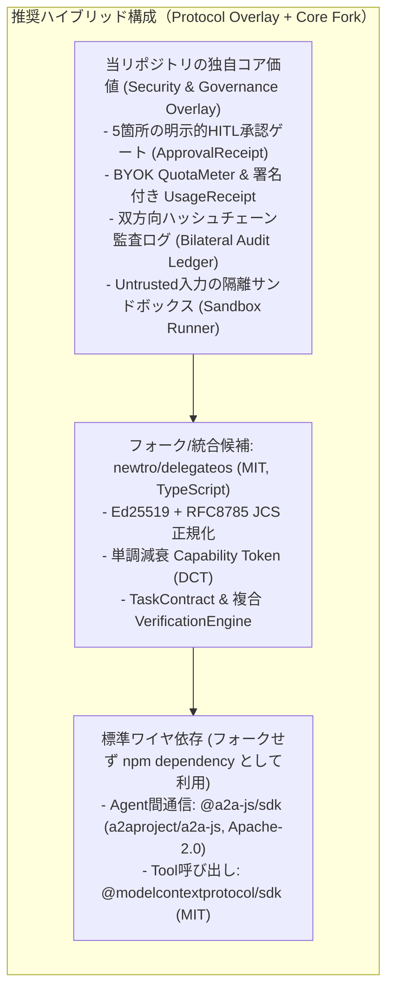

# OSS_FORK_ANALYSIS: 既存OSS調査と「スクラッチ vs フォーク vs オーバーレイ」比較設計

[English (OSS_FORK_ANALYSIS.md)](./OSS_FORK_ANALYSIS.md) | **日本語**

**結論**: エージェント間通信のワイヤ標準は **Linux Foundation 傘下の `A2A` (`a2aproject/A2A`) に収束** しており（IBM `i-am-bee/acp` や `agntcy/acp-spec` はアーカイブ済み）、通信層をゼロから再発明すべきではない。一方、A2A単体には「異オーナー間の減衰Capability」「BYOKトークン予算上限＋UsageReceipt」「隔離サンドボックス」「双方向ハッシュチェーン監査」が欠けている。
したがって、**アプローチC（`@a2a-js/sdk` と `@modelcontextprotocol/sdk` を標準ワイヤとしてnpm依存で利用し、その上に私たちの「契約・Capability・HITL・BYOK監査レイヤ」をオーバーレイ実装する。さらに内部のCapability/契約/検収コアはMITライセンスの `newtro/delegateos` をフォーク・構造統合して開発期間を短縮する）** を第1推奨とする。

---

## 1. 実在する主要OSSリポジトリの調査結果（2026年10月25日 JST時点）

GitHub APIおよび公式リポジトリで実在・ライセンス・メンテナンス状態・技術スタックを検証した一覧。

### 1.1 標準プロトコル・大手主導リポジトリ

| リポジトリ (`owner/repo`)                                                                                                                                                                        |           Stars           | ライセンス | 言語                         | 状態 (最終Push JST)                                             | 概要とフォーク評価                                                                                                                                                                                                                                                                        |
| :----------------------------------------------------------------------------------------------------------------------------------------------------------------------------------------------- | :-----------------------: | :--------: | :--------------------------- | :-------------------------------------------------------------- | :---------------------------------------------------------------------------------------------------------------------------------------------------------------------------------------------------------------------------------------------------------------------------------------- |
| [`a2aproject/A2A`](https://github.com/a2aproject/A2A) [`a2aproject/a2a-js`](https://github.com/a2aproject/a2a-js) [`a2aproject/a2a-python`](https://github.com/a2aproject/a2a-python)      | ★26,290 ★647 ★2,214 | Apache-2.0 | Spec TypeScript Python | Active (2026-10-23〜25)                                      | **Linux Foundation / Google主導のデファクト標準（v1.0）**。`AgentCard`、Task状態遷移、Artifact納品、JSON-RPC/REST/gRPC、永続ストアを提供。 👉 **評価**: 通信土管として必須。フォークすると本家v1.x追従コストが高いため、**`@a2a-js/sdk` パッケージ依存または薄いラッパー拡張が最適**。 |
| [`i-am-bee/acp`](https://github.com/i-am-bee/acp) [`i-am-bee/agentstack`](https://github.com/i-am-bee/agentstack)                                                                             |     ★1,019 ★1,172      | Apache-2.0 | Python / TS                  | **`acp` は ARCHIVED** (2025-08-26) `agentstack` は Active | IBM BeeAIのAgent Communication Protocol。**2025年8月にA2Aへ正式統合され `i-am-bee/acp` はアーカイブ済み**。後継の `agentstack` も内部通信をA2Aへ移行済みで、K8s前提の重厚なホスティング基盤。 👉 **評価**: **フォーク非推奨**（A2Aを使うべき）。                                       |
| [`agent-network-protocol/AgentNetworkProtocol`](https://github.com/agent-network-protocol/AgentNetworkProtocol) [`agent-network-protocol/anp`](https://github.com/agent-network-protocol/anp) |      ★1,458 ★354       | Apache-2.0 | Spec Rust/Py/TS           | Active (2026-10-22〜23)                                      | W3C `did:wba`（Webベース分散ID）による**異オーナー間の相互認証・HTTP署名・E2E暗号化通信**に特化。 👉 **評価**: 分散ID・E2E暗号化の設計リファレンスとして優秀だが、タスク分割・検収・トークン予算制御は持たない。                                                                       |
| [`agntcy/acp-spec`](https://github.com/agntcy/acp-spec) [`agntcy/dir`](https://github.com/agntcy/dir) [`agntcy/slim`](https://github.com/agntcy/slim)                                      |   ★169 ★199 ★231    | Apache-2.0 | OpenAPI Go Rust        | **`acp-spec` は ARCHIVED** `dir` / `slim` は Active          | Cisco / Outshift主導のAGNTCY。旧Agent Connect Protocol (`acp-spec`, `acp-sdk`) はアーカイブ済み。現行はエージェント名鑑 `agntcy/dir`（OASF）とメッセージング層 `agntcy/slim`。 👉 **評価**: 名鑑（Discovery）と低レイヤ通信に特化しており、契約・検収・コスト分離のベースには不向き。  |
| [`modelcontextprotocol/typescript-sdk`](https://github.com/modelcontextprotocol/typescript-sdk)                                                                                                  |          ★13,651          |    MIT     | TypeScript                   | Active (2026-10-25)                                          | エージェントからツール・リソースを呼び出す標準SDK。 👉 **評価**: 受託エージェントにスコープ制限付きでツールを公開する **MCP Capability Proxy の基盤としてそのまま依存利用** する。                                                                                                     |
| [`ucan-wg/spec`](https://github.com/ucan-wg/spec) [`ucan-wg/ts-ucan`](https://github.com/ucan-wg/ts-ucan)                                                                                     |       ★293 ★132        | Apache-2.0 | Spec TypeScript           | `ts-ucan` は 2024-03 以降停滞                                | 分散Capability認可仕様。仕様はv1.0へ進化したが、`ts-ucan` 実装は更新が止まっている。 👉 **評価**: `ts-ucan` の直接利用は避け、減衰モデルのみ踏襲してJCS + Ed25519で実装（または下記の `delegateos` を利用）する。                                                                      |

### 1.2 委譲・権限減衰・HITL・コスト制御を備えた新興OSS（フォーク有力候補）

| リポジトリ (`owner/repo`)                                                       | Stars |         ライセンス          | 言語                        | 状態 (最終Push JST)    | 概要とフォーク評価                                                                                                                                                                                                                                                                                                                                                                                                                                                        |
| :------------------------------------------------------------------------------ | :---: | :-------------------------: | :-------------------------- | :--------------------- | :------------------------------------------------------------------------------------------------------------------------------------------------------------------------------------------------------------------------------------------------------------------------------------------------------------------------------------------------------------------------------------------------------------------------------------------------------------------------ |
| [`newtro/delegateos`](https://github.com/newtro/delegateos)                     |  ★4   | **MIT** (`package.json`) | TypeScript                  | Active (2026-10-25) | **当プロジェクトの設計思想と最も近い実装**。Ed25519 + RFC 8785 (`canonicalize`) + `ajv` を用い、単調減衰Capability (`DCT`)、`TaskContract`、タスク分割、5種の検収エンジン (`schema_match`, `deterministic_check`, `human_review` 等)、完了証明 `Attestation`、MCPミドルウェア、A2A `AgentCard` ブローカーを374テスト付きで実装済み。 👉 **評価**: **コア層（`@acp/core`）のフォーク／コード統合ベースとして最有力**（ルートへの `LICENSE` ファイル明記のみ追加確認）。 |
| [`Cotal-AI/Cotal`](https://github.com/Cotal-AI/Cotal)                           | ★354  |       **Apache-2.0**        | TypeScript (NATS)        | Active (2026-10-25) | 異マシン・異ハーネス（Claude Code, Codex等）をNATS JetStreamメッシュで接続するランタイム。A2Aメッセージ互換、`checkpoint()` による**中断・再開可能なHITL人間承認ゲート**、JWT ACLを実装済み。 👉 **評価**: **ランタイム・メッシュ・HITL承認ワークフローのフォーク／参考候補として最有力**。                                                                                                                                                                            |
| [`GetBusbar/busbar`](https://github.com/GetBusbar/busbar)                       | ★214  |       **Apache-2.0**        | Rust                        | Active (2026-10-25) | エージェントに生APIキーを渡さず境界で秘匿し、6大LLMのコスト計量・予算上限強制・MCP/A2Aガバナンスを行うコントロールプレーン。 👉 **評価**: **BYOKコスト分離・QuotaMeterの設計モデル（またはサイドカー併用）** として最適。                                                                                                                                                                                                                                              |
| [`asap-protocol/asap-protocol`](https://github.com/asap-protocol/asap-protocol) |  ★16  |       **Apache-2.0**        | Python 3.13+ / TS Client | Active (2026-10-25) | Ed25519署名マニフェスト、Capability Grants、WebAuthn HITL承認、Usage meteringを備えたプロトコル実装。 👉 **評価**: **もし言語スタックをPython軸に変更する場合の第1フォーク候補**。                                                                                                                                                                                                                                                                                     |

---

## 2. 必須要件に対するギャップ分析（機能マトリクス）

たかぽんさんの必須要件（`ARCHITECTURE.ja.md` の5大安全メカニズム）に対して、各OSSが何をカバーしているかの対応表。

| 必須要件                                      |     `a2aproject/a2a-js`      |    `newtro/delegateos`     |   `Cotal-AI/Cotal`   |    `GetBusbar/busbar`    | 当基盤で追加・統合すべき差分                                                      |
| :-------------------------------------------- | :--------------------------: | :------------------------: | :------------------: | :----------------------: | :-------------------------------------------------------------------------------- |
| **1. 異オーナー間ワイヤ通信 & AgentCard**     |         **◎ (標準)**         |        ○ (A2A互換)         |     ◎ (NATS+A2A)     |      ○ (A2A Proxy)       | `@a2a-js/sdk` 準拠＋Untrusted Relay上のX25519 E2E暗号化                           |
| **2a. 減衰可能な Capability Token**           |        ❌ (OAuthのみ)        |   **◎ (DCT / Biscuit)**    |   △ (静的JWT ACL)    |      ○ (Tool Grant)      | `delegateos` のDCTにタスクID束縛・引数Schema検証を統合                            |
| **2b. 5箇所の明示的HITL承認ゲート**           | △ (`input-required`状態のみ) |   △ (検収時アダプタのみ)   | **◎ (`checkpoint`)** |            △             | 契約受諾・外部副作用・予算超過・再委譲・検収の5ゲート＋署名付き `ApprovalReceipt` |
| **2c. TaskContract & 自動検収パイプライン**   |     △ (Artifact送受のみ)     | **◎ (Contract + 5種検収)** |          △           |            ❌            | Content-Addressed成果物バンドル＋隔離検証サンドボックス                           |
| **2d. コスト分離 (BYOK + UsageReceipt)**      |              ❌              |   ○ (`maxBudget`枠のみ)    |  ○ (ハーネス別BYOK)  | **◎ (Key秘匿+予算上限)** | 実行側Gatewayでのトークン計量と署名付き `UsageReceipt` 発行                       |
| **2e. 隔離実行 & 双方向ハッシュチェーン監査** |              ❌              |   ○ (単方向Attestation)    |  ○ (JetStream履歴)   |     ○ (監査Webhook)      | コンテナ/プロセス隔離＋**双方向署名（Countersigned）ハッシュチェーン台帳**        |

---

## 3. 3つの開発アプローチの比較評価

### アプローチA：フルスクラッチ開発（独自ワイヤプロトコル＋独自コア）

- **概要**: `ARCHITECTURE.ja.md` の仕様に基づき、通信エンベロープから暗号コア・Relay・RuntimeまですべてゼロからTypeScriptで実装する。
- **メリット**: 不要なコードや外部依存が一切なく、設計の純度とシンプルさが最も高い。
- **デメリット**: A2A等の既存エコシステムと直接通信するためのアダプタを別途書く必要があり、初期実装（M0〜M1）に工数がかかる。

### アプローチB：単一OSSのハードフォーク（例：`a2a-js`、`Cotal`、または `delegateos` を丸ごとForkして改造）

- **概要**: 既存リポジトリをGitHub上でForkし、そのディレクトリ構造のまま直接機能を追加・書き換える。
- **メリット**: 初日から動くコードベースとテストが手に入る。
- **デメリット**:
  - `a2a-js` をForkした場合：通信SDKの内部構造にセキュリティ・契約・サンドボックス層が密結合し、本家A2A仕様のアップデート時にマージコンフリクトが多発する。
  - `Cotal` をForkした場合：NATSサーバー依存が必須となり、「ローカルやシンプルなWebSocket Relayだけで最小構成で動かす」という手軽さが損なわれる。

### アプローチC（★推奨）：標準プロトコル準拠オーバーレイ ＋ コアモジュールの選択的フォーク統合

- **概要**:
  1. **ワイヤ通信とツール接続はForkせず標準SDK（`@a2a-js/sdk` + `@modelcontextprotocol/sdk`）をそのまま利用** し、A2Aの `Message` / `Task` / `Artifact` の拡張メタデータ（または署名エンベロープ）として当基盤の `TaskContract`・`CapabilityToken`・`UsageReceipt`・`ApprovalReceipt` を載せる。
  2. **最も工数がかかる「Capability減衰・契約・検収・JCS署名」の実装（`@acp/core`）は、MITライセンスの `newtro/delegateos` のモジュール構造（DCT, Contract, Verification, Attestation, MCP Middleware）をベースとして取り込み（またはForkしてモノレポ化）**、そこに不足している「BYOK `UsageReceipt`」「5つのHITLゲート」「双方向ハッシュチェーン台帳」「隔離サンドボックス」を集中実装する。
- **メリット**:
  - **開発工数を約50〜60%削減** しつつ、**Linux Foundation標準のA2Aエコシステムと100%相互運用可能** になる。
  - `@a2a-js/sdk` や `@modelcontextprotocol/sdk` をForkしないため、`pnpm update` だけでアップストリームの更新に無痛で追従できる。
  - 私たちが本当に作るべき独自価値（異オーナー間の不信境界制御・HITL・BYOKコスト証明・隔離実行・双方向監査）に100%エンジニアリング資源を集中できる。

### 3アプローチ比較まとめ表

| 評価軸                           | A: フルスクラッチ  | B: 単一リポジトリ丸ごとFork | C: 標準SDKオーバーレイ＋コア選択的統合 (推奨) |
| :------------------------------- | :----------------: | :-------------------------: | :-------------------------------------------: |
| **MVP到達スピード**              |     △ (中〜遅)     |           ◎ (速)            |         **◎ (速: コアの6割を再利用)**         |
| **A2A / MCP エコシステム互換性** | △ (自前ブリッジ要) |              ○              |            **◎ (公式SDKそのまま)**            |
| **アップストリーム追従性**       |         ー         |    ❌ (コンフリクト多発)    |           **◎ (SDKはnpm更新のみ)**            |
| **設計のクリーンさ・境界規律**   |         ◎          |  △ (元設計に引きずられる)   |    **◎ (モノレポのパッケージ境界で分離)**     |
| **ライセンスの明快さ**           |         ◎          |              ○              |      **◎ (Apache-2.0 / MIT のみで構成)**      |

---

## 4. 推奨アプローチCを採る場合の具体的な組込・差し替え設計

| モノレポ内の対象パッケージ | ベースにする既存OSS / SDK                                                                      | そのまま活かす部分（Keep）                                                                                                                                                           | 差し替え・新規追加する部分（Replace / Add）                                                                                                                                                        |
| :------------------------- | :--------------------------------------------------------------------------------------------- | :----------------------------------------------------------------------------------------------------------------------------------------------------------------------------------- | :------------------------------------------------------------------------------------------------------------------------------------------------------------------------------------------------- |
| **`packages/core`**        | `newtro/delegateos` (MIT, TypeScript)                                                       | - `@noble/ed25519` + `canonicalize` (RFC 8785 JCS) - 単調減衰Capability (`DCT`) の検証ロジック - `TaskContract` & `VerificationEngine` (`schema_match`, `deterministic_check`) | - `TaskManifest` を当プロジェクトのJSON Schema (`spec/task-manifest.schema.json`) に統一 - `ApprovalReceipt` と `UsageReceipt` の署名型を追加                                                   |
| **`packages/ledger`**      | 新規実装（軽量）                                                                               | （`delegateos` の `Attestation` 型を流用）                                                                                                                                           | - `prevEntryHash` と送受信双方の署名（`actorSignature` + `counterSignature`）を持つ追記専用ハッシュチェーン台帳を実装                                                                              |
| **`packages/runtime`**     | `@a2a-js/sdk` (Apache-2.0) `@modelcontextprotocol/sdk` (MIT) `delegateos` MCP middleware | - A2A Client/Server 通信ハンドラ - MCP Tool Call のCapabilityインターセプター                                                                                                     | - **5箇所のHITL承認ゲートエンジン**（`Cotal` の `checkpoint` 思想を参考にJSONポリシー＋署名承認を実装） - **BYOK `QuotaMeter`**（`GetBusbar/busbar` 風のトークン上限遮断＋`UsageReceipt` 発行） |
| **`packages/sandbox`**     | 新規実装                                                                                       | ー                                                                                                                                                                                   | - 受託タスクごとの隔離一時ディレクトリ・環境変数遮断・ネットワーク制限ランナー                                                                                                                     |
| **`packages/relay`**       | `@a2a-js/sdk` トランスポート + WebSocket                                                       | - A2A JSON-RPC / SSE メッセージ配送                                                                                                                                                  | - Blind Relay化（署名エンベロープ検証＋M2でのX25519 E2E暗号化ルーティング）                                                                                                                        |
