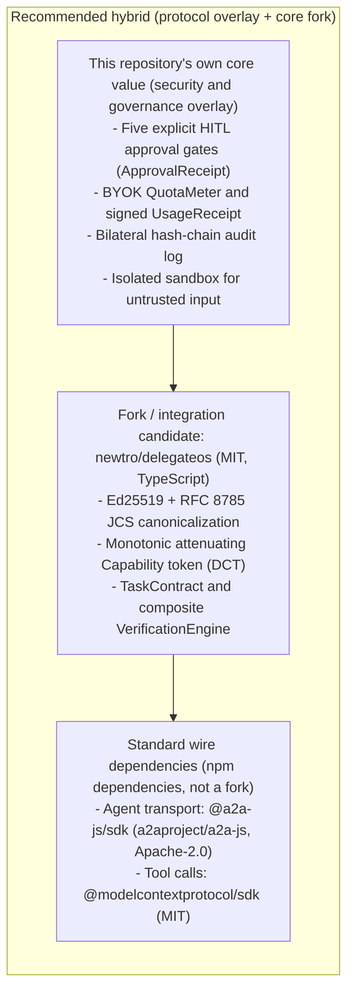

# OSS_FORK_ANALYSIS: Existing OSS Survey and Scratch vs Fork vs Overlay

**English** | [日本語 (OSS_FORK_ANALYSIS.ja.md)](./OSS_FORK_ANALYSIS.ja.md)

**Conclusion**: The wire standard for agent-to-agent communication has **converged on `A2A` (`a2aproject/A2A`) under the Linux Foundation**. IBM `i-am-bee/acp` and `agntcy/acp-spec` are archived, so the transport layer should not be reinvented from zero. A2A alone still lacks attenuating Capabilities across owners, a BYOK token budget plus a UsageReceipt, an isolated sandbox, and a bilateral hash-chain audit.
The first recommendation is therefore **approach C: depend on `@a2a-js/sdk` and `@modelcontextprotocol/sdk` as the standard wire, and overlay this repository's contract, Capability, HITL, and BYOK audit layer. Shorten the Capability, contract, and acceptance core by forking and structurally integrating MIT-licensed `newtro/delegateos`.**

---

## 1. Survey of real OSS repositories (as of 2026-10-25 JST)

The table below was checked against the GitHub API and the official repositories for existence, license, maintenance, and stack.

### 1.1 Standards and large-sponsor repositories

| Repository (`owner/repo`)                                                                                                                                                                        |         Stars          |  License   | Language                     | Status (last push, JST)                                         | Summary and fork assessment                                                                                                                                                                                                                                                                                                                                         |
| :----------------------------------------------------------------------------------------------------------------------------------------------------------------------------------------------- | :--------------------: | :--------: | :--------------------------- | :-------------------------------------------------------------- | :------------------------------------------------------------------------------------------------------------------------------------------------------------------------------------------------------------------------------------------------------------------------------------------------------------------------------------------------------------------ |
| [`a2aproject/A2A`](https://github.com/a2aproject/A2A) [`a2aproject/a2a-js`](https://github.com/a2aproject/a2a-js) [`a2aproject/a2a-python`](https://github.com/a2aproject/a2a-python)      | 26,290 647 2,214 | Apache-2.0 | Spec TypeScript Python | Active (2026-10-23 to 25)                                    | **De facto standard (v1.0), led by the Linux Foundation / Google.** Provides `AgentCard`, task state transitions, artifact delivery, JSON-RPC/REST/gRPC, and a persistence store. **Assessment**: required as the transport pipe. Forking it makes v1.x upstream tracking expensive, so a **dependency on `@a2a-js/sdk`, or a thin wrapper, is the better fit**. |
| [`i-am-bee/acp`](https://github.com/i-am-bee/acp) [`i-am-bee/agentstack`](https://github.com/i-am-bee/agentstack)                                                                             |     1,019 1,172     | Apache-2.0 | Python / TS                  | **`acp` is ARCHIVED** (2025-08-26) `agentstack` is Active | IBM BeeAI's Agent Communication Protocol. **Formally merged into A2A in August 2025, and `i-am-bee/acp` is archived.** The successor `agentstack` has also moved its internal transport to A2A, and it is a heavy Kubernetes-oriented hosting stack. **Assessment**: **do not fork it. Use A2A.**                                                                |
| [`agent-network-protocol/AgentNetworkProtocol`](https://github.com/agent-network-protocol/AgentNetworkProtocol) [`agent-network-protocol/anp`](https://github.com/agent-network-protocol/anp) |      1,458 354      | Apache-2.0 | Spec Rust/Py/TS           | Active (2026-10-22 to 23)                                    | Specialized in **cross-owner mutual authentication, HTTP signatures, and end-to-end encrypted transport** using W3C `did:wba` (web-based decentralized identity). **Assessment**: a strong design reference for decentralized identity and end-to-end encryption. It does not cover task splitting, acceptance, or token budgets.                                |
| [`agntcy/acp-spec`](https://github.com/agntcy/acp-spec) [`agntcy/dir`](https://github.com/agntcy/dir) [`agntcy/slim`](https://github.com/agntcy/slim)                                      |   169 199 231    | Apache-2.0 | OpenAPI Go Rust        | **`acp-spec` is ARCHIVED** `dir` / `slim` are Active         | Cisco / Outshift AGNTCY. The old Agent Connect Protocol (`acp-spec`, `acp-sdk`) is archived. Current work is the agent directory `agntcy/dir` (OASF) and the messaging layer `agntcy/slim`. **Assessment**: focused on discovery and low-level transport. A poor base for contracts, acceptance, and cost separation.                                            |
| [`modelcontextprotocol/typescript-sdk`](https://github.com/modelcontextprotocol/typescript-sdk)                                                                                                  |         13,651         |    MIT     | TypeScript                   | Active (2026-10-25)                                          | The standard SDK for calling tools and resources from an agent. **Assessment**: **depend on it directly** as the base of an MCP Capability Proxy that exposes tools to a worker agent with a limited scope.                                                                                                                                                      |
| [`ucan-wg/spec`](https://github.com/ucan-wg/spec) [`ucan-wg/ts-ucan`](https://github.com/ucan-wg/ts-ucan)                                                                                     |       293 132       | Apache-2.0 | Spec TypeScript           | `ts-ucan` has been stalled since 2024-03                     | A decentralized Capability authorization specification. The spec has moved to v1.0, but the `ts-ucan` implementation has stopped updating. **Assessment**: avoid depending on `ts-ucan` directly. Follow the attenuation model and implement it with JCS + Ed25519, or use `delegateos` below.                                                                   |

### 1.2 Newer OSS with delegation, attenuation, HITL, and cost control

| Repository (`owner/repo`)                                                       | Stars |           License           | Language                    | Status (last push, JST) | Summary and fork assessment                                                                                                                                                                                                                                                                                                                                                                                                                                                                                                                        |
| :------------------------------------------------------------------------------ | :---: | :-------------------------: | :-------------------------- | :---------------------- | :------------------------------------------------------------------------------------------------------------------------------------------------------------------------------------------------------------------------------------------------------------------------------------------------------------------------------------------------------------------------------------------------------------------------------------------------------------------------------------------------------------------------------------------------- |
| [`newtro/delegateos`](https://github.com/newtro/delegateos)                     |   4   | **MIT** (`package.json`) | TypeScript                  | Active (2026-10-25)  | **The implementation closest to this project's design.** Uses Ed25519 + RFC 8785 (`canonicalize`) + `ajv`. Already implements monotonic attenuating Capabilities (`DCT`), `TaskContract`, task splitting, five acceptance engines (`schema_match`, `deterministic_check`, `human_review`, and others), a completion `Attestation`, MCP middleware, and an A2A `AgentCard` broker, with 374 tests. **Assessment**: **the strongest base to fork or integrate into the core layer (`@acp/core`)**. Confirm that a root `LICENSE` notice is added. |
| [`Cotal-AI/Cotal`](https://github.com/Cotal-AI/Cotal)                           |  354  |       **Apache-2.0**        | TypeScript (NATS)        | Active (2026-10-25)  | A runtime that connects different machines and harnesses (Claude Code, Codex, and others) over a NATS JetStream mesh. Implements A2A-compatible messages, a **HITL approval gate that can pause and resume through `checkpoint()`**, and JWT ACLs. **Assessment**: **the strongest fork or reference candidate for the runtime, the mesh, and the HITL approval workflow.**                                                                                                                                                                     |
| [`GetBusbar/busbar`](https://github.com/GetBusbar/busbar)                       |  214  |       **Apache-2.0**        | Rust                        | Active (2026-10-25)  | A control plane that keeps raw API keys off the agent, meters cost for six major LLMs, enforces budget caps, and governs MCP/A2A. **Assessment**: **the right design model (or sidecar) for BYOK cost separation and QuotaMeter.**                                                                                                                                                                                                                                                                                                              |
| [`asap-protocol/asap-protocol`](https://github.com/asap-protocol/asap-protocol) |  16   |       **Apache-2.0**        | Python 3.13+ / TS client | Active (2026-10-25)  | A protocol implementation with Ed25519-signed manifests, Capability grants, WebAuthn HITL approval, and usage metering. **Assessment**: **the first fork candidate if the language stack moves to Python.**                                                                                                                                                                                                                                                                                                                                     |

---

## 2. Gap matrix against the required controls

Coverage of the five safety mechanisms in [`ARCHITECTURE.md`](./ARCHITECTURE.md).

| Required control                                            |        `a2aproject/a2a-js`         |         `newtro/delegateos`          |      `Cotal-AI/Cotal`       |          `GetBusbar/busbar`           | Delta this platform should add or integrate                                                                                            |
| :---------------------------------------------------------- | :--------------------------------: | :----------------------------------: | :-------------------------: | :-----------------------------------: | :------------------------------------------------------------------------------------------------------------------------------------- |
| **1. Cross-owner wire transport and AgentCard**             |     **Covered (the standard)**     |       Partial (A2A-compatible)       |    Covered (NATS + A2A)     |          Partial (A2A proxy)          | Conform to `@a2a-js/sdk`, plus X25519 end-to-end encryption on an untrusted Relay                                                      |
| **2a. Attenuating Capability token**                        |        Missing (OAuth only)        |     **Covered (DCT / Biscuit)**      |    Weak (static JWT ACL)    |         Partial (tool grant)          | Integrate task-id binding and argument-schema checks into the `delegateos` DCT                                                         |
| **2b. Five explicit HITL approval gates**                   | Weak (`input-required` state only) | Weak (acceptance-time adapter only)  | **Covered (`checkpoint`)**  |                 Weak                  | Five gates — contract acceptance, external side effect, budget overrun, redelegation, and acceptance — plus a signed `ApprovalReceipt` |
| **2c. TaskContract and automatic acceptance pipeline**      | Weak (artifact send/receive only)  | **Covered (contract + five checks)** |            Weak             |                Missing                | A content-addressed artifact bundle plus an isolated verification sandbox                                                              |
| **2d. Cost separation (BYOK + UsageReceipt)**               |              Missing               |   Partial (`maxBudget` slot only)    | Partial (BYOK per harness)  | **Covered (key hiding + budget cap)** | Token metering on the executor Gateway and a signed `UsageReceipt`                                                                     |
| **2e. Isolated execution and a bilateral hash-chain audit** |              Missing               |    Partial (one-way attestation)     | Partial (JetStream history) |        Partial (audit webhook)        | Container/process isolation plus a **countersigned hash-chain ledger**                                                                 |

---

## 3. Comparison of the three development approaches

### Approach A: full scratch (a private wire protocol and a private core)

- **Summary**: Implement the transport envelope, the cryptographic core, the Relay, and the Runtime from zero in TypeScript, following [`ARCHITECTURE.md`](./ARCHITECTURE.md).
- **Advantage**: No unused code and no external dependencies. The design stays the purest and the simplest.
- **Disadvantage**: An adapter is still required to speak to an existing ecosystem such as A2A, so M0–M1 takes longer.

### Approach B: hard fork of a single OSS project (for example `a2a-js`, `Cotal`, or all of `delegateos`)

- **Summary**: Fork an existing repository on GitHub and add or rewrite features inside its directory layout.
- **Advantage**: A working codebase and its tests are available on day one.
- **Disadvantage**:
  - Forking `a2a-js` couples the security, contract, and sandbox layers to the internals of a transport SDK, so upstream A2A updates produce frequent merge conflicts.
  - Forking `Cotal` requires a NATS server, which removes the option to run the smallest setup on a local or simple WebSocket Relay.

### Approach C (recommended): a standards-compliant overlay plus a selective core fork

- **Summary**:
  1. **Use the standard SDKs for wire transport and tool connection without forking them (`@a2a-js/sdk` + `@modelcontextprotocol/sdk`).** Carry this platform's `TaskContract`, `CapabilityToken`, `UsageReceipt`, and `ApprovalReceipt` as extension metadata (or a signed envelope) on A2A `Message` / `Task` / `Artifact`.
  2. **Take the expensive Capability attenuation, contract, acceptance, and JCS signature implementation (`@acp/core`) from the module structure of MIT-licensed `newtro/delegateos` (DCT, Contract, Verification, Attestation, MCP middleware), by vendoring it or forking it into the monorepo.** Concentrate new work on the missing BYOK `UsageReceipt`, the five HITL gates, the bilateral hash-chain ledger, and the isolated sandbox.
- **Advantage**:
  - Cuts development effort by about **50–60%**, and stays **interoperable with the Linux Foundation A2A ecosystem**.
  - Because `@a2a-js/sdk` and `@modelcontextprotocol/sdk` are not forked, `pnpm update` follows upstream.
  - Engineering time stays on the value this repository actually has to build: cross-owner distrust boundaries, HITL, BYOK cost proof, isolated execution, and a bilateral audit.

### Comparison of the three approaches

| Axis                                           |    A: full scratch     |   B: fork one whole repository    | C: standard SDK overlay plus selective core integration (recommended) |
| :--------------------------------------------- | :--------------------: | :-------------------------------: | :-------------------------------------------------------------------: |
| **Speed to an MVP**                            |     Slow to medium     |               Fast                |                 **Fast: reuse about 60% of the core**                 |
| **A2A / MCP ecosystem compatibility**          | Needs a private bridge |              Partial              |                **Uses the official SDKs as they are**                 |
| **Upstream tracking**                          |     Not applicable     |      Conflicts are frequent       |                   **SDK updates are `pnpm update`**                   |
| **Design cleanliness and boundary discipline** |         Strong         | Pulled toward the original design |             **Separated by monorepo package boundaries**              |
| **License clarity**                            |         Strong         |            Acceptable             |                      **Apache-2.0 and MIT only**                      |

---

## 4. Concrete keep / replace map if approach C is chosen

| Monorepo package       | Existing OSS / SDK used as the base                                                            | Keep                                                                                                                                                                                                           | Replace or add                                                                                                                                                                                                  |
| :--------------------- | :--------------------------------------------------------------------------------------------- | :------------------------------------------------------------------------------------------------------------------------------------------------------------------------------------------------------------- | :-------------------------------------------------------------------------------------------------------------------------------------------------------------------------------------------------------------- |
| **`packages/core`**    | `newtro/delegateos` (MIT, TypeScript)                                                       | - `@noble/ed25519` + `canonicalize` (RFC 8785 JCS) - Verification logic for monotonic attenuating Capabilities (`DCT`) - `TaskContract` and `VerificationEngine` (`schema_match`, `deterministic_check`) | - Align `TaskManifest` with this project's JSON Schema (`spec/task-manifest.schema.json`) - Add signed types for `ApprovalReceipt` and `UsageReceipt`                                                        |
| **`packages/ledger`**  | New, and small                                                                                 | (Reuse the `delegateos` `Attestation` type)                                                                                                                                                                    | - An append-only hash-chain ledger with `prevEntryHash` and signatures from both the sender and the receiver (`actorSignature` + `counterSignature`)                                                            |
| **`packages/runtime`** | `@a2a-js/sdk` (Apache-2.0) `@modelcontextprotocol/sdk` (MIT) `delegateos` MCP middleware | - A2A client/server transport handlers - A Capability interceptor on MCP tool calls                                                                                                                         | - **A five-gate HITL approval engine** (JSON policy plus a signed approval, following the `checkpoint` idea from `Cotal`) - **A BYOK `QuotaMeter`** (a Busbar-style token cap, plus `UsageReceipt` issuance) |
| **`packages/sandbox`** | New                                                                                            | —                                                                                                                                                                                                              | - A per-task runner with an isolated temporary directory, an environment cutoff, and a network limit                                                                                                            |
| **`packages/relay`**   | `@a2a-js/sdk` transports + WebSocket                                                           | - A2A JSON-RPC / SSE message delivery                                                                                                                                                                          | - Turn it into a Blind Relay (signed-envelope verification, and X25519 end-to-end encrypted routing in M2)                                                                                                      |
