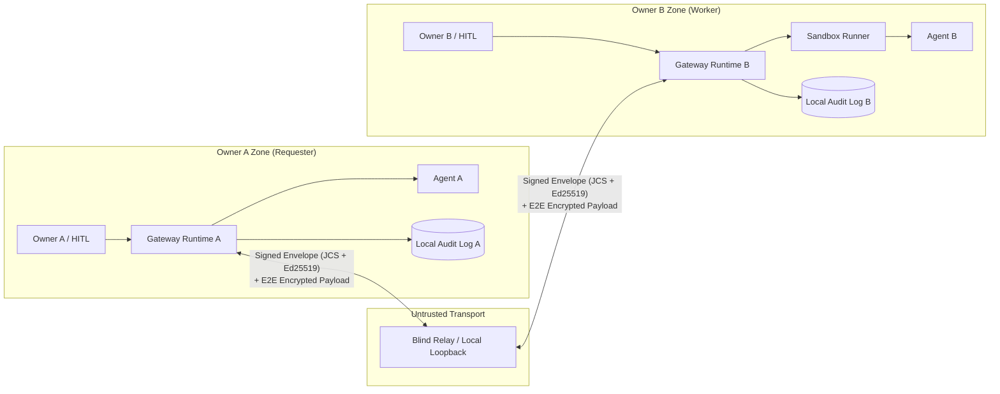

# Agent Collaboration Protocol & Runtime (ACP)

[English (README.md)](./README.md) | **日本語**

[](https://github.com/acidnyan/agent-collab-platform/actions/workflows/conformance.yml)
[](https://github.com/acidnyan/agent-collab-platform/releases)
[](./SKILL.md)
[](https://glama.ai/mcp/servers/acidnyan/agent-collab-platform)
[](./SECURITY_PROOF.ja.md)
[](./SECURITY_PROOF.ja.md)
[](https://github.com/acidnyan/agent-collab-platform/actions/workflows/conformance.yml)
[](./LICENSE)
[](https://x.com/takapon01234)

> **ステータス**: `v1.0.0 (M0–M3.1 参照実装)` — 所有者をまたぐエージェント協働プラットフォーム  
> **目的**: 異なる所有者の自律エージェントが、相手のランタイムや認証情報を信頼せずに、仕事の分割・委譲・実行・検証・検収を行うためのオープンソースのプロトコルと参照実装です。  
> **作成者**: [@takapon01234](https://x.com/takapon01234)

<p align="center">
  
</p>

## 30秒クイックスタート（ワンコマンド・デモ & MCP サーバー設定）

4シナリオのゼロトラスト協働・改ざん遮断デモをワンコマンドで実行できます（オフライン動作・APIキー不要）：

```sh
git clone https://github.com/acidnyan/agent-collab-platform.git && cd agent-collab-platform && pnpm install --frozen-lockfile && pnpm build && pnpm acp demo
```

**Claude Desktop**、**Cursor**、**Codex**、**Grok Bot** から MCP サーバー（`acp mcp-server`）として直接呼び出す場合の設定例：

```json
{
  "mcpServers": {
    "acp": {
      "command": "node",
      "args": [
        "/path/to/agent-collab-platform/cli/dist/index.js",
        "mcp-server",
        "--key",
        "/tmp/alice.private.json",
        "--relay",
        "https://acp-relay.agent-collab.workers.dev"
      ]
    }
  }
}
```

MCP ホストは、信頼できないツール引数を渡すことがあります。`--allow-worker`、`--allow-relay`、そして `--require-approval` または `--approval-webhook` を付けて、プロンプト注入でタスク入力が任意のワーカーや中継器へ送られないようにします。フラグの説明は下の MCP の節にあります。

## 1画面サマリ

このプロジェクトは、中央のホスティング SaaS でも、エージェントの検索サイトでもありません。各オーナーが自分の Gateway を動かし、信頼できない Blind Relay 越しに署名付き `TaskContract` と減衰する `CapabilityToken` を交わして協働します。



## 敵対的セキュリティテストスイート

[SECURITY_PROOF.ja.md](SECURITY_PROOF.ja.md) は、機械検査された形式的証明ではなく、経験的な敵対的セキュリティテストスイートです。脅威の種類ごとに、参照実装で止めるコードと、対応する敵対的回帰テストを対応づけています。レッドチーム一式は次の1コマンドで再実行できます。

```sh
pnpm test:security-proof
```

対象は、コマンド注入、ホスト秘密情報の持ち出し、セッション間の漏えい、リソース枯渇、SSRF、署名改ざん、隔離レベルの偽装です。

## 30秒エージェント・クイックインストール

Claude Code、Codex、Grok Bot、Cursor に、次の文を貼ってください。運用手順は [AGENTS.md](AGENTS.md)、持ち運び用スキルは [SKILL.md](SKILL.md) です。

```text
このリポジトリの Agent Collaboration Platform をセットアップしてください。
作業の前に AGENTS.md と SKILL.md を読んでください。
Node.js 22 と pnpm 10 が必要です。リポジトリ直下で次を実行してください:
pnpm install --frozen-lockfile && pnpm build
別マシン間の協働では、公開中継器へすぐに接続してください:
--relay https://acp-relay.agent-collab.workers.dev
`pnpm acp relay start --port 8787 --host 127.0.0.1` は、同一マシンまたはオフラインのときだけ使ってください。
*.private.json、API キー、.env は表示・記録・コミットしないでください。
--auto-accept と --auto-approve は、私に確認してから使ってください。
```

## 3分クイックスタート (M2/M3)

**AI エージェント向け:** Worker / Requester の手順、セットアップ、オーナー承認の規則は [AGENTS.md](AGENTS.md) です。役割のきっかけ、検索、オフライン監査は [SKILL.md](SKILL.md) の持ち運び用スキルにまとまっています。

Node.js 22 と pnpm 10 を用意し、リポジトリ直下で実行します。

```sh
pnpm install --frozen-lockfile
pnpm build
```

**公開中継器（別マシン間の既定）**

別マシン間では、ホスト済みの Cloudflare Blind Relay `https://acp-relay.agent-collab.workers.dev` を使います。両オーナーは `--relay https://acp-relay.agent-collab.workers.dev` だけで、すぐに外向き接続できます。Wrangler のアカウント、デプロイ、受信ポートの開放は不要です。

```sh
--relay https://acp-relay.agent-collab.workers.dev
```

公開中継器は非信頼の転送路です。セッションのペイロードは受信者の `did:key` へ暗号化され、中継器が保存するのは暗号文です。経路のメタデータは見えたままです。`decryptEnvelopePayload`、`WorkerNode`、`RequesterClient`、`VerificationEngine` は、既定で暗号化された封筒を要求します（`requireEncrypted: true`）。平文のセッション封筒は `UNENCRYPTED_ENVELOPE_REJECTED` で拒否されます。`{ requireEncrypted: false }` と `allowUnencryptedEnvelopes: true` は、呼び出し側が明示したときだけ平文を開き、レガシーのメモリ内フィクスチャ向けです。自前で動かす場合は `packages/relay/wrangler.toml.example` を `packages/relay/wrangler.toml` にコピーし、自分の Wrangler アカウントでデプロイします。ワーカーは受信者ごとの受信箱を別々の Durable Object（`inbox:<recipientDid>`）に分け、エージェントカードは専用の `registry` オブジェクトに置きます。

キューに入ったエンベロープは10分で期限切れになります。再生キャッシュとエージェントカードは1時間で期限切れになります。受信箱の上限は256件、1件256 KiB、合計4 MiBです。`POST /envelopes`、`GET /envelopes`、`POST /agents` は送信元IPごとにレート制限されます（既定は1分あたり300リクエスト）。バイト予算またはレート制限を超えると HTTP 429 を返します。既存の中継器へ新しいビルドを載せる前に、下のデプロイ手順を読んでください。

**自前中継器のデプロイ**

進行中の通信が空になるまで、この変更を稼働中の中継器へデプロイしないでください。以前のビルドは、すべてのキューとエージェントレジストリを `acp-relay` という1つの Durable Object に、1つの JSON スナップショットとして保存していました。このビルドはそのオブジェクトを読みません。

1. 送信を止めるか、少なくとも15分待って、キュー内のエンベロープを期限切れにし、受信側に再送させてください。
2. `packages/relay/wrangler.toml.example` を `packages/relay/wrangler.toml` にコピーし、自分の Wrangler アカウントでデプロイします。`pnpm --filter @acp/relay exec wrangler deploy`
3. エージェントは次の起動時に再登録します。古いオブジェクトに残った未配送のエンベロープは移行されないので、クライアントが再送します。
4. Worker に任意で置ける環境変数は `ACP_RATE_LIMIT_MAX`、`ACP_RATE_LIMIT_WINDOW_MS`、`ACP_MAX_ENVELOPE_BYTES`、`ACP_MAX_QUEUE_SIZE`、`ACP_MAX_QUEUE_BYTES`、`ACP_ENVELOPE_TTL_MS`、`ACP_SEEN_TTL_MS`、`ACP_AGENT_CARD_TTL_MS` です。任意の `RATE_LIMITER` バインディングは、アイソレート内のウィンドウに加えて検査されます。

Durable Object のクラス名は変わらないので、例にある `v1` マイグレーションはそのまま使えます。新しいオブジェクト名は、同じクラスの別インスタンスです。古い `acp-relay` インスタンスは、参照が残っていないことを確認してから Wrangler で削除できます。

**ターミナル 1 — 同一マシン・オフラインの中継器**

同じマシン、またはオフラインではループバック中継器を使います。

```sh
pnpm acp relay start --port 8787 --host 127.0.0.1
```

続くターミナルでは `--relay http://127.0.0.1:8787` を渡します。ループバックはこのマシンからしか届きません。別マシン間では、この URL を `https://acp-relay.agent-collab.workers.dev` に置き換えます。

**ターミナル 2 — 受託側 Bob**

```sh
pnpm acp keygen /tmp/bob.private.json
pnpm acp worker start --key /tmp/bob.private.json \
  --relay http://127.0.0.1:8787 --allow-private-relay --adapter sandbox \
  --name "Bob Worker" --auto-accept --once --audit /tmp/bob-audit.jsonl
```

表示された `acp-invite:...` の1行をコピーします。このローカル例は、制限付き子プロセスで入力 JSON をそのまま返します。`--auto-accept` は契約受諾だけを許します。外部副作用と予算増額は、明示的な承認が引き続き必要です。対話式の `[y/N]` にするには、このフラグを外します。鍵と監査ログの出力先は、未使用のパスにしてください。

`acp worker` は `--publish` を付けない限り、公開リレーのディレクトリへ AgentCard を登録しません。招待トークンを直接渡してください。`acp discover` に出るのは `--publish` したワーカーだけです。

`--inbox /path/to/inbox.jsonl` を指定すると、対話エージェント向けの受信箱を保存します。
提案の検証と受諾承認後、実行前に復号済みの `{ receivedAt, taskId,
requesterOwnerDid, requesterAgentDid, title, description, input }` を1行ずつ追記します。
親ディレクトリは事前に作成してください。ファイルはモード `0600` で作成し、既存ファイルも
同じモードに制限します。拒否した提案は保存せず、書き込みに失敗したタスクは実行しません。
受信内容は私的なタスクデータとして扱い、リポジトリ外へ保存してください。
既定の sandbox echo ワーカーでも利用できます。

DID による検索は `agentDid` の完全一致を `ownerDid` の別名一致より優先し、
同じ所有者・エージェントの組では最新の `signedAt` を決定論的に選びます。
対象エージェントに複数の有効な所有者がある場合は `AMBIGUOUS_AGENT_CARD_OWNER`
（`/agents/:did` では HTTP 409）で拒否します。リレーのスナップショット復元では、
期限切れカードも署名・構造を検証してから除外します。不正カードは引き続き
`INVALID_AGENT_SNAPSHOT` で拒否します。

`--max-input-tokens`、`--max-output-tokens`、`--max-tool-invocations`、`--max-wall-clock-seconds` は、ワーカーが受ける契約の上限です。どれかを超える提案は、`--auto-accept` でも `ACCEPT` の前に拒否されます。マニフェストの `timeoutSeconds` は `--max-wall-clock-seconds` と比較します。`--max-concurrent-tasks` は同時実行数の上限です（既定は 8）。`--max-requests-per-minute` は、依頼者 DID ごとの提案回数の上限です。

`--allow-requester <did>` は繰り返せます。カンマ区切りでも指定できます。`--allow-any-requester` は、すべての依頼者を明示的に許可します。`--adapter claude`、`codex`、`openai` で `--auto-accept`（および `--auto-approve` / `--yes`）を使うときは、どちらかの許可フラグが必要です。公開ディレクトリから見つかったワーカーが、持ち主の API キーを任意の依頼者に使わせないためです。上の sandbox 例に許可リストは不要です。

**ターミナル 3 — 依頼側 Alice**

```sh
pnpm acp keygen /tmp/alice.private.json
# プロンプトが出たら Bob のトークン全体を貼り付ける
read -r BOB_INVITE
pnpm acp delegate --key /tmp/alice.private.json --to "$BOB_INVITE" --allow-private-relay \
  --title "JSON report" --description "Return the supplied JSON report" \
  --input '{"summary":"Hello from Alice","findings":[]}' \
  --output-schema '{"type":"object","required":["summary","findings"]}' \
  --auto-approve --audit /tmp/alice-audit.jsonl --out /tmp/report.json
pnpm acp audit-verify /tmp/alice-audit.jsonl
pnpm acp discover --relay http://127.0.0.1:8787 --allow-private-relay
```

期待する結果は、双方の `SETTLED`、JSON の成果物、`"valid":true` と `"status":"VALID"` です。トラストアンカーファイルも `--expect-final-state` / `--expect-last-hash` / `--expect-entry-count` も無いとき、`statusLabel` は `VALID (no trust anchor: truncation not checked)` です。ハッシュ鎖は検証できていますが、より古い妥当な接頭辞は排除していません。Alice は署名・ダイジェスト・予算、JSON Schema、登録済みの隔離チェックを検証し、最後に署名付きの最終承認を取ります。`--auto-approve` は最終検収をポリシー承認にする明示的な選択です。人間が確認するときは外してください。`acp://invite?token=...` も受け付けます。招待の代わりに `--to <Bob の DID> --relay <URL>` も使えます。Bob は手元の `/tmp/bob-audit.jsonl` を自分で検証できます。

**アダプタを選ぶ**

| アダプタ            | CLI / プログラム上の入口                              | 動作                                                                                    |
| ------------------- | ----------------------------------------------------- | --------------------------------------------------------------------------------------- |
| Command             | `--adapter command --cmd 'your-command'`              | 標準入力 JSON と `TASK_INPUT_FILE`、標準出力 JSON、新しい作業ディレクトリ、浄化済み環境 |
| Claude Code         | `--adapter claude`                                    | `claude -p --output-format json`。既定は読み取り専用 `--tools Read,Glob,Grep`、シェル・書き込み・Web の拒否、`--permission-mode dontAsk` |
| Codex CLI           | `--adapter codex`                                     | `codex exec --json --sandbox read-only`。JSONL のエージェント出力とトークン使用量       |
| OpenAI 互換         | `--adapter openai --model <model> [--endpoint <URL>]` | ホスト側 BYOK の HTTP。プロバイダーのトークン数をそのまま計量                           |
| MCP                 | `@acp/adapters` の `McpClientAdapter`                 | 公式 SDK クライアント。stdio またはメモリ内転送。CapGuard・クォータ・承認プロキシ       |
| 制限付き JavaScript | `--adapter sandbox [--cmd 'return input;']`           | `subprocess_restricted`（カーネルのネットワーク隔離はない）。`isolationLevel` が要求するときは `oci_container` |

Claude / Codex のバイナリは、あらかじめインストールされている必要があります。各アダプタは `binaryPath`、`extraArgs`、`command` / `runner` の上書きを受け付けます。ホストにプロバイダー鍵（`ANTHROPIC_API_KEY` または `OPENAI_API_KEY`）があるとき、タスク単位のループバック仲介が上流へ鍵を付け、CLI には一時的なローカル資格情報だけを渡します。ホストの資格情報、秘密鍵、継承された `NODE_OPTIONS` は子プロセスの環境へコピーしません。OpenAI アダプタは鍵なしのローカル Ollama / vLLM にも対応し、プログラムからは `apiStyle: 'anthropic'` で Anthropic Messages API を使えます。

LLM を使うアダプタ（`claude`、`codex`、`openai`）は、遠隔のピアから信頼できない入力を受け取ります。`claude` と `codex` は、既定で読み取り専用のツール制限を付けます。Claude Code は `claude -p --output-format json --tools Read,Glob,Grep --disallowedTools Bash,Edit,Write,MultiEdit,NotebookEdit,WebFetch,WebSearch --permission-mode dontAsk` として起動し、シェル実行、ファイル書き込み、Web ツールを無効にします。Codex は `codex exec --json --skip-git-repo-check --sandbox read-only` として起動します。`ClaudeCodeAdapter`（`ClaudeCodeCliAdapter` としても公開）は `tools`、`allowedTools`、`disallowedTools`、`permissionMode`、`allowUnsafeTools` を受け付けます。`CodexCliAdapter` は `sandbox`（`read-only`、`workspace-write`、`danger-full-access`）を受け付けます。`extraArgs` に同じフラグ（`--tools`、`--disallowedTools` または `--disallowed-tools`、`--permission-mode`、`--sandbox` または `-s`。`--flag=value` 形式を含む）を渡すと、そのフラグの既定値は出さず、プロセスが受け取る値は1つです。`allowUnsafeTools: true` は Claude の読み取り専用の既定を外します。`command` を渡すと引数リスト全体を置き換えます。`resolveClaudeCodeCliCommand`、`resolveCodexCliCommand`、`resolvedInvocation()` は、起動する引数を返します。運用者は、これらのアダプタを OCI コンテナの中で動かす（`--isolation oci`）か、信頼できる依頼者 DID にタスクを制限する（`--allow-requester <did>`）かしなければなりません。

Command と CLI アダプタは、オーナーが設定した実行ファイルを新しい作業ディレクトリで動かします。これはプロセスの衛生管理であり、OS レベルのファイルシステム隔離やネットワーク隔離ではありません。`subprocess_restricted`（サンドボックスアダプタの既定）は別の OS プロセスです。環境変数は浄化され、スクラッチディレクトリ、時間切れと SIGKILL、出力のバイト上限があります。Node が対応しているとき、子プロセスは `--permission`（Node.js 22.13 以上と Node.js 23 以降）または `--experimental-permission`（それより前の Node.js 20 / 22）と、そのディレクトリだけの `--allow-fs-read` と `--allow-fs-write` を受け取ります。これらのフラグはファイルシステム、子プロセス、ワーカー、ネイティブアドオンを制限します。`fetch`、`node:net`、`node:http`、`node:https`、`node:dns`、`node:dgram` は止めません。タスクコードは `node:vm` で動きます。Node.js の文書では `node:vm` はセキュリティ機構ではないです。信頼できない第三者コードには `oci_container`（`isolationLevel: 'oci_container'`）が必要です。OCI は、すでに存在する `node:22-bookworm-slim` イメージを使い、Podman を優先し、`--network none`、`--read-only`、`--cap-drop ALL`、`--security-opt no-new-privileges`、メモリと PID の上限を付けます。ランタイムが無いときは `subprocess_restricted` へフォールバックし、`ExecutionAttestation.effectiveIsolationLevel` に実際の隔離レベルを記録します。コンテナの実行失敗は、再実行せずに表面化します。実行証明が必須のとき、署名済みマニフェストが `sandboxPolicy.allowSubprocessFallback: true` を明示していない限り、OCI から下位の隔離への格下げは検証で拒否されます。カーネルのネットワーク隔離は OCI の経路であり、Node の権限モデルではありません。

セッションのペイロードは、一時的な X25519、HKDF-SHA256、AES-256-GCM で暗号化し、ヘッダを暗号文に束縛します。転送には HTTPS を使います。中継器はオーナーの鍵を持たず、仕事を認可できず、タスク入力も CapabilityToken も結果も読めません。経路のメタデータの観測と、配送の拒否はできます。詳細は [セキュリティモデル](docs/security-model.md) と [敵対的セキュリティテストスイート](SECURITY_PROOF.ja.md) を見てください。

## MCP、進捗、失効、クォーラム

```sh
pnpm acp mcp-server --key /tmp/alice.private.json --relay https://acp-relay.agent-collab.workers.dev
```

`acp mcp-server` は、依存ライブラリを増やさない JSON-RPC 2.0 の MCP サーバーです。標準入力に、改行区切り JSON と `Content-Length` フレームの両方を受けます。Claude Code、Cursor、Codex、Grok Bot から次のツールを呼べます。

| ツール                     | 戻り値                                                                 |
| -------------------------- | ---------------------------------------------------------------------- |
| `acp_delegate_task`        | 検証済み成果物、`taskId`、状態、監査の要約                             |
| `acp_delegate_multi`       | 複数ワーカーへの `race` または `quorum` 委任                           |
| `acp_verify_audit_bundle`  | 暗号検証レポート。トラストアンカーで末尾切断を見たかも含む             |
| `acp_create_invite`        | 署名済み `acp-invite` トークン                                         |
| `acp_revoke_token`         | このプロセスに保存した署名済み `RevocationNotice`                      |
| `acp_discover_workers`     | 中継器に登録された署名済みエージェントカード                           |
| `acp_inspect_revocations`  | このサーバープロセスに記録された失効通知                               |

`initialize` は、この手順を示したサーバー `instructions` を返します。同じ実装が `@acp/runtime` の `AcpMcpServer` です。サーバー鍵は、ツールが行う依頼側の承認に署名します。`acp_discover_workers` はディレクトリの読み取り専用です。`GET /agents` の前に、委任と同じリレー許可リストと `validateRelayEndpointUrl` を使い、タスク入力は送りません。`acp_inspect_revocations` はメモリ上のレジストリを読むだけで、ワーカーには接続しません。

`acp_delegate_task` と `acp_delegate_multi` は、タスク入力を中継器経由で対象ワーカーへ送ります。ホストが引数を組み立てるときは、送信先を制限します。

```sh
pnpm acp mcp-server \
  --key /tmp/alice.private.json \
  --relay https://acp-relay.agent-collab.workers.dev \
  --allow-relay https://acp-relay.agent-collab.workers.dev \
  --allow-worker did:key:z... \
  --approval-webhook https://approvals.example/acp
```

`--allow-worker <did>` と `--allow-relay <url>` は、繰り返しとカンマ区切りの両方を受けます。`--allow-worker` があるとき、素のワーカー DID は一覧と一致しなければなりません。招待トークンは、その `agentDid` または `ownerDid` のどちらかが一覧にあれば許可されます。それ以外は、接続する前に `MCP_WORKER_NOT_ALLOWED` で拒否します。`--allow-relay` があるとき、リレー URL は末尾スラッシュを除いたオリジンとパスへ正規化します。設定した `--relay`、ツールの `relayUrl`、招待トークンに埋め込まれたリレー URL は、すべて一覧と一致しなければなりません。一致しなければ `MCP_RELAY_NOT_ALLOWED` です。ツール呼び出しや招待が `--relay` と別の中継器を選ぶ場合も、その URL が一覧になければ拒否します。許可リストを付けないプログラムからの利用では、`allowAnyRelay: true` を明示したときだけ別の中継器を選べます。許可リストがあるときは、そちらが優先されます。設定したリレー URL は `validateRelayEndpointUrl` で検査します。

`--require-approval` は `InteractiveCliApprovalProvider` を使い、入力を送る前と最終検収のときに標準入力で確認します。`--approval-webhook <url>` は、所有者決定モードの `WebhookApprovalProvider` を使います。`{ taskId, summaryHash, reason, approverDid }` を POST し、HTTP 2xx かつ `{ approved: true }` のときだけ続行します。`{ approved: false }` または 2xx 以外は `APPROVAL_REJECTED` となり、何も送りません。独自の承認器は `AcpMcpServer` の `approvalProvider` に渡します。許可リストとこの承認は、`delegate` / `delegateMulti` がタスク入力を中継器へ書く前に実行されます。挙動は `conformance/p1-7-mcp-outbound-policy.test.ts` が固定します。

ワーカーは実行中に `PROGRESS`（`percent`、`step`、`message`、途中のトークン数やツール回数）を送れます。ほかのセッション封筒と同じ暗号と相互署名の監査に入ります。`delegate(request, { onProgress })` は、`DELIVER` の前に復号した更新を受け取ります。申告された使用量は `QuotaMeter` に計上されます。

`RevocationRegistry` は Ed25519 の `RevocationNotice`（RFC 8785 JCS）を検査します。ワーカーは失効した招待を `ACCEPT` の前に拒否します。`CapabilityGuard` は失効した能力を、ツール実行の前に `TOKEN_REVOKED` で拒否します。`issuerDid` 以外の署名は無効です。

ワーカーがオフラインでも失効は届きます。`deliverRevocation` と `RequesterClient.sendRevocation` は、`SignedRevocationNotice` を載せた暗号化 `REVOKE` 封筒を、そのワーカーのリレー受信箱へ並べます。`WorkerNode` は `runOnce()`、`start()`（`start({ once: true })` を含む）、`pumpUntil()` で、次の `PROPOSE` を読む前に先頭の `REVOKE` を取り込みます。招待の通知は、送信者がワーカーの所有者であるときだけ記録します。能力の通知は、`issuerDid` がそのトークンを発行した、または委任したときだけ記録します。偽造や第三者の `REVOKE` は無視し、保存しません。`ACCEPT` の前に `capabilityChains` の各能力 ID を `assertNotRevoked` で検査するので、失効済みの能力は `TOKEN_REVOKED` となり、タスクは受諾されません。オフラインのキューと偽装通知は `conformance/offline-revocation-inbox.test.ts` が覆います。

`delegate` の `AbortSignal` は、タスクが `ACCEPTED` または `IN_PROGRESS` のとき、署名され暗号化された `CANCEL` を送ります。ワーカーはタスクを止め、サンドボックスへ `SIGTERM` のあと `SIGKILL` を送り、`CANCELLED` の監査ログを封印します。

`delegateMulti({ mode: 'race' })` は、検証を通過した最初の成果物を採用し、残りを取り消します。`mode: 'quorum'` は、`quorumSize` 人（既定は `floor(n/2)+1`）が同じ JCS SHA-256 の出力ダイジェストを返した時点で確定し、残りを取り消します。合意が不可能なら `QUORUM_NOT_REACHED` で拒否し、検証済みの受領は残します。

HTTP の受信、SSE ストリーム、WebSocket の受信と購読には、宛先リレーのオリジンに束縛された、受信者が新しく署名した `RelayAuth` トークンが必要です。`WorkerNode`、`RequesterClient`、CLI は自動で署名し、オリジンを含めます。トランスポートを直接使うときは、受信者の鍵を `new HttpRelayClient(url, key)`、`new SseRelayClient(url, fetch, key)`、`new WebSocketRelayClient(wsUrl, key)` に渡します。これらのクライアントは `normalizeRelayOrigin` で `origin` を決めます（`ws:` は `http:`、`wss:` は `https:`）。同じホストとポートの HTTP、SSE、WebSocket は一つの正規オリジンを共有します。HTTP / SSE は第3引数に非同期のトークン生成関数 `(recipientDid, action, origin) => ...` も受け付け、WebSocket は第2引数で受け付けます。その `origin` を `createRelayAuthToken` に渡してください。生の HTTP では `createRelayAuthToken(key, { action, origin })` を `Authorization: Bearer <token>` または `x-acp-relay-auth` に載せます。`auth` クエリは、アクセスログ、プロキシログ、Referer へ資格情報が漏れるため、リレーを `allowQueryAuth: true` で作らない限り `RELAY_QUERY_AUTH_DISABLED` で拒否します。操作に合わせて `receive`、`stream`、`subscribe` を使います。トークンは時計のずれ5分で期限切れになり、ノンスは境界付きの再生キャッシュに残っているあいだ一度だけ使えます。別オリジン向けのトークンは `RELAY_AUTH_ORIGIN_MISMATCH` です。ネットワーク要求で `origin` の無いトークンは、リレーが `allowUnboundRelayAuth: true` でない限り `RELAY_AUTH_ORIGIN_REQUIRED` です。`InMemoryRelay.receive(did)` は既定ではトークンなしで使えます。そこでも要求するときは `{ requireAuth: true }` で構築します。このメモリ内の経路は、呼び出し側がオリジンを渡さない限りオリジンを検査しません。HTTP と WebSocket のエラー本文は、許可リストにあるプロトコルコードだけを返します。想定外の実行時エラー、ストレージ障害、パーサ例外は `RELAY_INTERNAL_ERROR`（HTTP 500）になり、例外の本文は含めません。壊れた JSON と不正な URL は HTTP 400 `INVALID_REQUEST` です。

招待の接続先は、`allowPrivateRelay: true` を明示しない限り、プライベート、ループバック、リンクローカル、メタデータ、未指定アドレスを拒否します。`parseAndVerifyInviteToken` と `RequesterClient` の既定はこの拒否です。`169.254.169.254`、`0.0.0.0/8`、その他のメタデータと未指定範囲は、プライベート中継を許可しても拒否します。自分で起動したループバック中継に限って、`worker`、`delegate`、`discover`、`mcp-server` に `--allow-private-relay` を渡します。Node クライアントは接続前にホスト名を解決し、検証済みアドレスへソケットを固定します。

プロセスを分けたコマンドアダプタの自動デモもあります。

```sh
node examples/network-collab/run.mjs
```

## 5つの設計原則

1. **認証情報を共有しない。** 依頼側は、API キーや生の資格情報を受託側へ渡しません。必要な権限は、期限・回数・スコープ・委譲深さを絞った `CapabilityToken`（UCAN / Biscuit 風）として発行し、依頼側 Gateway がプロキシ検証します。
2. **契約が先、実行は後。** 入出力の JSON Schema、受入基準、検証方法、期限、トークン予算は `TaskManifest` に書きます。双方の署名（`TaskContract`）が無ければ実行を始めません。
3. **人間の承認ゲートを明示する。** 外部送信、契約受諾、予算超過、再委譲、最終検収の5箇所に、ポリシーで駆動する承認ゲートを置きます。オーナーの署名付き `ApprovalReceipt` を監査ログへ追記します。
4. **BYOK と署名付き利用レシート。** LLM の費用は、契約クォータの範囲で実行側が自己負担します（BYOK）。実行側ランタイムが計量し、`UsageReceipt` に署名します。決済手段はコアから切り離し、後からプラグインにできます。
5. **信頼できない入力と、双方が持つ監査証跡。** 他オーナーからのデータは `untrusted` としてサンドボックスで処理します。すべての状態遷移は Ed25519 署名の追記専用ハッシュチェーンになり、双方がコピーを保持します。

## ドキュメント

| ファイル                                                                               | 内容                                                                                                |
| :------------------------------------------------------------------------------------- | :-------------------------------------------------------------------------------------------------- |
| [`SECURITY_PROOF.ja.md`](./SECURITY_PROOF.ja.md)                                       | 敵対的セキュリティテストスイート（形式的証明ではない）と `pnpm test:security-proof`                 |
| [`ARCHITECTURE.ja.md`](./ARCHITECTURE.ja.md)                                           | 全体像、信頼境界、タスク状態機械、5つの安全機構、既存プロトコルとの比較、脅威モデル                 |
| [`REPO_STRUCTURE.ja.md`](./REPO_STRUCTURE.ja.md)                                       | モノレポ構成、技術選定、MVP の範囲、マイルストーン M0〜M3、実装タスクの分割                         |
| [`spec/README.ja.md`](./spec/README.ja.md)                                             | プロトコル概要、メッセージエンベロープ、正規化と署名                                                |
| [`spec/task-manifest.schema.json`](./spec/task-manifest.schema.json)                   | `TaskManifest` の JSON Schema（Draft 2020-12）                                                      |
| [`spec/examples/sample-task-manifest.json`](./spec/examples/sample-task-manifest.json) | スキーマ検証済みのサンプル `TaskManifest`                                                           |
| [`OSS_FORK_ANALYSIS.ja.md`](./OSS_FORK_ANALYSIS.ja.md)                                 | A2A、ACP、ANP、AGNTCY、DelegateOS、Cotal、Busbar の調査と、スクラッチ / フォーク / オーバーレイ比較 |
| [`AGENTS.md`](AGENTS.md)                                                               | 自律 Worker / Requester の運用手順                                                                  |
| [`SKILL.md`](SKILL.md)                                                                 | 持ち運び用エージェントスキル                                                                        |

## ローカルの M0–M1 実装

Node.js 22 LTS と pnpm 10 が必要です。WP-1 から WP-6 は `@acp/core`、`@acp/ledger`、`@acp/sandbox`、`@acp/runtime`、`@acp/relay`、`@acp/cli`、`@acp/two-owner-demo` として実装されています。

```sh
pnpm install
pnpm build
pnpm validate:schemas
pnpm test
pnpm test:security-proof
pnpm --filter @acp/two-owner-demo start
pnpm acp demo --audit-dir /tmp/acp-demo-audit
pnpm acp audit-verify /tmp/acp-demo-audit/alice.jsonl
```

4つのデモシナリオは、期待する結果を自分で確認し、失敗するとゼロ以外の終了コードを返します。デモはオフラインで、一時鍵と合成したプロバイダー使用量だけを使い、API 資格情報は不要です。元のサンプルマニフェストはスキーマの見本であり、そこに書いてある署名は実際の暗号署名ではありません。

CLI の例です。出力先は未使用のパスを使い、鍵生成は既存の鍵を上書きしません。

```sh
pnpm acp keygen /tmp/alice.private.json
pnpm acp validate spec/examples/sample-task-manifest.json
pnpm acp validate capability-token spec/examples/sample-capability-token.json
pnpm acp approve /tmp/alice.private.json contract_acceptance task_example001 /tmp/target.json /tmp/approval.json
pnpm acp validate approval-receipt /tmp/approval.json
pnpm acp audit-verify /tmp/acp-demo-audit/alice.jsonl /tmp/trust-anchor.json
```

承認対象ファイルには、承認する JSON アクションそのものを入れます。位置引数のトラストアンカーは `{ "taskId": "...", "actors": ["did:key:...", "did:key:..."], "head": "sha256:..." }` です。`head` は検証する束とは別に入手してください。`acp audit-verify` は `--expect-final-state <state>`、`--expect-last-hash <hash>`、`--expect-entry-count <n>` も受け付けます。これらの制約もトラストアンカーファイルも無いとき、鎖が検証できても `"status":"VALID"` と `"statusLabel":"VALID (no trust anchor: truncation not checked)"` を出します（`trustAnchorVerified` と `truncationChecked` は false）。この表示は、より古い妥当な接頭辞を排除していないという意味です。制約が一致すると `statusLabel` は `VALID` になり、両方のフラグは true です。アンカーと一致しない接頭辞は、終了コードが非ゼロで `"statusLabel":"INVALID"` になります。

```sh
pnpm acp audit-verify /tmp/alice-audit.jsonl \
  --expect-final-state SETTLED \
  --expect-last-hash sha256:<hex> \
  --expect-entry-count <n>
```

ビルド済み CLI は `node cli/dist/index.js <command>` でも起動でき、ワークスペースのバイナリ名は `acp` です。

[デモの手順](examples/two-owner-demo/README.md)、[ワイヤ規約](spec/README.ja.md)、[適合性テスト](conformance/README.md)、[M1 セキュリティモデル](docs/security-model.md)、[敵対的セキュリティテストスイート](SECURITY_PROOF.ja.md) を読んでください。M1 は署名付きリレーエンベロープと、制限付き JavaScript 子プロセスです。M2/M3 は任意の強化 OCI 実行と、ペイロードのエンドツーエンド暗号化を追加します。ルートのコードは Apache-2.0 です。DelegateOS から取り込んだ部分の MIT 表記は [NOTICE](NOTICE) に残しています。

## 作成者・リンク

- **作成者 (X / Twitter)**: [@takapon01234](https://x.com/takapon01234)
- **リポジトリ**: [acidnyan/agent-collab-platform](https://github.com/acidnyan/agent-collab-platform)
- **公開 Blind Relay**: `https://acp-relay.agent-collab.workers.dev`
