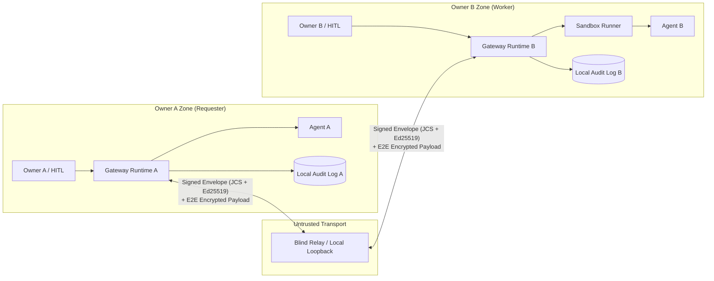

# Agent Collaboration Protocol & Runtime (ACP)

> **Status**: `v0.2.0 (M0–M3 Reference Implementation)` — Cross-Owner Agent Collaboration Platform
> **Target**: 異なる所有者（Owner）に属する自律エージェント同士が、互いのランタイムや認証情報を信頼せずにタスクを分割・委譲・実行・検証・検収できるOSSプロトコルおよびリファレンス実装。

## 結論（1画面サマリ）

本プロジェクトは、中央集権型のホスティングSaaSや単なるエージェント検索サイトではなく、**各オーナーが自前のランタイム（Gateway）を動かしながら、信頼できない中継器（Untrusted Relay）越しに署名付き契約（`TaskContract`）と減衰可能な権限トークン（`CapabilityToken`）を交わして協働するワークフロー基盤**である。



## 3-Minute Quickstart / 3分クイックスタート (M2/M3)

**For AI agents / AI エージェント向け:** Read [AGENTS.md](AGENTS.md) for the
autonomous Worker/Requester playbook, setup commands, and owner approval rules.
[SKILL.md](SKILL.md) provides the portable `agent-collab-platform` skill with
English/Japanese role triggers, discovery, and offline audit verification.
Claude Code・Codex・Grok Bot・Cursor などは、これらの手順で役割を判断し、
秘密鍵を共有せずにセットアップ・待機・委譲・検証を実行できます。

Requires Node.js 22 and pnpm 10. From the repository root:
Node.js 22・pnpm 10 を用意し、リポジトリ直下で実行します。

```sh
pnpm install --frozen-lockfile
pnpm build
```

**Public relay / 公開中継器（別マシン間の既定）**

Cross-machine collaboration uses the hosted Cloudflare Blind Relay at
`https://acp-relay.agent-collab.workers.dev`. Both owners connect immediately
with `--relay https://acp-relay.agent-collab.workers.dev`. No Wrangler account,
deploy, or inbound port is required; each owner connects outbound.
別マシン間では、この公開 HTTPS 中継器を既定としてすぐに接続します。
インフラの用意は不要です。

```sh
--relay https://acp-relay.agent-collab.workers.dev
```

The public relay is untrusted transport: envelopes stay signed plaintext. To
run your own relay, copy `packages/relay/wrangler.toml.example` to
`packages/relay/wrangler.toml` and deploy it with your Wrangler account. The
example binds a Durable Object for persistent queues and registry state.
公開中継器は署名付き平文を運ぶ非信頼の中継です。自前で動かす場合は
`packages/relay/wrangler.toml.example` を使います。

**Terminal 1 — Local offline relay / 同一マシン・オフライン中継器**

Same-machine and offline sessions use a loopback relay:

```sh
pnpm acp relay start --port 8787 --host 127.0.0.1
```

Then pass `--relay http://127.0.0.1:8787` in the terminals below. Loopback is
reachable only on this machine. For cross-machine runs, replace that URL with
`https://acp-relay.agent-collab.workers.dev`.
同一マシンではこのローカル中継器を使い、別マシン間では公開 URL に置き換えます。

**Terminal 2 — Bob Worker / 受託側**

```sh
pnpm acp keygen /tmp/bob.private.json
pnpm acp worker start --key /tmp/bob.private.json \
  --relay http://127.0.0.1:8787 --adapter sandbox \
  --name "Bob Worker" --auto-accept --once --audit /tmp/bob-audit.jsonl
```

Copy the printed `acp-invite:...` line. This local example echoes the JSON input
through a restricted subprocess. `--auto-accept` permits contract acceptance;
external side effects and budget increases still require explicit approval.
Remove it for an interactive `[y/N]` gate. Keys and audit output paths must be fresh.

表示された `acp-invite:...` の1行をコピーします。この例は隔離された
JavaScript 子プロセスで入力 JSON を返します。`--auto-accept` を外すと
契約承認が対話式になります。外部副作用・予算増額は自動承認されません。
鍵・監査ファイルの出力先には未使用のパスを指定してください。

**Terminal 3 — Alice Requester / 依頼・検証側**

```sh
pnpm acp keygen /tmp/alice.private.json
# Paste Bob's complete token when prompted / Bob のトークンを貼り付ける
read -r BOB_INVITE
pnpm acp delegate --key /tmp/alice.private.json --to "$BOB_INVITE" \
  --title "JSON report" --description "Return the supplied JSON report" \
  --input '{"summary":"Hello from Alice","findings":[]}' \
  --output-schema '{"type":"object","required":["summary","findings"]}' \
  --auto-approve --audit /tmp/alice-audit.jsonl --out /tmp/report.json
pnpm acp audit-verify /tmp/alice-audit.jsonl
pnpm acp discover --relay http://127.0.0.1:8787
```

Expected: `SETTLED`, a JSON deliverable, and audit status `VALID` on both owners.
Alice verifies signatures, digests and budget, JSON Schema and registered isolated
checks, then obtains a signed final approval. `--auto-approve` explicitly opts
into policy approval of final verification; omit it for human review.
`acp://invite?token=...` is also accepted. Alternatively, use `--to <Bob DID>
--relay <URL>`. Bob can verify his own `/tmp/bob-audit.jsonl` locally.

双方で `SETTLED` / `VALID` を確認できます。Alice は暗号・予算検証、
スキーマ・隔離された決定的チェック、オーナー承認の3段階を通して検収します。
`--auto-approve` を外すと最終検収も対話式になります。Bob 側でも
`pnpm acp audit-verify /tmp/bob-audit.jsonl` を実行できます。

**Choose an adapter / 実エージェント接続**

| Adapter | CLI / programmatic entry | Behavior |
| --- | --- | --- |
| Command | `--adapter command --cmd 'your-command'` | stdin JSON + `TASK_INPUT_FILE`, stdout JSON, fresh workspace, sanitized environment |
| Claude Code | `--adapter claude` | `claude -p --output-format json`, wrapper/direct JSON and token usage |
| Codex CLI | `--adapter codex` | `codex exec --json`, JSONL agent output and token usage |
| OpenAI compatible | `--adapter openai --model <model> [--endpoint <URL>]` | Host-owned BYOK HTTP requests; exact provider token accounting |
| MCP | `McpClientAdapter` from `@acp/adapters` | Official SDK client, stdio or in-memory transport; CapGuard + quota + approval proxy |
| Restricted JS | `--adapter sandbox [--cmd 'return input;']` | Node permission-restricted subprocess, or hardened OCI when requested in the manifest |

Claude/Codex binaries must already be installed. Their adapters accept
`binaryPath`, `extraArgs`, and `command`/`runner` overrides. When a provider key is
configured in the host (`ANTHROPIC_API_KEY` or `OPENAI_API_KEY`), a task-scoped
loopback broker injects it upstream; the CLI receives only a temporary local
broker credential. Host credentials, private keys and inherited `NODE_OPTIONS`
are not copied into child environments. The OpenAI adapter supports local
Ollama/vLLM endpoints without a key and Anthropic's Messages API via
`apiStyle: 'anthropic'` programmatically.

Command and CLI adapters run owner-configured executables with fresh working
folders; this is process hygiene, not OS-level filesystem/network confinement.
Use the restricted sandbox for untrusted JavaScript. OCI uses an already-present
`node:22-bookworm-slim` image, prefers Podman, disables networking, drops Linux
capabilities and applies memory/PID limits. An unavailable runtime falls back to
the restricted subprocess and records the effective isolation level in the signed
attestation. A container execution failure is surfaced rather than rerun.
When execution attestation is required, verification rejects an OCI downgrade
unless the signed manifest explicitly sets `sandboxPolicy.allowSubprocessFallback: true`.

実 CLI は事前インストールが必要です。プロバイダー鍵はホストの仲介プロセスに
保持し、子プロセスには実鍵を渡しません。Command/CLI の作業ディレクトリ分離は
OS の完全隔離ではありません。非信頼の JavaScript は `sandbox` を使用します。
OCI が利用できない場合は制限付き子プロセスへフォールバックし、実際の隔離方式を
署名付き証明に記録します。

Relay envelopes retain the M1 signed plaintext wire format: use HTTPS for transit.
The relay has no owner keys and cannot authorize work, but can observe metadata
and payloads or deny delivery. End-to-end encryption is not implemented by this
milestone. See [security details](docs/security-model.md).

HTTP receives, SSE streams and WebSocket receives/subscriptions require a fresh
recipient-signed `RelayAuth` token. `WorkerNode`, `RequesterClient` and the CLI
sign automatically. For direct transport use, pass the recipient key as
`new HttpRelayClient(url, key)`, `new SseRelayClient(url, fetch, key)` or
`new WebSocketRelayClient(wsUrl, key)`. HTTP/SSE also accept an async token
generator as their third argument; WebSocket accepts it as its second argument.
Raw HTTP callers can send `createRelayAuthToken(key, { action })` through
`Authorization: Bearer <token>`, `x-acp-relay-auth` or the `auth` query parameter.
Use `receive`, `stream` or `subscribe` to match the operation. Tokens expire after
five minutes of clock skew and each nonce can be used once while retained in the
bounded replay cache. Direct `InMemoryRelay.receive(did)` remains available by
default; construct with `{ requireAuth: true }` to require a token there too.

Invite endpoints always block metadata and unspecified addresses.
`parseAndVerifyInviteToken(uri, Date.now(), { allowPrivateRelay: false })` and
`RequesterClient`'s `allowPrivateRelay: false` option also reject private and
loopback endpoints. Local relays remain enabled by default.

A fully automated **separate-process command-adapter demo** is also available:

```sh
node examples/network-collab/run.mjs
```

## 5つの設計原則

1. **Zero Shared Credentials（認証情報の非共有）**: 依頼側は受託側にAPIキーや生クレデンシャルを一切渡さない。必要な権限は期限・回数・スコープ・委譲深さを絞った `CapabilityToken`（UCAN/Biscuit風）として発行し、依頼側Gatewayがプロキシ検証する。
2. **Contract-First Execution（契約駆動の実行と検証）**: 入出力JSON Schema・受入基準・検証手段（自動テスト / スキーマ検証 / 人間検収）・期限・トークン予算上限を `TaskManifest` に定義し、双方の署名（`TaskContract`）なしに実行を開始しない。
3. **Explicit HITL Gates（明示的な人間承認ゲート）**: 外部送信、契約受諾、予算超過、再委譲、最終検収の5箇所にポリシー駆動の承認ゲートを設け、オーナーの署名付き `ApprovalReceipt` を監査ログに残す。
4. **BYOK + Signed Usage Receipts（決済非依存のコスト分離）**: LLM推論コストは原則として**実行側自己負担（BYOK）**とし、契約で定めたクォータ上限内で実行側Runtimeが計量・署名した `UsageReceipt` を発行する。決済手段はコアから分離しプラグイン化する。
5. **Untrusted Input & Bilateral Audit（隔離実行と双方向監査証跡）**: 他オーナーからの受信データはすべて `untrusted` としてサンドボックス内で処理し、全状態遷移をハッシュチェーン＋Ed25519署名の追記専用ログとして双方が保持する。

## ドキュメント一覧

| ファイル | 内容 |
| :--- | :--- |
| [`ARCHITECTURE.md`](./ARCHITECTURE.md) | システム全体像、信頼境界、タスク状態機械、5大安全メカニズム、既存プロトコル比較、脅威モデル |
| [`REPO_STRUCTURE.md`](./REPO_STRUCTURE.md) | モノレポ構成案、技術スタック選定理由、MVPスコープ、マイルストーン（M0〜M3）、実装タスク分割 |
| [`spec/README.md`](./spec/README.md) | プロトコル仕様概要、メッセージエンベロープ、正規化・署名仕様 |
| [`spec/task-manifest.schema.json`](./spec/task-manifest.schema.json) | `TaskManifest` の JSON Schema（Draft 2020-12） |
| [`spec/examples/sample-task-manifest.json`](./spec/examples/sample-task-manifest.json) | スキーマ検証済みのサンプル `TaskManifest` |
| [`OSS_FORK_ANALYSIS.md`](./OSS_FORK_ANALYSIS.md) | 既存OSS（A2A, ACP, ANP, AGNTCY, DelegateOS, Cotal, Busbar等）の実在調査と「スクラッチ vs フォーク vs オーバーレイ」比較設計 |

## Local M0–M1 implementation

Node.js 22 LTS and pnpm 10 are required. WP-1 through WP-6 are implemented as
`@acp/core`, `@acp/ledger`, `@acp/sandbox`, `@acp/runtime`, `@acp/relay`, `@acp/cli`
and `@acp/two-owner-demo`.

```sh
pnpm install
pnpm build
pnpm validate:schemas
pnpm test
pnpm --filter @acp/two-owner-demo start
pnpm acp demo --audit-dir /tmp/acp-demo-audit
pnpm acp audit-verify /tmp/acp-demo-audit/alice.jsonl
```

All four demo scenarios assert their expected outcomes and return a nonzero exit
code on failure. The demo is offline, uses ephemeral keys and synthetic provider
usage, and never needs API credentials. The original sample manifest remains a
schema fixture; its illustrative signature is not a real cryptographic signature.

CLI examples (use a fresh output path; key generation never overwrites a key):

```sh
pnpm acp keygen /tmp/alice.private.json
pnpm acp validate spec/examples/sample-task-manifest.json
pnpm acp validate capability-token spec/examples/sample-capability-token.json
pnpm acp approve /tmp/alice.private.json contract_acceptance task_example001 /tmp/target.json /tmp/approval.json
pnpm acp validate approval-receipt /tmp/approval.json
pnpm acp audit-verify /tmp/acp-demo-audit/alice.jsonl /tmp/trust-anchor.json
```

The approval target file contains the exact JSON action being approved. The trust
anchor file has `{ "taskId": "...", "actors": ["did:key:...", "did:key:..."],
"head": "sha256:..." }`; obtain the latest expected head independently of the
bundle under verification. The built CLI is also available as
`node cli/dist/index.js <command>` and its workspace binary is `acp`.

Read the [demo walkthrough](examples/two-owner-demo/README.md),
[wire rules](spec/README.md), [conformance suite](conformance/README.md), and
[M1 security model](docs/security-model.md). M1 uses signed plaintext relay
payloads and the restricted JavaScript subprocess driver. M2/M3 adds optional hardened OCI execution; end-to-end payload encryption remains future work. The root code is Apache-2.0; adapted DelegateOS
portions retain MIT attribution in [NOTICE](NOTICE).
