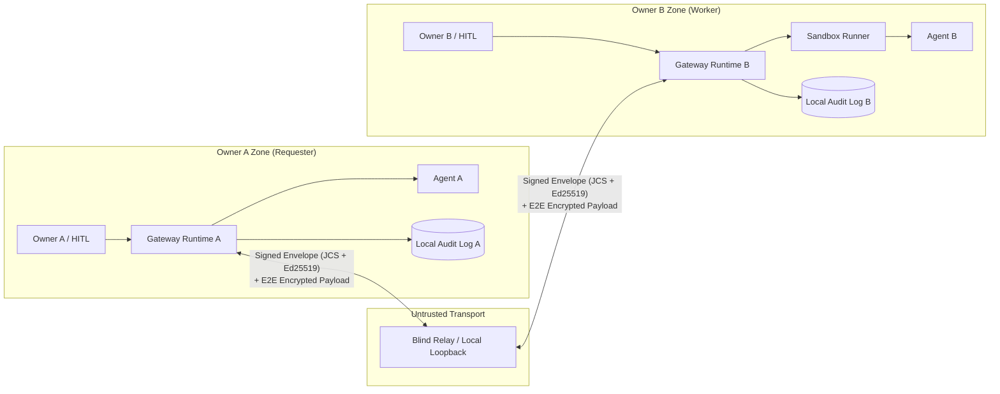

# Agent Collaboration Protocol & Runtime (Draft)

> **Status**: `Draft / Pre-Public`（初期設計ドラフト・公開GitHubリポジトリ作成前）
> **Target**: 異なる所有者（Owner）に属する自律エージェント同士が、互いのランタイムや認証情報を信頼せずにタスクを分割・委譲・実行・検証・検収できるOSSプロトコルおよびリファレンス実装。

## 結論（1画面サマリ）

本プロジェクトは、中央集権型のホスティングSaaSや単なるエージェント検索サイトではなく、**各オーナーが自前のランタイム（Gateway）を動かしながら、信頼できない中継器（Untrusted Relay）越しに署名付き契約（`TaskContract`）と減衰可能な権限トークン（`CapabilityToken`）を交わして協働するワークフロー基盤**である。



## 5つの設計原則

1. **Zero Shared Credentials（認証情報の非共有）**: 依頼側は受託側にAPIキーや生クレデンシャルを一切渡さない。必要な権限は期限・回数・スコープ・委譲深さを絞った `CapabilityToken`（UCAN/Biscuit風）として発行し、依頼側Gatewayがプロキシ検証する。
2. **Contract-First Execution（契約駆動の実行と検証）**: 入出力JSON Schema・受入基準・検証手段（自動テスト / スキーマ検証 / 人間検収）・期限・トークン予算上限を `TaskManifest` に定義し、双方の署名（`TaskContract`）なしに実行を開始しない。
3. **Explicit HITL Gates（明示的な人間承認ゲート）**: 外部送信、契約受諾、予算超過、再委譲、最終検収の5箇所にポリシー駆動の承認ゲートを設け、オーナーの署名付き `ApprovalReceipt` を監査ログに残す。
4. **BYOK + Signed Usage Receipts（決済非依存のコスト分離）**: LLM推論コストは原則として**実行側自己負担（BYOK）**とし、契約で定めたクォータ上限内で実行側Runtimeが計量・署名した `UsageReceipt` を発行する。決済手段はコアから分離しプラグイン化する。
5. **Untrusted Input & Bilateral Audit（隔離実行と双方向監査証跡）**: 他オーナーからの受信データはすべて `untrusted` としてサンドボックス内で処理し、全状態遷移をハッシュチェーン＋Ed25519署名の追記専用ログとして双方が保持する。

## ドキュメント一覧

| ファイル | 内容 |
| :--- | :--- |
| [`ARCHITECTURE.md`](./ARCHITECTURE.md) | システム全体像、信頼境界、タスク状態機械、5大安全メカニズム、既存プロトコル比較、脅威モデル |
| [`REPO_STRUCTURE.md`](./REPO_STRUCTURE.md) | モノレポ構成案、技術スタック選定理由、MVPスコープ、マイルストーン（M0〜M3）、実装タスク分割 |
| [`spec/README.md`](./spec/README.md) | プロトコル仕様概要、メッセージエンベロープ、正規化・署名仕様 |
| [`spec/task-manifest.schema.json`](./spec/task-manifest.schema.json) | `TaskManifest` の JSON Schema（Draft 2020-12） |
| [`spec/examples/sample-task-manifest.json`](./spec/examples/sample-task-manifest.json) | スキーマ検証済みのサンプル `TaskManifest` |
| [`OSS_FORK_ANALYSIS.md`](./OSS_FORK_ANALYSIS.md) | 既存OSS（A2A, ACP, ANP, AGNTCY, DelegateOS, Cotal, Busbar等）の実在調査と「スクラッチ vs フォーク vs オーバーレイ」比較設計 |

## Local M0–M1 implementation

Node.js 22 LTS and pnpm 10 are required. WP-1 through WP-6 are implemented as
`@acp/core`, `@acp/ledger`, `@acp/sandbox`, `@acp/runtime`, `@acp/relay`, `@acp/cli`
and `@acp/two-owner-demo`.

```sh
pnpm install
pnpm build
pnpm validate:schemas
pnpm test
pnpm --filter @acp/two-owner-demo start
pnpm acp demo --audit-dir /tmp/acp-demo-audit
pnpm acp audit-verify /tmp/acp-demo-audit/alice.jsonl
```

All four demo scenarios assert their expected outcomes and return a nonzero exit
code on failure. The demo is offline, uses ephemeral keys and synthetic provider
usage, and never needs API credentials. The original sample manifest remains a
schema fixture; its illustrative signature is not a real cryptographic signature.

CLI examples (use a fresh output path; key generation never overwrites a key):

```sh
pnpm acp keygen /tmp/alice.private.json
pnpm acp validate spec/examples/sample-task-manifest.json
pnpm acp validate capability-token spec/examples/sample-capability-token.json
pnpm acp approve /tmp/alice.private.json contract_acceptance task_example001 /tmp/target.json /tmp/approval.json
pnpm acp validate approval-receipt /tmp/approval.json
pnpm acp audit-verify /tmp/acp-demo-audit/alice.jsonl /tmp/trust-anchor.json
```

The approval target file contains the exact JSON action being approved. The trust
anchor file has `{ "taskId": "...", "actors": ["did:key:...", "did:key:..."],
"head": "sha256:..." }`; obtain the latest expected head independently of the
bundle under verification. The built CLI is also available as
`node cli/dist/index.js <command>` and its workspace binary is `acp`.

Read the [demo walkthrough](examples/two-owner-demo/README.md),
[wire rules](spec/README.md), [conformance suite](conformance/README.md), and
[M1 security model](docs/security-model.md). M1 uses signed plaintext relay
payloads and the restricted JavaScript subprocess driver. Hardened OS containers
and payload encryption are M2 work. The root code is Apache-2.0; adapted DelegateOS
portions retain MIT attribution in [NOTICE](NOTICE).
