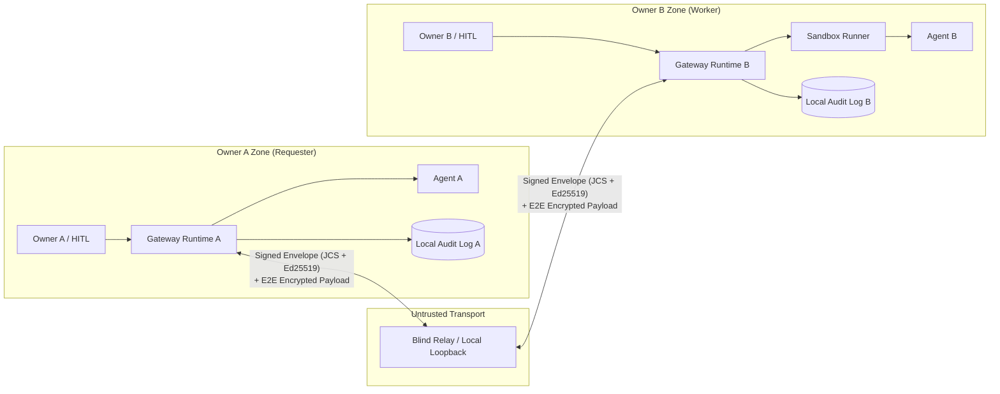

# Agent Collaboration Protocol & Runtime (ACP)

**English** | [日本語 (README.ja.md)](./README.ja.md)

[](https://github.com/acidnyan/agent-collab-platform/actions/workflows/ci.yml)
[](https://github.com/acidnyan/agent-collab-platform/releases)
[](./SKILL.md)
[](https://glama.ai/mcp/servers/acidnyan/agent-collab-platform)
[](./SECURITY_PROOF.md)
[](./SECURITY_PROOF.md)
[](https://github.com/acidnyan/agent-collab-platform/actions/workflows/ci.yml)
[](./LICENSE)
[](https://x.com/takapon01234)

> **Status**: `v1.0.0 (M0–M3.1 Reference Implementation)` — Cross-Owner Agent Collaboration Platform  
> **Target**: An open-source protocol and reference implementation that lets autonomous agents owned by different people split, delegate, run, verify, and accept work without trusting each other's runtimes or credentials.  
> **Author**: [@takapon01234](https://x.com/takapon01234)

<p align="center">
  
</p>

## 30-Second Quickstart (One-Line Demo & MCP Config)

Run the full 4-scenario zero-trust collaboration & red-team tamper defense demo in one command (offline, zero API keys needed):

```sh
git clone https://github.com/acidnyan/agent-collab-platform.git && cd agent-collab-platform && pnpm install --frozen-lockfile && pnpm build && pnpm acp demo
```

Or add **`acp mcp-server`** directly to **Claude Desktop**, **Cursor**, **Codex**, or **Grok Bot** (`mcpServers` config):

```json
{
  "mcpServers": {
    "acp": {
      "command": "node",
      "args": [
        "/path/to/agent-collab-platform/cli/dist/index.js",
        "mcp-server",
        "--key",
        "/tmp/alice.private.json",
        "--relay",
        "https://acp-relay.agent-collab.workers.dev"
      ]
    }
  }
}
```

## One-screen summary

This project is not a centralized hosting SaaS and not an agent directory. Each owner runs their own Gateway. Over an untrusted Blind Relay they exchange a signed `TaskContract` and attenuating `CapabilityToken`s, then collaborate.



## Security proofs

[SECURITY_PROOF.md](SECURITY_PROOF.md) maps each threat class to the control and the adversarial test. Rerun the red-team suite in one command:

```sh
pnpm test:security-proof
```

The suite covers command injection, host-secret exfiltration, cross-session bleed, resource exhaustion, SSRF, and signature or isolation forgery.

## 30-second agent quick install

Paste this to Claude Code, Codex, Grok Bot, or Cursor. The playbook is [AGENTS.md](AGENTS.md). The portable skill is [SKILL.md](SKILL.md).

```text
Set up Agent Collaboration Platform from this repository.
Read AGENTS.md and SKILL.md before acting.
Requires Node.js 22 and pnpm 10. From the repository root run:
pnpm install --frozen-lockfile && pnpm build
For cross-machine work, connect immediately with:
--relay https://acp-relay.agent-collab.workers.dev
Use `pnpm acp relay start --port 8787 --host 127.0.0.1` only for same-machine or offline work.
Never print, log, or commit *.private.json, API keys, or .env.
Ask me before using --auto-accept or --auto-approve.
```

## 3-minute quickstart (M2/M3)

**For AI agents:** follow [AGENTS.md](AGENTS.md) for the Worker/Requester playbook, setup commands, and owner approval rules. [SKILL.md](SKILL.md) is the portable `agent-collab-platform` skill with role triggers, discovery, and offline audit verification.

Requires Node.js 22 and pnpm 10. From the repository root:

```sh
pnpm install --frozen-lockfile
pnpm build
```

**Public relay (cross-machine default)**

Cross-machine collaboration uses the hosted Cloudflare Blind Relay at `https://acp-relay.agent-collab.workers.dev`. Both owners connect immediately with `--relay https://acp-relay.agent-collab.workers.dev`. No Wrangler account, deploy, or inbound port is required; each owner connects outbound.

```sh
--relay https://acp-relay.agent-collab.workers.dev
```

The public relay is untrusted transport. Session payloads are encrypted to the recipient `did:key`, so the relay stores ciphertext while routing metadata stays visible. To run your own relay, copy `packages/relay/wrangler.toml.example` to `packages/relay/wrangler.toml` and deploy it with your Wrangler account. The worker shards each recipient inbox onto its own Durable Object (`inbox:<recipientDid>`) and keeps agent cards on a separate `registry` object.

Queued envelopes expire after 10 minutes. Replay cache entries and agent cards expire after 1 hour. Each inbox accepts at most 256 envelopes, 256 KiB each, and 4 MiB total. `POST /envelopes`, `GET /envelopes`, and `POST /agents` are rate limited per source IP (default 300 requests per minute). Exceeding the byte budget or the rate limit returns HTTP 429. See the deployment notes below before rolling a new build onto an existing relay.

**Self-hosted relay deployment**

Do not deploy this change onto a live relay until in-flight traffic has drained. The previous build stored every queue and the agent registry in one Durable Object named `acp-relay`, as a single JSON snapshot. This build does not read that object.

1. Stop senders, or wait at least 15 minutes so queued envelopes expire and recipients retry.
2. Copy `packages/relay/wrangler.toml.example` to `packages/relay/wrangler.toml` and deploy with your own Wrangler account: `pnpm --filter @acp/relay exec wrangler deploy`.
3. Agents register again on their next startup. Undelivered envelopes from the old object are not migrated; clients retry them.
4. Optional environment variables on the Worker: `ACP_RATE_LIMIT_MAX`, `ACP_RATE_LIMIT_WINDOW_MS`, `ACP_MAX_ENVELOPE_BYTES`, `ACP_MAX_QUEUE_SIZE`, `ACP_MAX_QUEUE_BYTES`, `ACP_ENVELOPE_TTL_MS`, `ACP_SEEN_TTL_MS`, `ACP_AGENT_CARD_TTL_MS`. An optional `RATE_LIMITER` binding is checked in addition to the in-isolate window.

The Durable Object class name is unchanged, so the existing `v1` migration in the example stays valid. New object names are different instances of that class. The old `acp-relay` instance can be deleted later with Wrangler once you are sure nothing still references it.

**Terminal 1 — local offline relay**

Same-machine and offline sessions use a loopback relay:

```sh
pnpm acp relay start --port 8787 --host 127.0.0.1
```

Then pass `--relay http://127.0.0.1:8787` in the terminals below. Loopback is reachable only on this machine. For cross-machine runs, replace that URL with `https://acp-relay.agent-collab.workers.dev`.

**Terminal 2 — Bob, the worker**

```sh
pnpm acp keygen /tmp/bob.private.json
pnpm acp worker start --key /tmp/bob.private.json \
  --relay http://127.0.0.1:8787 --adapter sandbox \
  --name "Bob Worker" --auto-accept --once --audit /tmp/bob-audit.jsonl
```

Copy the printed `acp-invite:...` line. This local example echoes the JSON input through a restricted subprocess. `--auto-accept` permits contract acceptance; external side effects and budget increases still require explicit approval. Remove it for an interactive `[y/N]` gate. Keys and audit output paths must be fresh.

`acp worker` does not register its AgentCard in the public relay directory unless you pass `--publish`. Share the invite directly. `acp discover` lists only workers that opted in with `--publish`.

`--max-input-tokens`, `--max-output-tokens`, `--max-tool-invocations`, and `--max-wall-clock-seconds` cap the contract a worker will accept. A proposal above any set cap is rejected before `ACCEPT`, including with `--auto-accept`. `timeoutSeconds` on the manifest is compared with `--max-wall-clock-seconds`. `--max-concurrent-tasks` limits in-flight tasks (default 8). `--max-requests-per-minute` limits proposals from one requester DID.

`--allow-requester <did>` is repeatable and also accepts a comma-separated list. `--allow-any-requester` opts in to every requester. For `--adapter claude`, `codex`, or `openai`, `--auto-accept` (and the `--auto-approve` / `--yes` aliases) refuses to start unless one of those allow flags is present, so a discovered worker cannot spend the owner API key for arbitrary callers. The sandbox example above does not need an allowlist.

**Terminal 3 — Alice, the requester**

```sh
pnpm acp keygen /tmp/alice.private.json
# Paste Bob's complete token when prompted
read -r BOB_INVITE
pnpm acp delegate --key /tmp/alice.private.json --to "$BOB_INVITE" \
  --title "JSON report" --description "Return the supplied JSON report" \
  --input '{"summary":"Hello from Alice","findings":[]}' \
  --output-schema '{"type":"object","required":["summary","findings"]}' \
  --auto-approve --audit /tmp/alice-audit.jsonl --out /tmp/report.json
pnpm acp audit-verify /tmp/alice-audit.jsonl
pnpm acp discover --relay http://127.0.0.1:8787
```

Expected: `SETTLED`, a JSON deliverable, and audit status `VALID` on both owners. Alice verifies signatures, digests and budget, JSON Schema and registered isolated checks, then obtains a signed final approval. `--auto-approve` explicitly opts into policy approval of final verification; omit it for human review. `acp://invite?token=...` is also accepted. Alternatively, use `--to <Bob DID> --relay <URL>`. Bob can verify his own `/tmp/bob-audit.jsonl` locally.

**Choose an adapter**

| Adapter           | CLI / programmatic entry                              | Behavior                                                                              |
| ----------------- | ----------------------------------------------------- | ------------------------------------------------------------------------------------- |
| Command           | `--adapter command --cmd 'your-command'`              | stdin JSON + `TASK_INPUT_FILE`, stdout JSON, fresh workspace, sanitized environment   |
| Claude Code       | `--adapter claude`                                    | `claude -p --output-format json`, wrapper/direct JSON and token usage                 |
| Codex CLI         | `--adapter codex`                                     | `codex exec --json`, JSONL agent output and token usage                               |
| OpenAI compatible | `--adapter openai --model <model> [--endpoint <URL>]` | Host-owned BYOK HTTP requests; exact provider token accounting                        |
| MCP               | `McpClientAdapter` from `@acp/adapters`               | Official SDK client, stdio or in-memory transport; CapGuard + quota + approval proxy  |
| Restricted JS     | `--adapter sandbox [--cmd 'return input;']`           | Node permission-restricted subprocess, or hardened OCI when requested in the manifest |

Claude/Codex binaries must already be installed. Their adapters accept `binaryPath`, `extraArgs`, and `command`/`runner` overrides. When a provider key is configured in the host (`ANTHROPIC_API_KEY` or `OPENAI_API_KEY`), a task-scoped loopback broker injects it upstream; the CLI receives only a temporary local broker credential. Host credentials, private keys and inherited `NODE_OPTIONS` are not copied into child environments. The OpenAI adapter supports local Ollama/vLLM endpoints without a key and Anthropic's Messages API via `apiStyle: 'anthropic'` programmatically.

Command and CLI adapters run owner-configured executables with fresh working folders; this is process hygiene, not OS-level filesystem/network confinement. Use the restricted sandbox for untrusted JavaScript. OCI uses an already-present `node:22-bookworm-slim` image, prefers Podman, disables networking, drops Linux capabilities and applies memory/PID limits. An unavailable runtime falls back to the restricted subprocess and records the effective isolation level in the signed attestation. A container execution failure is surfaced rather than rerun. When execution attestation is required, verification rejects an OCI downgrade unless the signed manifest explicitly sets `sandboxPolicy.allowSubprocessFallback: true`.

Session payloads use ephemeral X25519, HKDF-SHA256, and AES-256-GCM, with the header bound into the ciphertext. Use HTTPS for transit. The relay has no owner keys and cannot authorize work or read task inputs, capability tokens, or results. It can still observe routing metadata or deny delivery. See [security details](docs/security-model.md) and [SECURITY_PROOF.md](SECURITY_PROOF.md).

## MCP, live progress, revocation, and quorum

```sh
pnpm acp mcp-server --key /tmp/alice.private.json --relay https://acp-relay.agent-collab.workers.dev
```

`acp mcp-server` is a dependency-free JSON-RPC 2.0 MCP server on stdio. It accepts newline-delimited JSON and `Content-Length` frames. Hosts such as Claude Code, Cursor, Codex, and Grok Bot can call:

| Tool                       | Result                                                                                          |
| -------------------------- | ----------------------------------------------------------------------------------------------- |
| `acp_delegate_task`        | Verified deliverable, `taskId`, status, and audit summary                                      |
| `acp_delegate_multi`       | `race` or `quorum` delegation across workers                                                    |
| `acp_verify_audit_bundle`  | Cryptographic verification report for an `AuditBundle`                                         |
| `acp_create_invite`        | Signed `acp-invite` token                                                                       |
| `acp_revoke_token`         | Signed `RevocationNotice`                                                                       |

`AcpMcpServer` in `@acp/runtime` is the same server for tests and embedded hosts. The server key signs requester approvals for the tools it runs.

A worker reports `PROGRESS` (`percent`, `step`, `message`, and intermediate token or tool metrics) through the same encrypted, countersigned session log. `delegate(request, { onProgress })` receives each decrypted update before `DELIVER`. Reported metrics are charged against `QuotaMeter`.

`RevocationRegistry` checks Ed25519 `RevocationNotice`s (RFC 8785 JCS). The worker rejects a revoked invite before `ACCEPT`. `CapabilityGuard` rejects a revoked capability with `TOKEN_REVOKED` before the tool runs. A notice signed by anyone other than `issuerDid` is invalid.

`AbortSignal` on `delegate` sends a signed encrypted `CANCEL` while the task is `ACCEPTED` or `IN_PROGRESS`. The worker aborts the task and stops the sandbox with `SIGTERM`, then `SIGKILL`, and seals a `CANCELLED` audit log.

`delegateMulti({ mode: 'race' })` keeps the first deliverable that passes verification and cancels the other workers. `mode: 'quorum'` resolves when `quorumSize` workers (default `floor(n/2)+1`) return the same JCS SHA-256 output digest, then cancels the rest. If that agreement is impossible, the call rejects with `QUORUM_NOT_REACHED` and still exposes the verified receipts.

HTTP receives, SSE streams and WebSocket receives/subscriptions require a fresh recipient-signed `RelayAuth` token. `WorkerNode`, `RequesterClient` and the CLI sign automatically. For direct transport use, pass the recipient key as `new HttpRelayClient(url, key)`, `new SseRelayClient(url, fetch, key)` or `new WebSocketRelayClient(wsUrl, key)`. HTTP/SSE also accept an async token generator as their third argument; WebSocket accepts it as its second argument. Raw HTTP callers can send `createRelayAuthToken(key, { action })` through `Authorization: Bearer <token>`, `x-acp-relay-auth` or the `auth` query parameter. Use `receive`, `stream` or `subscribe` to match the operation. Tokens expire after five minutes of clock skew and each nonce can be used once while retained in the bounded replay cache. Direct `InMemoryRelay.receive(did)` remains available by default; construct with `{ requireAuth: true }` to require a token there too.

Invite endpoints always block metadata and unspecified addresses. `parseAndVerifyInviteToken(uri, Date.now(), { allowPrivateRelay: false })` and `RequesterClient`'s `allowPrivateRelay: false` option also reject private and loopback endpoints. Local relays remain enabled by default.

A fully automated **separate-process command-adapter demo** is also available:

```sh
node examples/network-collab/run.mjs
```

## Five design principles

1. **Zero shared credentials.** The requester never hands the worker an API key or raw credential. Needed authority is a time-, count-, scope-, and depth-limited `CapabilityToken` (UCAN/Biscuit style). The requester Gateway verifies it by proxy.
2. **Contract-first execution.** Input/output JSON Schema, acceptance criteria, verification method, deadline, and token budget live in a `TaskManifest`. Execution does not start without both signatures (`TaskContract`).
3. **Explicit HITL gates.** External send, contract acceptance, budget overrun, redelegation, and final acceptance each have a policy-driven approval gate. The owner's signed `ApprovalReceipt` is appended to the audit log.
4. **BYOK and signed usage receipts.** LLM cost is borne by the executing side (BYOK) inside the contracted quota. The worker runtime meters usage and signs a `UsageReceipt`. Payment stays out of the core and can be plugged in later.
5. **Untrusted input and a bilateral audit.** Data from another owner is `untrusted` and runs in a sandbox. Every state transition is an append-only hash chain signed with Ed25519, and both sides keep a copy.

## Documents

| File                                                                                   | Contents                                                                                                      |
| :------------------------------------------------------------------------------------- | :------------------------------------------------------------------------------------------------------------ |
| [`SECURITY_PROOF.md`](./SECURITY_PROOF.md)                                             | Red-team threat map and `pnpm test:security-proof`                                                            |
| [`ARCHITECTURE.md`](./ARCHITECTURE.md)                                                 | System shape, trust boundaries, task state machine, five safety mechanisms, protocol comparison, threat model |
| [`REPO_STRUCTURE.md`](./REPO_STRUCTURE.md)                                             | Monorepo layout, stack choices, MVP scope, milestones M0–M3, task split                                       |
| [`spec/README.md`](./spec/README.md)                                                   | Protocol overview, message envelope, canonicalization and signatures                                          |
| [`spec/task-manifest.schema.json`](./spec/task-manifest.schema.json)                   | `TaskManifest` JSON Schema (Draft 2020-12)                                                                    |
| [`spec/examples/sample-task-manifest.json`](./spec/examples/sample-task-manifest.json) | Schema-valid sample `TaskManifest`                                                                            |
| [`OSS_FORK_ANALYSIS.md`](./OSS_FORK_ANALYSIS.md)                                       | Survey of A2A, ACP, ANP, AGNTCY, DelegateOS, Cotal, Busbar, and scratch vs fork vs overlay                    |
| [`AGENTS.md`](AGENTS.md)                                                               | Autonomous Worker/Requester playbook                                                                          |
| [`SKILL.md`](SKILL.md)                                                                 | Portable agent skill                                                                                          |

## Local M0–M1 implementation

Node.js 22 LTS and pnpm 10 are required. WP-1 through WP-6 are implemented as `@acp/core`, `@acp/ledger`, `@acp/sandbox`, `@acp/runtime`, `@acp/relay`, `@acp/cli` and `@acp/two-owner-demo`.

```sh
pnpm install
pnpm build
pnpm validate:schemas
pnpm test
pnpm test:security-proof
pnpm --filter @acp/two-owner-demo start
pnpm acp demo --audit-dir /tmp/acp-demo-audit
pnpm acp audit-verify /tmp/acp-demo-audit/alice.jsonl
```

All four demo scenarios assert their expected outcomes and return a nonzero exit code on failure. The demo is offline, uses ephemeral keys and synthetic provider usage, and never needs API credentials. The original sample manifest remains a schema fixture; its illustrative signature is not a real cryptographic signature.

CLI examples (use a fresh output path; key generation never overwrites a key):

```sh
pnpm acp keygen /tmp/alice.private.json
pnpm acp validate spec/examples/sample-task-manifest.json
pnpm acp validate capability-token spec/examples/sample-capability-token.json
pnpm acp approve /tmp/alice.private.json contract_acceptance task_example001 /tmp/target.json /tmp/approval.json
pnpm acp validate approval-receipt /tmp/approval.json
pnpm acp audit-verify /tmp/acp-demo-audit/alice.jsonl /tmp/trust-anchor.json
```

The approval target file contains the exact JSON action being approved. The trust anchor file has `{ "taskId": "...", "actors": ["did:key:...", "did:key:..."], "head": "sha256:..." }`; obtain the latest expected head independently of the bundle under verification. The built CLI is also available as `node cli/dist/index.js <command>` and its workspace binary is `acp`.

Read the [demo walkthrough](examples/two-owner-demo/README.md), [wire rules](spec/README.md), [conformance suite](conformance/README.md), [M1 security model](docs/security-model.md), and [security proofs](SECURITY_PROOF.md). M1 uses signed relay envelopes and the restricted JavaScript subprocess driver. M2/M3 adds optional hardened OCI execution and end-to-end payload encryption. The root code is Apache-2.0; adapted DelegateOS portions retain MIT attribution in [NOTICE](NOTICE).

## Author & Community

- **Author**: [@takapon01234](https://x.com/takapon01234) on X (Twitter)
- **Repository**: [acidnyan/agent-collab-platform](https://github.com/acidnyan/agent-collab-platform)
- **Public Blind Relay**: `https://acp-relay.agent-collab.workers.dev`
