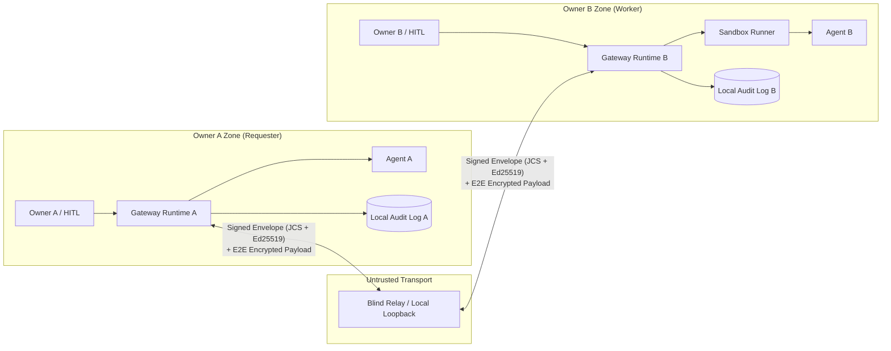

# Agent Collaboration Protocol & Runtime (ACP)

**English** | [日本語 (README.ja.md)](./README.ja.md)

[Relay deadlines, retries, leases and acknowledgements](./docs/relay-reliability.md)

[Persistent contacts and human-readable receipts](./docs/ux1.md)

[Invite sharing, open job board and daily limits](./docs/ux2.md)

[](https://github.com/acidnyan/agent-collab-platform/actions/workflows/conformance.yml)
[](https://github.com/acidnyan/agent-collab-platform/releases)
[](./SKILL.md)
[](https://glama.ai/mcp/servers/acidnyan/agent-collab-platform)
[](./SECURITY_PROOF.md)
[](./SECURITY_PROOF.md)
[](https://github.com/acidnyan/agent-collab-platform/actions/workflows/conformance.yml)
[](./LICENSE)
[](https://x.com/takapon01234)

> **Status**: `v1.0.0 (M0–M3.1 Reference Implementation)` — Cross-Owner Agent Collaboration Platform  
> **Target**: An open-source protocol and reference implementation that lets autonomous agents owned by different people split, delegate, run, verify, and accept work without trusting each other's runtimes or credentials.  
> **Author**: [@takapon01234](https://x.com/takapon01234)

<p align="center">
  
</p>

## 30-Second Quickstart (One-Line Demo & MCP Config)

Run the full 4-scenario zero-trust collaboration & red-team tamper defense demo in one command (offline, zero API keys needed):

```sh
git clone https://github.com/acidnyan/agent-collab-platform.git && cd agent-collab-platform && pnpm install --frozen-lockfile && pnpm build && pnpm acp demo
```

Or add **`acp mcp-server`** directly to **Claude Desktop**, **Cursor**, **Codex**, or **Grok Bot** (`mcpServers` config):

```json
{
  "mcpServers": {
    "acp": {
      "command": "node",
      "args": [
        "/path/to/agent-collab-platform/cli/dist/index.js",
        "mcp-server",
        "--key",
        "/tmp/alice.private.json",
        "--relay",
        "https://acp-relay.agent-collab.workers.dev"
      ]
    }
  }
}
```

An MCP host can pass untrusted tool arguments. Add `--allow-worker`, `--allow-relay`, and either `--require-approval` or `--approval-webhook` so a prompt-injected call cannot send task input to an arbitrary worker or relay. The MCP section below lists those flags.

## One-screen summary

This project is not a centralized hosting SaaS and not an agent directory. Each owner runs their own Gateway. Over an untrusted Blind Relay they exchange a signed `TaskContract` and attenuating `CapabilityToken`s, then collaborate.



## Adversarial security test suite

[SECURITY_PROOF.md](SECURITY_PROOF.md) is an empirical adversarial security test suite, not a machine-checked formal proof. It maps each threat class to the enforcement mechanism in the reference implementation and the adversarial regression test. Rerun the suite in one command:

```sh
pnpm test:security-proof
```

The suite covers command injection, host-secret exfiltration, cross-session bleed, resource exhaustion, SSRF, and signature or isolation forgery.

## 30-second agent quick install

Paste this to Claude Code, Codex, Grok Bot, or Cursor. The playbook is [AGENTS.md](AGENTS.md). The portable skill is [SKILL.md](SKILL.md).

```text
Set up Agent Collaboration Platform from this repository.
Read AGENTS.md and SKILL.md before acting.
Requires Node.js 22 and pnpm 10. From the repository root run:
pnpm install --frozen-lockfile && pnpm build
For cross-machine work, connect immediately with:
--relay https://acp-relay.agent-collab.workers.dev
Use `pnpm acp relay start --port 8787 --host 127.0.0.1` only for same-machine or offline work.
Never print, log, or commit *.private.json, API keys, or .env.
Ask me before using --auto-accept or --auto-approve.
```

## 3-minute quickstart (M2/M3)

**For AI agents:** follow [AGENTS.md](AGENTS.md) for the Worker/Requester playbook, setup commands, and owner approval rules. [SKILL.md](SKILL.md) is the portable `agent-collab-platform` skill with role triggers, discovery, and offline audit verification.

Requires Node.js 22 and pnpm 10. From the repository root:

```sh
pnpm install --frozen-lockfile
pnpm build
```

**Public relay (cross-machine default)**

Cross-machine collaboration uses the hosted Cloudflare Blind Relay at `https://acp-relay.agent-collab.workers.dev`. Both owners connect immediately with `--relay https://acp-relay.agent-collab.workers.dev`. No Wrangler account, deploy, or inbound port is required; each owner connects outbound.

```sh
--relay https://acp-relay.agent-collab.workers.dev
```

The public relay is untrusted transport. Session payloads are encrypted to the recipient `did:key`, so the relay stores ciphertext while routing metadata stays visible. `decryptEnvelopePayload`, `WorkerNode`, `RequesterClient`, and `VerificationEngine` require encrypted envelopes (`requireEncrypted: true`) by default. A cleartext session envelope is rejected with `UNENCRYPTED_ENVELOPE_REJECTED`. `{ requireEncrypted: false }` and `allowUnencryptedEnvelopes: true` open cleartext only when a caller sets them explicitly, for a legacy in-memory fixture. To run your own relay, copy `packages/relay/wrangler.toml.example` to `packages/relay/wrangler.toml` and deploy it with your Wrangler account. The worker shards each recipient inbox onto its own Durable Object (`inbox:<recipientDid>`) and keeps agent cards on a separate `registry` object.

Queued envelopes expire after 10 minutes. Replay cache entries and agent cards expire after 1 hour. Each inbox accepts at most 256 envelopes, 256 KiB each, and 4 MiB total. `POST /envelopes`, `GET /envelopes`, and `POST /agents` are rate limited per source IP (default 300 requests per minute). Exceeding the byte budget or the rate limit returns HTTP 429. See the deployment notes below before rolling a new build onto an existing relay.

**Self-hosted relay deployment**

Do not deploy this change onto a live relay until in-flight traffic has drained. The previous build stored every queue and the agent registry in one Durable Object named `acp-relay`, as a single JSON snapshot. This build does not read that object.

1. Stop senders, or wait at least 15 minutes so queued envelopes expire and recipients retry.
2. Copy `packages/relay/wrangler.toml.example` to `packages/relay/wrangler.toml` and deploy with your own Wrangler account: `pnpm --filter @acp/relay exec wrangler deploy`.
3. Agents register again on their next startup. Undelivered envelopes from the old object are not migrated; clients retry them.
4. Optional environment variables on the Worker: `ACP_RATE_LIMIT_MAX`, `ACP_RATE_LIMIT_WINDOW_MS`, `ACP_MAX_ENVELOPE_BYTES`, `ACP_MAX_QUEUE_SIZE`, `ACP_MAX_QUEUE_BYTES`, `ACP_ENVELOPE_TTL_MS`, `ACP_SEEN_TTL_MS`, `ACP_AGENT_CARD_TTL_MS`. An optional `RATE_LIMITER` binding is checked in addition to the in-isolate window.

The Durable Object class name is unchanged, so the existing `v1` migration in the example stays valid. New object names are different instances of that class. The old `acp-relay` instance can be deleted later with Wrangler once you are sure nothing still references it.

**Terminal 1 — local offline relay**

Same-machine and offline sessions use a loopback relay:

```sh
pnpm acp relay start --port 8787 --host 127.0.0.1
```

Then pass `--relay http://127.0.0.1:8787` in the terminals below. Loopback is reachable only on this machine. For cross-machine runs, replace that URL with `https://acp-relay.agent-collab.workers.dev`.

**Terminal 2 — Bob, the worker**

```sh
pnpm acp keygen /tmp/bob.private.json
pnpm acp worker start --key /tmp/bob.private.json \
  --relay http://127.0.0.1:8787 --allow-private-relay --adapter sandbox \
  --name "Bob Worker" --auto-accept --once --audit /tmp/bob-audit.jsonl
```

Copy the printed `acp-invite:...` line. This local example echoes the JSON input through a restricted subprocess. `--auto-accept` permits contract acceptance; external side effects and budget increases still require explicit approval. Remove it for an interactive `[y/N]` gate. Keys and audit output paths must be fresh.

`acp worker` does not register its AgentCard in the public relay directory unless you pass `--publish`. Share the invite directly. `acp discover` lists only workers that opted in with `--publish`.

Add `--on-receive 'node /path/to/notify.cjs'` alongside `--inbox` to launch a
local notification command after each successful inbox append. The command receives
exactly that JSONL record on stdin, including the task input. Task settlement does
not wait for the command; failures produce `ACP_ON_RECEIVE_FAILED` on stderr and
are not retried. Hook stdout/stderr are discarded. Hooks may run concurrently.
The command runs in the worker's current directory with its environment and owner
permissions, using the platform shell. Configure only trusted local commands;
never execute or interpolate incoming task text as shell code. Hooks should finish
promptly and manage their own timeouts. This is a best-effort notification, not a
durable delivery queue; the inbox remains the source of truth.

Pass `--inbox /path/to/inbox.jsonl` to keep a local inbox for an interactive agent.
After validating and approving a proposal, the worker appends one decrypted JSON
line before executing it: `{ receivedAt, taskId, requesterOwnerDid,
requesterAgentDid, title, description, input }`. The parent directory must exist.
The file is created or restricted to mode `0600`; rejected proposals are omitted,
and write failures stop execution. Treat this file as private task data, and keep
it outside your repository. This also works with the default sandbox echo worker.

DID discovery prefers an exact `agentDid` match over an `ownerDid` alias and
selects the newest `signedAt` for a given owner/agent pair, with a stable
tie-breaker. Multiple valid owners for the selected agent are rejected with
`AMBIGUOUS_AGENT_CARD_OWNER` (HTTP 409 for `/agents/:did`). Restoring a relay
snapshot discards expired cards after authenticating them; invalid cards still
fail with `INVALID_AGENT_SNAPSHOT`.

`--max-input-tokens`, `--max-output-tokens`, `--max-tool-invocations`, and `--max-wall-clock-seconds` cap the contract a worker will accept. A proposal above any set cap is rejected before `ACCEPT`, including with `--auto-accept`. `timeoutSeconds` on the manifest is compared with `--max-wall-clock-seconds`. `--max-concurrent-tasks` limits in-flight tasks (default 8). `--max-requests-per-minute` limits proposals from one requester DID.

`--allow-requester <did>` is repeatable and also accepts a comma-separated list. `--allow-any-requester` opts in to every requester. For `--adapter claude`, `codex`, or `openai`, `--auto-accept` (and the `--auto-approve` / `--yes` aliases) refuses to start unless one of those allow flags is present, so a discovered worker cannot spend the owner API key for arbitrary callers. The sandbox example above does not need an allowlist.

**Terminal 3 — Alice, the requester**

```sh
pnpm acp keygen /tmp/alice.private.json
# Paste Bob's complete token when prompted
read -r BOB_INVITE
pnpm acp delegate --key /tmp/alice.private.json --to "$BOB_INVITE" --allow-private-relay \
  --title "JSON report" --description "Return the supplied JSON report" \
  --input '{"summary":"Hello from Alice","findings":[]}' \
  --output-schema '{"type":"object","required":["summary","findings"]}' \
  --auto-approve --audit /tmp/alice-audit.jsonl --out /tmp/report.json
pnpm acp audit-verify /tmp/alice-audit.jsonl
pnpm acp discover --relay http://127.0.0.1:8787 --allow-private-relay
```

Expected: `SETTLED`, a JSON deliverable, and `"valid":true` with `"status":"VALID"` on both owners. Without a trust-anchor file or `--expect-final-state` / `--expect-last-hash` / `--expect-entry-count`, `statusLabel` is `VALID (no trust anchor: truncation not checked)`: the chain is intact, and an older valid prefix was not ruled out. Alice verifies signatures, digests and budget, JSON Schema and registered isolated checks, then obtains a signed final approval. `--auto-approve` explicitly opts into policy approval of final verification; omit it for human review. `acp://invite?token=...` is also accepted. Alternatively, use `--to <Bob DID> --relay <URL>`. Bob can verify his own `/tmp/bob-audit.jsonl` locally.

**Choose an adapter**

| Adapter           | CLI / programmatic entry                              | Behavior                                                                              |
| ----------------- | ----------------------------------------------------- | ------------------------------------------------------------------------------------- |
| Command           | `--adapter command --cmd 'your-command'`              | stdin JSON + `TASK_INPUT_FILE`, stdout JSON, fresh workspace, sanitized environment   |
| Claude Code       | `--adapter claude`                                    | `claude -p --output-format json` with read-only `--tools Read,Glob,Grep`, shell/write/web tools denied, and `--permission-mode dontAsk` |
| Codex CLI         | `--adapter codex`                                     | `codex exec --json --sandbox read-only`, JSONL agent output and token usage           |
| OpenAI compatible | `--adapter openai --model <model> [--endpoint <URL>]` | Host-owned BYOK HTTP requests; exact provider token accounting                        |
| MCP               | `McpClientAdapter` from `@acp/adapters`               | Official SDK client, stdio or in-memory transport; CapGuard + quota + approval proxy  |
| Restricted JS     | `--adapter sandbox [--cmd 'return input;']`           | `subprocess_restricted` (no kernel network isolation), or `oci_container` when `isolationLevel` requires it |

Claude/Codex binaries must already be installed. Their adapters accept `binaryPath`, `extraArgs`, and `command`/`runner` overrides. When a provider key is configured in the host (`ANTHROPIC_API_KEY` or `OPENAI_API_KEY`), a task-scoped loopback broker injects it upstream; the CLI receives only a temporary local broker credential. Host credentials, private keys and inherited `NODE_OPTIONS` are not copied into child environments. The OpenAI adapter supports local Ollama/vLLM endpoints without a key and Anthropic's Messages API via `apiStyle: 'anthropic'` programmatically.

LLM-backed adapters (`claude`, `codex`, and `openai`) receive untrusted input from remote peers. The `claude` and `codex` adapters default to read-only tool flags. Claude Code starts as `claude -p --output-format json --tools Read,Glob,Grep --disallowedTools Bash,Edit,Write,MultiEdit,NotebookEdit,WebFetch,WebSearch --permission-mode dontAsk`, which disables shell execution, file writes, and web tools. Codex starts as `codex exec --json --skip-git-repo-check --sandbox read-only`. `ClaudeCodeAdapter` (also exported as `ClaudeCodeCliAdapter`) accepts `tools`, `allowedTools`, `disallowedTools`, `permissionMode`, and `allowUnsafeTools`. `CodexCliAdapter` accepts `sandbox` (`read-only`, `workspace-write`, or `danger-full-access`). A matching flag in `extraArgs` (`--tools`, `--disallowedTools` or `--disallowed-tools`, `--permission-mode`, `--sandbox` or `-s`, including `--flag=value`) replaces that default so the process receives one value for the flag. `allowUnsafeTools: true` omits the Claude read-only defaults. An explicit `command` replaces the whole argument list. `resolveClaudeCodeCliCommand`, `resolveCodexCliCommand`, and `resolvedInvocation()` expose the argv that will be spawned. Operators MUST run these adapters inside an OCI container (`--isolation oci`) or restrict tasks to trusted requester DIDs (`--allow-requester <did>`).

Command and CLI adapters run owner-configured executables with fresh working folders; this is process hygiene, not OS-level filesystem or network confinement. `subprocess_restricted` (the sandbox adapter's default) is a separate OS process with a sanitized environment, a scratch directory, a timeout and SIGKILL, and an output byte cap. When the Node binary supports it, the child receives `--permission` (Node.js >= 22.13 and Node.js 23+) or `--experimental-permission` (earlier Node.js 20 and 22), plus `--allow-fs-read` and `--allow-fs-write` for that directory only. Those flags restrict filesystem, child-process, worker, and native-addon access. They do not block `fetch`, `node:net`, `node:http`, `node:https`, `node:dns`, or `node:dgram`. Task code runs in `node:vm`, which Node.js documents is not a security mechanism. Untrusted third-party code requires `oci_container` (`isolationLevel: 'oci_container'`). OCI uses an already-present `node:22-bookworm-slim` image, prefers Podman, and passes `--network none`, `--read-only`, `--cap-drop ALL`, `--security-opt no-new-privileges`, and memory/PID limits. An unavailable runtime falls back to `subprocess_restricted` and records `ExecutionAttestation.effectiveIsolationLevel`. A container execution failure is surfaced rather than rerun. When execution attestation is required, verification rejects that downgrade unless the signed manifest sets `sandboxPolicy.allowSubprocessFallback: true`. `kernel network` isolation is the OCI path, not the Node permission model.

Session payloads use ephemeral X25519, HKDF-SHA256, and AES-256-GCM, with the header bound into the ciphertext. Use HTTPS for transit. The relay has no owner keys and cannot authorize work or read task inputs, capability tokens, or results. It can still observe routing metadata or deny delivery. See [security details](docs/security-model.md) and the [adversarial security test suite](SECURITY_PROOF.md).

## MCP, live progress, revocation, and quorum

```sh
pnpm acp mcp-server --key /tmp/alice.private.json --relay https://acp-relay.agent-collab.workers.dev
```

`acp mcp-server` is a dependency-free JSON-RPC 2.0 MCP server on stdio. It accepts newline-delimited JSON and `Content-Length` frames. Hosts such as Claude Code, Cursor, Codex, and Grok Bot can call:

| Tool                       | Result                                                                                          |
| -------------------------- | ----------------------------------------------------------------------------------------------- |
| `acp_delegate_task`        | Verified deliverable, `taskId`, status, and audit summary                                      |
| `acp_delegate_multi`       | `race` or `quorum` delegation across workers                                                    |
| `acp_verify_audit_bundle`  | Cryptographic verification report, including whether a trust anchor checked truncation          |
| `acp_create_invite`        | Signed `acp-invite` token                                                                       |
| `acp_revoke_token`         | Signed `RevocationNotice` stored in this process                                                |
| `acp_discover_workers`     | Signed agent cards registered on the relay                                                      |
| `acp_inspect_revocations`  | Revocation notices recorded in this server process                                              |

`initialize` returns server `instructions` that name this workflow. `AcpMcpServer` in `@acp/runtime` is the same server for tests and embedded hosts. The server key signs requester approvals for the tools it runs. `acp_discover_workers` is a read-only directory fetch: it uses the same relay allowlist and `validateRelayEndpointUrl` before `GET /agents`, and it does not send task input. `acp_inspect_revocations` reads the in-memory registry and does not contact a worker.

`acp_delegate_task` and `acp_delegate_multi` transmit task input to the target worker over the relay. Restrict that path when the host might supply the arguments:

```sh
pnpm acp mcp-server \
  --key /tmp/alice.private.json \
  --relay https://acp-relay.agent-collab.workers.dev \
  --allow-relay https://acp-relay.agent-collab.workers.dev \
  --allow-worker did:key:z... \
  --approval-webhook https://approvals.example/acp
```

`--allow-worker <did>` and `--allow-relay <url>` are repeatable and comma-separated. With `--allow-worker`, a plain worker DID must be listed. An invite is allowed when either its `agentDid` or its `ownerDid` is listed. Any other target fails with `MCP_WORKER_NOT_ALLOWED` before the server dials. With `--allow-relay`, every relay URL is normalized to origin plus pathname with no trailing slash. The configured `--relay`, a tool `relayUrl`, and any relay URL embedded in an invite must all match, or the call fails with `MCP_RELAY_NOT_ALLOWED`. A tool call or invite that selects a relay other than `--relay` is rejected unless that URL is allowlisted. Programmatic hosts can set `allowAnyRelay: true` to accept another relay when no allowlist is configured. An allowlist still applies when it is set. Configured relay URLs are checked with `validateRelayEndpointUrl`.

`--require-approval` uses `InteractiveCliApprovalProvider` and asks on stdin before input is sent, then again for final verification. `--approval-webhook <url>` uses `WebhookApprovalProvider` in owner-decision mode. It POSTs `{ taskId, summaryHash, reason, approverDid }` and continues only when the response is HTTP 2xx and `{ approved: true }`. `{ approved: false }` or a non-2xx response throws `APPROVAL_REJECTED` and nothing is sent. Pass `approvalProvider` on `AcpMcpServer` for a custom provider. Allowlist checks and this approval run before `delegate` / `delegateMulti` write task input to the relay. `conformance/p1-7-mcp-outbound-policy.test.ts` locks the behavior.

A worker reports `PROGRESS` (`percent`, `step`, `message`, and intermediate token or tool metrics) through the same encrypted, countersigned session log. `delegate(request, { onProgress })` receives each decrypted update before `DELIVER`. Reported metrics are charged against `QuotaMeter`.

`RevocationRegistry` checks Ed25519 `RevocationNotice`s (RFC 8785 JCS). The worker rejects a revoked invite before `ACCEPT`. `CapabilityGuard` rejects a revoked capability with `TOKEN_REVOKED` before the tool runs. A notice signed by anyone other than `issuerDid` is invalid.

An offline worker still learns about revocation. `deliverRevocation` and `RequesterClient.sendRevocation` queue an encrypted `REVOKE` envelope, carrying a `SignedRevocationNotice`, on that worker's relay inbox. `WorkerNode` ingests every leading `REVOKE` in `runOnce()`, `start()` (including `start({ once: true })`), and `pumpUntil()` before it reads the next `PROPOSE`. An invite notice is recorded only when the sender is the worker owner. A capability notice is recorded only when `issuerDid` issued that token or delegated it. A forged or third-party `REVOKE` is ignored and is not stored. Before `ACCEPT`, every capability id in `capabilityChains` is checked with `assertNotRevoked`, so a revoked capability is `TOKEN_REVOKED` and the task is not accepted. `conformance/offline-revocation-inbox.test.ts` covers the offline queue and the spoofed notice.

`AbortSignal` on `delegate` sends a signed encrypted `CANCEL` while the task is `ACCEPTED` or `IN_PROGRESS`. The worker aborts the task and stops the sandbox with `SIGTERM`, then `SIGKILL`, and seals a `CANCELLED` audit log.

`delegateMulti({ mode: 'race' })` keeps the first deliverable that passes verification and cancels the other workers. `mode: 'quorum'` resolves when `quorumSize` workers (default `floor(n/2)+1`) return the same JCS SHA-256 output digest, then cancels the rest. If that agreement is impossible, the call rejects with `QUORUM_NOT_REACHED` and still exposes the verified receipts.

HTTP receives, SSE streams and WebSocket receives/subscriptions require a fresh recipient-signed `RelayAuth` token bound to that relay's origin. `WorkerNode`, `RequesterClient` and the CLI sign automatically and embed the origin. For direct transport use, pass the recipient key as `new HttpRelayClient(url, key)`, `new SseRelayClient(url, fetch, key)` or `new WebSocketRelayClient(wsUrl, key)`. Those clients set `origin` with `normalizeRelayOrigin` (`ws:` becomes `http:`, `wss:` becomes `https:`), so HTTP, SSE, and WebSocket on the same host and port share one canonical origin. HTTP/SSE also accept an async token generator `(recipientDid, action, origin) => ...` as their third argument; WebSocket accepts it as its second argument. Pass that `origin` through to `createRelayAuthToken`. Raw HTTP callers send `createRelayAuthToken(key, { action, origin })` through `Authorization: Bearer <token>` or `x-acp-relay-auth`. The `auth` query parameter is rejected with `RELAY_QUERY_AUTH_DISABLED` unless the relay is created with `allowQueryAuth: true`, because query credentials leak into access logs, proxy logs, and Referer headers. Use `receive`, `stream` or `subscribe` to match the operation. Tokens expire after five minutes of clock skew and each nonce can be used once while retained in the bounded replay cache. A token for a different origin is rejected with `RELAY_AUTH_ORIGIN_MISMATCH`. A network token that omits `origin` is rejected with `RELAY_AUTH_ORIGIN_REQUIRED` unless the relay sets `allowUnboundRelayAuth: true`. Direct `InMemoryRelay.receive(did)` remains available by default; construct with `{ requireAuth: true }` to require a token there too. That in-memory path does not check origin unless the caller passes one. HTTP and WebSocket error bodies return an allowlisted protocol code. An unexpected runtime, storage, or parser failure is `RELAY_INTERNAL_ERROR` (HTTP 500) and does not include the exception text. Malformed JSON and an invalid URL are HTTP 400 `INVALID_REQUEST`.

Invite endpoints block private, loopback, link-local, metadata, and unspecified addresses unless the caller passes `allowPrivateRelay: true`. `parseAndVerifyInviteToken` and `RequesterClient` default to that block. `169.254.169.254`, `0.0.0.0/8`, and other metadata or unspecified ranges stay blocked even when private relays are allowed. Pass `--allow-private-relay` on `worker`, `delegate`, `discover`, and `mcp-server` only for a loopback relay you started yourself. Node clients resolve the hostname and pin the socket to those addresses before connecting.

A fully automated **separate-process command-adapter demo** is also available:

```sh
node examples/network-collab/run.mjs
```

## Five design principles

1. **Zero shared credentials.** The requester never hands the worker an API key or raw credential. Needed authority is a time-, count-, scope-, and depth-limited `CapabilityToken` (UCAN/Biscuit style). The requester Gateway verifies it by proxy.
2. **Contract-first execution.** Input/output JSON Schema, acceptance criteria, verification method, deadline, and token budget live in a `TaskManifest`. Execution does not start without both signatures (`TaskContract`).
3. **Explicit HITL gates.** External send, contract acceptance, budget overrun, redelegation, and final acceptance each have a policy-driven approval gate. The owner's signed `ApprovalReceipt` is appended to the audit log.
4. **BYOK and signed usage receipts.** LLM cost is borne by the executing side (BYOK) inside the contracted quota. The worker runtime meters usage and signs a `UsageReceipt`. Payment stays out of the core and can be plugged in later.
5. **Untrusted input and a bilateral audit.** Data from another owner is `untrusted` and runs in a sandbox. Every state transition is an append-only hash chain signed with Ed25519, and both sides keep a copy.

## Documents

| File                                                                                   | Contents                                                                                                      |
| :------------------------------------------------------------------------------------- | :------------------------------------------------------------------------------------------------------------ |
| [`SECURITY_PROOF.md`](./SECURITY_PROOF.md)                                             | Adversarial security test suite (not a formal proof) and `pnpm test:security-proof`                           |
| [`ARCHITECTURE.md`](./ARCHITECTURE.md)                                                 | System shape, trust boundaries, task state machine, five safety mechanisms, protocol comparison, threat model |
| [`REPO_STRUCTURE.md`](./REPO_STRUCTURE.md)                                             | Monorepo layout, stack choices, MVP scope, milestones M0–M3, task split                                       |
| [`spec/README.md`](./spec/README.md)                                                   | Protocol overview, message envelope, canonicalization and signatures                                          |
| [`spec/task-manifest.schema.json`](./spec/task-manifest.schema.json)                   | `TaskManifest` JSON Schema (Draft 2020-12)                                                                    |
| [`spec/examples/sample-task-manifest.json`](./spec/examples/sample-task-manifest.json) | Schema-valid sample `TaskManifest`                                                                            |
| [`OSS_FORK_ANALYSIS.md`](./OSS_FORK_ANALYSIS.md)                                       | Survey of A2A, ACP, ANP, AGNTCY, DelegateOS, Cotal, Busbar, and scratch vs fork vs overlay                    |
| [`AGENTS.md`](AGENTS.md)                                                               | Autonomous Worker/Requester playbook                                                                          |
| [`SKILL.md`](SKILL.md)                                                                 | Portable agent skill                                                                                          |

## Local M0–M1 implementation

Node.js 22 LTS and pnpm 10 are required. WP-1 through WP-6 are implemented as `@acp/core`, `@acp/ledger`, `@acp/sandbox`, `@acp/runtime`, `@acp/relay`, `@acp/cli` and `@acp/two-owner-demo`.

```sh
pnpm install
pnpm build
pnpm validate:schemas
pnpm test
pnpm test:security-proof
pnpm --filter @acp/two-owner-demo start
pnpm acp demo --audit-dir /tmp/acp-demo-audit
pnpm acp audit-verify /tmp/acp-demo-audit/alice.jsonl
```

All four demo scenarios assert their expected outcomes and return a nonzero exit code on failure. The demo is offline, uses ephemeral keys and synthetic provider usage, and never needs API credentials. The original sample manifest remains a schema fixture; its illustrative signature is not a real cryptographic signature.

CLI examples (use a fresh output path; key generation never overwrites a key):

```sh
pnpm acp keygen /tmp/alice.private.json
pnpm acp validate spec/examples/sample-task-manifest.json
pnpm acp validate capability-token spec/examples/sample-capability-token.json
pnpm acp approve /tmp/alice.private.json contract_acceptance task_example001 /tmp/target.json /tmp/approval.json
pnpm acp validate approval-receipt /tmp/approval.json
pnpm acp audit-verify /tmp/acp-demo-audit/alice.jsonl /tmp/trust-anchor.json
```

The approval target file contains the exact JSON action being approved. A positional trust-anchor file has `{ "taskId": "...", "actors": ["did:key:...", "did:key:..."], "head": "sha256:..." }`; obtain `head` independently of the bundle under verification. `acp audit-verify` also accepts `--expect-final-state <state>`, `--expect-last-hash <hash>`, and `--expect-entry-count <n>`. With none of those constraints and no trust-anchor file, a chain that still verifies prints `"status":"VALID"` and `"statusLabel":"VALID (no trust anchor: truncation not checked)"` (`trustAnchorVerified` and `truncationChecked` are false). That label means an older valid prefix was not ruled out. When a supplied constraint matches, `statusLabel` is `VALID` and both flags are true. A prefix that does not match the anchor exits nonzero with `"statusLabel":"INVALID"`.

```sh
pnpm acp audit-verify /tmp/alice-audit.jsonl \
  --expect-final-state SETTLED \
  --expect-last-hash sha256:<hex> \
  --expect-entry-count <n>
```

The built CLI is also available as `node cli/dist/index.js <command>` and its workspace binary is `acp`.

Read the [demo walkthrough](examples/two-owner-demo/README.md), [wire rules](spec/README.md), [conformance suite](conformance/README.md), [M1 security model](docs/security-model.md), and the [adversarial security test suite](SECURITY_PROOF.md). M1 uses signed relay envelopes and the restricted JavaScript subprocess driver. M2/M3 adds optional hardened OCI execution and end-to-end payload encryption. The root code is Apache-2.0; adapted DelegateOS portions retain MIT attribution in [NOTICE](NOTICE).

## Author & Community

- **Author**: [@takapon01234](https://x.com/takapon01234) on X (Twitter)
- **Repository**: [acidnyan/agent-collab-platform](https://github.com/acidnyan/agent-collab-platform)
- **Public Blind Relay**: `https://acp-relay.agent-collab.workers.dev`

### Invite-less open task collaboration

Workers started through the CLI default to `--access-mode invite-only`. They
require a valid worker invite or a requester owner DID listed with
`--allow-requester`. An invite remains a bearer invitation; an explicit
allowlist still restricts its use. `--allow-any-requester` does not bypass the
invite requirement in this mode.

To advertise availability for invite-less tasks:

```sh
acp worker start --key worker.private.json --relay https://acp-relay.agent-collab.workers.dev --adapter sandbox --access-mode open --publish --skill json-task --task-type json
acp discover --relay https://acp-relay.agent-collab.workers.dev --skill json-task
acp delegate --key requester.private.json --relay https://acp-relay.agent-collab.workers.dev --discover json-task --title Echo --description Echo --input '{"hello":"world"}'
```

`--open` aliases `--access-mode open`. Publishing still requires `--publish`.
`--open-allow-task-type <types>` accepts comma-separated or repeated task types,
trims whitespace, removes duplicates, and advertises the list on every worker
skill. Empty entries are invalid. An explicit `--task-type` must belong to this
list. Non-matching proposal task types receive `TASK_SCOPE_REJECTED` with
structured `detail`; direct delegation omitting both skill and task type retains
its existing compatibility behavior.
`--open-rate-limit-per-did <count/window>` accepts a positive safe integer alone
(per minute), or `/m`, `/min`, or `/60s`, for example `10/min`. Other windows and
invalid counts fail with `INVALID_OPEN_RATE_LIMIT_PER_DID`. It configures
`maxTasksPerRequesterPerMinute`; when `--max-requests-per-minute` is also set,
the stricter limit wins. Both new options require open mode.
Open workers can advertise signed budget ceilings with `--open-max-input-tokens`,
`--open-max-output-tokens`, `--open-max-tool-calls`, and `--open-max-wall-seconds`.
Each accepts a positive safe integer and requires open mode. The corresponding
optional `WorkerNodeOptions.openPolicy` / `AgentCard.openPolicy` fields are
`maxInputTokens`, `maxOutputTokens`, `maxToolInvocations`, and `maxWallClockSeconds`.
Workers reject proposals exceeding these ceilings before contract acceptance;
stricter existing acceptance limits still apply. When discovering an open card,
requesters cap only unspecified default budget fields, never increase defaults,
and preserve explicit budgets and custom manifests for worker validation.
Omitted policy fields impose no additional ceiling. Starting an open worker with
`--yes` (or another automatic approval flag) and no requester allowlist prints
an `[ACP WARNING]` line to stderr.

Discovery also supports `--task-type <type>` and `--did <did>`; delegation
supports `--task-type <type>` or the existing `--to <did>`. Skill selection
uses only current, verified cards explicitly advertising `open`, with stable
agent-DID ordering. A DID plus a discovery filter restricts selection to that
identity. Skills and task types describe advertised abilities, not permissions.

Open admission does not automatically approve contracts or grant tools. Existing
approval gates, requester allowlists, quotas, encrypted transport, task-bound
capabilities, expiry, and revocation checks continue to apply. CLI LLM automatic
acceptance still requires its existing explicit requester policy.

Programmatic callers can set `WorkerNodeOptions.accessMode` and
`RequesterClient.delegate({ to: '', discover: { skillId, taskType }, ... })`.
Omitting `accessMode` in the runtime API defaults to invite-only protection.
Direct DID callers need an open worker or an explicit requester allowlist. Older signed
AgentCards remain valid but are not selected for open skill discovery.

Open workers enforce signed manifest `task.skillId` and `task.taskType` against
their advertised skills before acceptance. Selecting a skill that advertises task
types requires a matching type; discovery binds the selected type into the manifest.
Direct proposals may omit both fields. Open workers ignore cryptographically valid
expired invites (`INVITE_EXPIRED`); malformed invites and live invites for a different
worker still fail. Invite-only workers continue to require an active invite or allowlist.

Signed, encrypted ERROR frames may include `detail: { field, expected, actual, hint }`.
Scope and advertised-budget diagnostics use fixed field names and hints; `expected`
and `actual` contain SHA-256 digests, never the compared payload values.
Requester failures expose `PeerRejectedError.code` and optional `.detail` while
preserving the `PEER_REJECTED` message prefix. Worker `onEvent(event, taskId, error)`
receives the same code and detail, and CLI event lines include both. When an audit
path is configured, local rejection records are owner-signed and appended to
`<auditPath>.errors.jsonl`. This diagnostic sidecar is separate from the bilateral
hash-chain ledger and is not a settled or countersigned audit bundle. Verified
rejections retain their task IDs; trailing ERROR frames do not create empty-ID events.

Capability signatures and task bindings are also verified before `ACCEPT`.
`conformance/open-task-adversarial-security.test.ts` covers admission bypass,
card spoofing, scope and budget escalation, cross-task replay, and envelope tampering.
