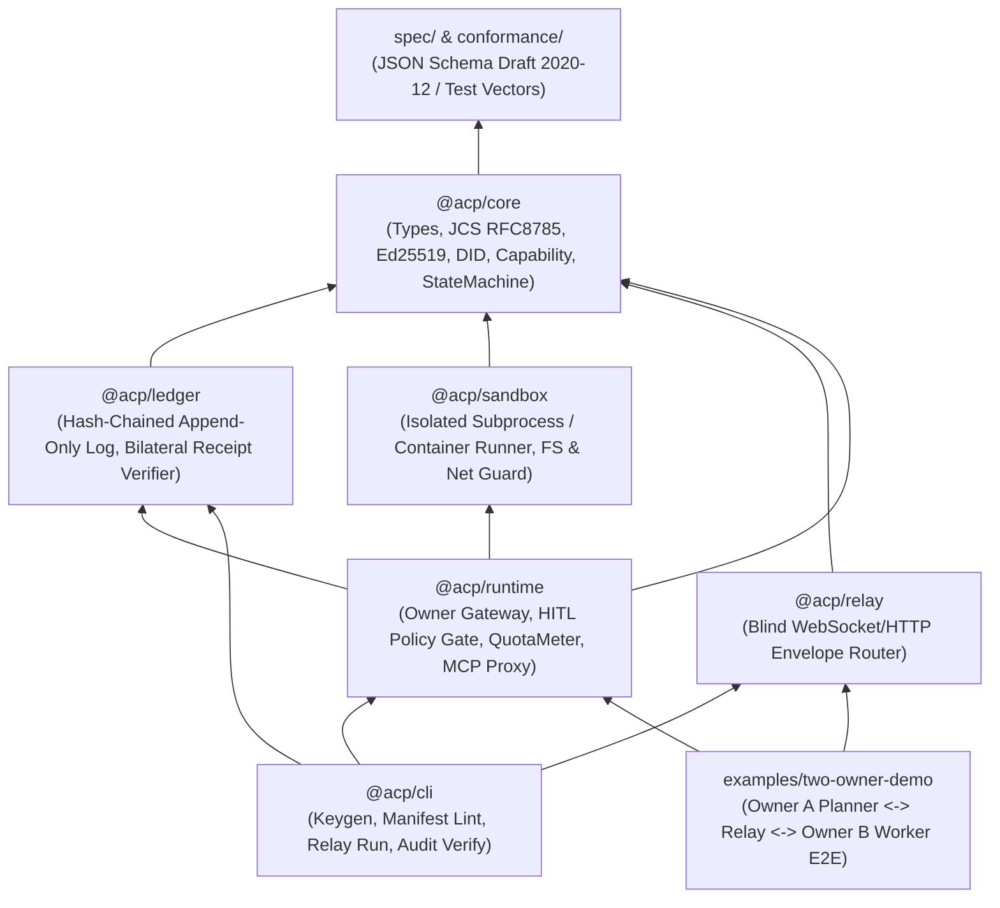

# REPO_STRUCTURE: モノレポ構成・技術スタック・MVPロードマップ

[English (REPO_STRUCTURE.md)](./REPO_STRUCTURE.md) | **日本語**

**結論**: プロトコル仕様（`spec/`）と適合性テストベクタ（`conformance/`）を言語非依存の「正（Single Source of Truth）」として最上位に置き、リファレンス実装（`packages/*`）は **TypeScript (Node.js 22 LTS + pnpm workspace)** で最小依存に構築する。最初のマイルストーン（MVP / M1）は、**「異なる鍵ペアを持つ2つのOwner Gatewayが、Untrusted Relay越しに1つのタスクを契約・Capability制限付きツール呼び出し・自動検収・双方向監査ログ記録まで完遂するE2Eデモ」** とする。

---

## 1. パッケージ依存関係とモノレポ構成

### 1.1 パッケージ依存グラフ（レイヤ規律）

循環依存を禁止し、下位レイヤ（`spec` → `core`）は上位レイヤ（`runtime`, `relay`, `cli`）を一切参照しない。



### 1.2 ディレクトリツリー案

```text
agent-collab-platform/
├── README.md                          # プロジェクト概要（1画面サマリ）
├── ARCHITECTURE.md                    # 全体アーキテクチャ・信頼境界・安全設計
├── REPO_STRUCTURE.md                  # リポジトリ構成・技術スタック・MVP計画（本書）
├── LICENSE                            # Apache-2.0 または MIT（オーナー判断事項）
├── package.json                       # pnpm workspace root
├── pnpm-workspace.yaml
├── tsconfig.base.json
│
├── spec/                              # 【言語非依存】プロトコル仕様 & JSON Schema
│   ├── README.md                      # エンベロープ・正規化・署名・状態遷移仕様
│   ├── task-manifest.schema.json      # TaskManifest スキーマ (Draft 2020-12)
│   ├── capability-token.schema.json   # CapabilityToken スキーマ (M0で追加)
│   ├── envelope.schema.json           # SignedEnvelope / AckReceipt スキーマ (M0で追加)
│   ├── audit-entry.schema.json        # AuditLogEntry / UsageReceipt スキーマ (M0で追加)
│   └── examples/
│       └── sample-task-manifest.json  # スキーマ検証用サンプルマニフェスト
│
├── conformance/                       # 【言語非依存】実装適合性テストベクタ
│   ├── README.md                      # テストベクタ仕様（将来Python/Go/Rust実装を検証）
│   ├── jcs-signing-vectors.json       # RFC 8785 正規化＋Ed25519署名の一致ベクタ
│   ├── capability-attenuation.json    # 正常減衰ケースと権限昇格拒否ケースのベクタ
│   └── state-transitions.json         # 状態機械の正常遷移・不正遷移ベクタ
│
├── packages/
│   ├── core/                          # @acp/core: ゼロ外部通信の純粋関数コア
│   │   ├── src/
│   │   │   ├── crypto/                # did:key, Ed25519署名/検証, RFC 8785 JCS, SHA-256
│   │   │   ├── capability/            # CapabilityToken発行・減衰検証ロジック
│   │   │   ├── contract/              # TaskManifest / TaskContract 検証・状態機械
│   │   │   └── index.ts
│   │   └── test/
│   │
│   ├── ledger/                        # @acp/ledger: 追記専用ハッシュチェーン監査台帳
│   │   ├── src/
│   │   │   ├── store.ts               # JSONL / SQLite 追記ストア
│   │   │   ├── verifier.ts            # 双方向署名・ハッシュ連鎖の完全性検証器
│   │   │   └── index.ts
│   │   └── test/
│   │
│   ├── sandbox/                       # @acp/sandbox: 受託タスク隔離実行アダプタ
│   │   ├── src/
│   │   │   ├── driver.ts              # SandboxDriver インターフェース
│   │   │   ├── local-process.ts       # MVP用: 制限付き一時ディレクトリ＋環境変数遮断ドライバ
│   │   │   ├── container.ts           # M2用: Docker / OCI rootless コンテナドライバ
│   │   │   └── index.ts
│   │   └── test/
│   │
│   ├── runtime/                       # @acp/runtime: 各オーナーが動かす Gateway Runtime
│   │   ├── src/
│   │   │   ├── gateway.ts             # メッセージ送受信・契約ライフサイクル管理
│   │   │   ├── hitl-gate.ts           # 承認ゲート（Policy評価 + ApprovalReceipt署名）
│   │   │   ├── mcp-proxy.ts           # CapabilityToken で絞った MCP ツールプロキシ
│   │   │   ├── quota-meter.ts         # トークン・API呼び出し回数計量 & UsageReceipt発行
│   │   │   ├── verifier.ts            # 納品物のSHA-256・JSON Schema・自動チェック検証
│   │   │   └── index.ts
│   │   └── test/
│   │
│   └── relay/                         # @acp/relay: 非信頼メッセージ中継サーバー
│       ├── src/
│       │   ├── server.ts              # WebSocket / HTTP SSE ベースの Blind Relay
│       │   ├── memory-transport.ts    # テスト・ローカル単一マシン検証用インメモリバス
│       │   └── index.ts
│       └── test/
│
├── cli/                               # @acp/cli: 開発・運用・監査検証用CLI (`acp`)
│   ├── src/
│   │   ├── commands/
│   │   │   ├── keygen.ts              # Owner / Agent の did:key ペア生成
│   │   │   ├── validate.ts            # TaskManifest / Schema 検証
│   │   │   ├── approve.ts             # HITL 承認署名コマンド
│   │   │   └── audit-verify.ts        # 監査ログバンドルのオフライン改ざん検証
│   │   └── index.ts
│   └── package.json
│
├── examples/
│   └── two-owner-demo/                # MVP E2Eデモ（Owner Alice と Owner Bob の協働）
│       ├── README.md
│       ├── alice-policy.json          # 依頼側オーナーのHITL・権限ポリシー
│       ├── bob-policy.json            # 受託側オーナーの受諾・クォータポリシー
│       └── run-demo.ts                # 正常系＋攻撃遮断系を一気通貫で実証するスクリプト
│
└── docs/
    ├── protocol-walkthrough.md        # メッセージシーケンス詳細解説
    └── security-model.md              # 脅威モデルと運用ガイド
```

---

## 2. 技術スタック選定と理由

### 2.1 採用スタック（MVP）

- **言語・ランタイム**: **TypeScript 5.x (Strict mode) + Node.js 22 LTS**
  - **理由**: MCP SDK（`@modelcontextprotocol/sdk`）やA2A JS SDK、JSON Schemaエコシステムとの親和性が最も高く、Web/CLI/Relay/Runtimeを単一言語で高速に一気通貫実装できるため。
- **暗号・署名プリミティブ**: **Node.js 標準 `node:crypto` (Ed25519 / X25519 / SHA-256)**
  - **理由**: 外部ネイティブアドオンや怪しい暗号ライブラリへの依存をゼロにし、サプライチェーン攻撃リスクを最小化するため。
- **スキーマ検証**: **JSON Schema Draft 2020-12 (`ajv` v8)**
  - **理由**: 言語非依存で `spec/*.schema.json` をそのまま配布でき、将来Python（`jsonschema` / `pydantic`）やGo/RustのSDKを追加する際もスキーマと `conformance/` ベクタを共有できるため。
- **パッケージ管理・テスト**: **pnpm workspaces + Vitest（または Node.js 標準 `node:test`）**
  - **理由**: 依存関係が軽く、CI/ローカルでの実行速度が速いため。

### 2.2 代替案と却下理由（MVP時点）

| 代替案                                            | 却下理由（なぜ今選ばないか）                                                                                                                                                                                                                         |
| :------------------------------------------------ | :--------------------------------------------------------------------------------------------------------------------------------------------------------------------------------------------------------------------------------------------------- |
| **Python単一構成**                                | エージェント実装には人気だが、軽量なGatewayデーモン・WebSocket Relay・厳密な型境界を持つCLI配布ではTypeScript/Node.jsの方が単一コードベースでの凝集度が高い。Python SDKは `spec/` と `conformance/` を使ってM2以降に薄いクライアントとして提供する。 |
| **Rust / Go でのコア実装**                        | バイナリ配布や高速性には優れるが、初期プロトコル仕様の反復速度（Schema変更やMCP連携の試行錯誤）が落ちる。仕様が固まった後に必要なら移植する。                                                                                                        |
| **Protobuf / gRPC 必須化**                        | 人間による監査ログの可読性、LLM出力との直接検証、ブラウザやCLIからのデバッグ容易性において、RFC 8785 (JCS) 正規化JSONの方が圧倒的に扱いやすい。                                                                                                      |
| **ブロックチェーン / スマートコントラクト必須化** | ガス代・ウォレット管理・レイテンシが導入障壁になり、OSSとして「手元で5分で動く」体験を損なうため。双方向署名ハッシュチェーンで十分な否認防止が得られる。                                                                                             |

---

## 3. MVPスコープ定義（In-Scope / Out-of-Scope）

### 3.1 MVPの目的

**「異なる2人のオーナー（AliceとBob）に属するエージェントが、互いのAPIキーやファイルシステムを共有せず、Untrusted Relay経由で1つのタスクを安全に委譲・実行・自動検収・監査記録できること」** を動作するコードとテストで証明する。

### 3.2 MVPに入れるもの / 入れないもの

| 区分                   | MVPに入れるもの（In-Scope: M0〜M1）                                                                            | MVPに入れないもの（Out-of-Scope: M2以降）                                           |
| :--------------------- | :------------------------------------------------------------------------------------------------------------- | :---------------------------------------------------------------------------------- |
| **アイデンティティ**   | `did:key`（Ed25519公開鍵ベース）とローカル鍵生成CLI                                                            | 分散公開ディレクトリ、Web PKI / DNS連携（`did:web`）、評判スコア                    |
| **契約・状態機械**     | `TaskManifest` 検証、双方署名による `TaskContract`、基本状態機械（`PROPOSE`〜`SETTLED`）                       | 複雑な複数ラウンド価格オークション、マルチパーティ（3者以上）同時合意               |
| **権限（Capability）** | 1段の委譲（Requester → Worker）と減衰検証（ツール名・引数Schema・回数上限・期限）、再委譲禁止（`maxDepth: 0`） | 3段以上の多段チェーン委譲（データ構造は対応し、M2で解禁）                           |
| **承認（HITL）**       | JSONポリシー設定＋CLI/コールバックによるオーナー署名承認（`ApprovalReceipt`）                                  | Web GUIダッシュボード、モバイルPush通知連携                                         |
| **コスト・クォータ**   | BYOK前提、`QuotaMeter` によるトークン/呼び出し回数上限強制、署名付き `UsageReceipt`                            | 法定通貨・暗号資産による実決済プラグイン（Stripe / X Money等）                      |
| **隔離・通信・監査**   | ローカルプロセス隔離（専用一時ディレクトリ＋環境変数遮断）、WebSocket/InMemory Relay、双方向署名JSONL監査台帳  | Docker/WASM隔離ドライバ（M2）、Sigstore Rekor等の外部公開ログへの自動アンカー（M3） |

### 3.3 MVP完了条件（Definition of Done / 実証デモシナリオ）

`pnpm --filter @acp/two-owner-demo start` を実行した際、以下の **正常系1本＋異常系（攻撃遮断）3本** がすべて決定論的テストとしてPASSすることをもってMVP完了とする。

1. **正常系（Happy Path）**:
   - Owner Alice（Requester）が「指定ドキュメント群の要約と構造化JSONレポート作成」の `TaskManifest` を署名してRelayに投稿。
   - Owner Bob（Worker）のGatewayがHITL承認（`ApprovalReceipt`）を経て `ACCEPT` し、`TaskContract` が成立。
   - BobのエージェントがAliceから付与されたRead-Only `CapabilityToken`（`docs/read` のみ許可、最大5回）を使ってAlice GatewayのMCPプロキシから対象文書を取得。
   - Bobが成果物（SHA-256ハッシュ付きJSON）と `UsageReceipt`（消費トークンが予算内）を `DELIVER`。
   - Alice Gatewayが `outputSchema` とダイジェストを自動検証して `VERIFY_ACCEPT` → `SETTLED` へ遷移し、双方の監査ログを `acp audit-verify` で検証して `VALID` となる。
2. **攻撃遮断1（Capability権限昇格の拒否）**:
   - Bob（またはインジェクションされたプロンプト）が許可されていない `docs/delete` ツールや回数上限（6回目）を呼び出そうとした瞬間、Alice Gatewayが `CAPABILITY_VIOLATION` で遮断し監査ログに記録する。
3. **攻撃遮断2（予算超過の自動停止）**:
   - Bobの消費トークンが契約の `maxOutputTokens` を超えた瞬間、Bob Gatewayの `QuotaMeter` が実行を強制停止し、無断で継続しない。
4. **攻撃遮断3（不正成果物・改ざんメッセージの拒否）**:
   - Relay上でのメッセージ改ざん、または `outputSchema` を満たさない納品物がAlice GatewayのVerifierで確実に `VERIFY_REJECT` される。

---

## 4. マイルストーン（M0〜M3）と実装タスク分割案

### 4.1 マイルストーン全体像

- **M0: Spec & Core Primitives（仕様と暗号・検証コア）** — スキーマ確定、JCS正規化、Ed25519署名、Capability減衰検証、状態機械の純粋関数実装。
- **M1: MVP End-to-End（2オーナーローカル/Relay協働実証）** — Ledger、Runtime Gateway、HITLゲート、Blind Relay、2オーナーE2Eデモと攻撃遮断テストの完遂。
- **M2: Hardened Isolation & E2E Encryption（隔離強化と暗号化中継）** — X25519ペイロードE2E暗号化、Docker/OCIコンテナサンドボックスドライバ、多段Capability委譲、Python SDK。
- **M3: Ecosystem & Settlement Plugins（外部連携・決済・公開透明性ログ）** — Web HITLコンソール、外部Transparency Log（Sigstore Rekor等）アンカー、決済・エスクロープラグインインターフェース。

### 4.2 M0〜M1 実装タスク分割（Codex 委譲用ワークパッケージ）

初期設計承認後、以下の順序で実装タスク（WP-1 〜 WP-6）を分割して進める。

| タスクID | 対象パッケージ                           | 実装内容                                                                                                                             | 受入基準（Acceptance Criteria）                                                                                                                      |
| :------- | :--------------------------------------- | :----------------------------------------------------------------------------------------------------------------------------------- | :--------------------------------------------------------------------------------------------------------------------------------------------------- |
| **WP-1** | `spec/`<br>`conformance/`                | 残りのJSON Schema（`capability-token`, `envelope`, `audit-entry`）と適合性テストベクタの作成                                         | 全スキーマとサンプルJSONが `npx ajv validate --spec=draft2020` でエラー0件でPASSすること                                                             |
| **WP-2** | `packages/core`                          | `did:key` 生成、RFC 8785 JCS正規化、Ed25519署名/検証、`CapabilityToken` の減衰検証器、`TaskContract` 状態機械の実装                  | `conformance/` の全テストベクタ（改ざん検知、期限切れ、スコープ外ツール、回数超過、委譲深さ超過、不正状態遷移）に対する単体テストが100% PASSすること |
| **WP-3** | `packages/ledger`                        | ハッシュチェーン（`prevEntryHash`）＋双方向署名（`actorSignature` + `counterSignature`）の追記専用ログストアとオフライン検証器の実装 | 任意の1バイト改ざん・順序入れ替え・エントリ欠落・片側署名欠落を100%検知するテストがPASSすること                                                      |
| **WP-4** | `packages/sandbox`<br>`packages/runtime` | Gateway Runtime、HITLポリシー評価器、`ApprovalReceipt` 署名、Capability MCP Proxy、`QuotaMeter`、3段階成果物Verifierの実装           | 未承認の外部副作用呼び出し、Capabilityスコープ外呼び出し、クォータ超過、スキーマ違反成果物がすべてGateway層で遮断されること                          |
| **WP-5** | `packages/relay`<br>`cli/`               | Blind Relay（InMemoryおよびWebSocket）と `acp` CLI（`keygen`, `validate`, `approve`, `audit-verify`）の実装                          | Relayが秘密鍵を一切持たずにエンベロープをルーティングでき、CLIから監査バンドルの正当性を検証できること                                               |
| **WP-6** | `examples/two-owner-demo`                | Owner Alice と Owner Bob の2オーナー協働E2Eシナリオ（正常系1本＋攻撃遮断3本）の結合実装                                              | ワンコマンドで全シナリオが自動実行され、終了コード `0` かつ双方の監査ログ検証がPASSすること                                                          |

---

## 5. 既存OSSフォーク／ベース利用時の構成オプション（詳細は [`OSS_FORK_ANALYSIS.ja.md`](./OSS_FORK_ANALYSIS.ja.md)）

ゼロからのスクラッチ実装だけでなく、既存のパーミッシブライセンス（Apache-2.0 / MIT）OSSをベースにする場合のパッケージマッピング方針を以下に示す。

### 5.1 推奨ハイブリッド構成（アプローチC：標準SDK依存 ＋ コア選択的フォーク）

- **Forkせずに `package.json` の依存（Dependencies）として使うもの（アップストリーム追従を優先）**:
  - `@a2a-js/sdk` (`a2aproject/a2a-js`, Apache-2.0): AgentCard公開、JSON-RPC / HTTP+SSE タスク通信、永続ストア基盤
  - `@modelcontextprotocol/sdk` (`modelcontextprotocol/typescript-sdk`, MIT): ツール呼び出し（MCP）のクライアント／サーバー基盤
- **フォークまたは `packages/core` へソース統合（Vendor/Fork）する有力候補**:
  - `newtro/delegateos` (MIT, TypeScript): Ed25519 + RFC 8785 (`canonicalize`) + `ajv` ベースの単調減衰Capability (`DCT`)、`TaskContract`、5種検収エンジン（`VerificationEngine`）、MCPツール認可ミドルウェアが既に374テスト付きで実装されており、`@acp/core` および `@acp/runtime` の初期実装を大幅に短縮できる（採用時はリポジトリルートへのMITライセンス表記継承を明記）。
- **参考・部分移植する候補**:
  - `Cotal-AI/Cotal` (Apache-2.0, TypeScript): `checkpoint()` による中断・再開可能なHITL承認ゲートと、Claude Code / Codex ハーネスコネクタの設計。
  - `GetBusbar/busbar` (Apache-2.0, Rust): エージェントに生APIキーを渡さずプロキシ境界でトークン予算上限（Quota）を強制する設計。

## M2/M3 実装対応表（WP-7〜WP-12）

| ワークパッケージ                | 実装したソース                                                                                | 確認内容                                                                                                      |
| ------------------------------- | --------------------------------------------------------------------------------------------- | ------------------------------------------------------------------------------------------------------------- |
| WP-7 アダプタ / ディスカバリ    | `packages/adapters/src/`、`packages/core/src/discovery.ts`、`packages/runtime/src/adapter.ts` | 5つのアダプタが署名付きの2オーナーセッションを完了する。HTTP 利用量の一致、CLI ラッパーの解析、資格情報の隔離 |
| WP-8 リレー / 招待              | `packages/relay/src/fetch.ts`、`index.ts`、`worker.ts`、`wrangler.toml.example`               | HTTP、SSE、ロングポーリング、WebSocket、レジストリ署名、期限切れと改ざんの拒否、エッジでの永続化              |
| WP-9 承認 / 隔離                | `packages/runtime/src/approval-providers.ts`、`packages/sandbox/src/container.ts`             | 対話ストリーム、署名付き Webhook、ポリシー上の機微なゲート、OCI の検出とフォールバック                        |
| WP-10 オーケストレータ / CLI    | `packages/runtime/src/session.ts`、`session-audit.ts`、`cli/src/network.ts`                   | オーナーごとの鍵の分離、プロトコル遷移、イベントごとの AckReceipt、副署されたチェックポイント                 |
| WP-11 ネットワーク適合性 / デモ | `conformance/network-collab.test.ts`、`examples/network-collab/run.mjs`                       | 実際の TCP セッションと分離した CLI プロセス。EPERM / EACCES のときの fetch ブリッジ                          |
| WP-12 オンボーディング / CI     | `README.md`、`.github/workflows/conformance.yml`                                              | Node 22 と pnpm の frozen install、ビルド、スキーマ検証、テスト、元のデモ（Ubuntu、macOS、Windows）            |

依存の向きは `adapters → runtime → relay/core/ledger/sandbox` です。`cli → adapters/runtime/relay` であり、元のサンプルもそのまま使えます。ワイルドカードの pnpm ワークスペースは `packages/adapters` を含みます。ルートの tsconfig はそのソースを含め、パッケージ自身が宣言ファイルを出すビルドを持ちます。

新しい CLI コマンドは `relay start`、`worker start`、`delegate`、`discover`、`invite create` です。既存の `keygen`、`validate`、`approve`、`audit-verify`、`demo` はインターフェースを保ちます。`pnpm acp` はソースの CLI を実行します。`node cli/dist/index.js` とパッケージのバイナリは、コンパイル済み CLI を実行します。

Cloudflare の既定ワーカーエクスポートは `packages/relay/src/worker.ts` で、設定された Durable Object へリクエストを振ります。Web の fetch ハンドラは、Node のソケットを束縛しなくても、ローカルまたは組み込みホストで使えます。WebSocket は Node の入口が提供します。デプロイと認証情報は、オーナーが自分で管理します。
