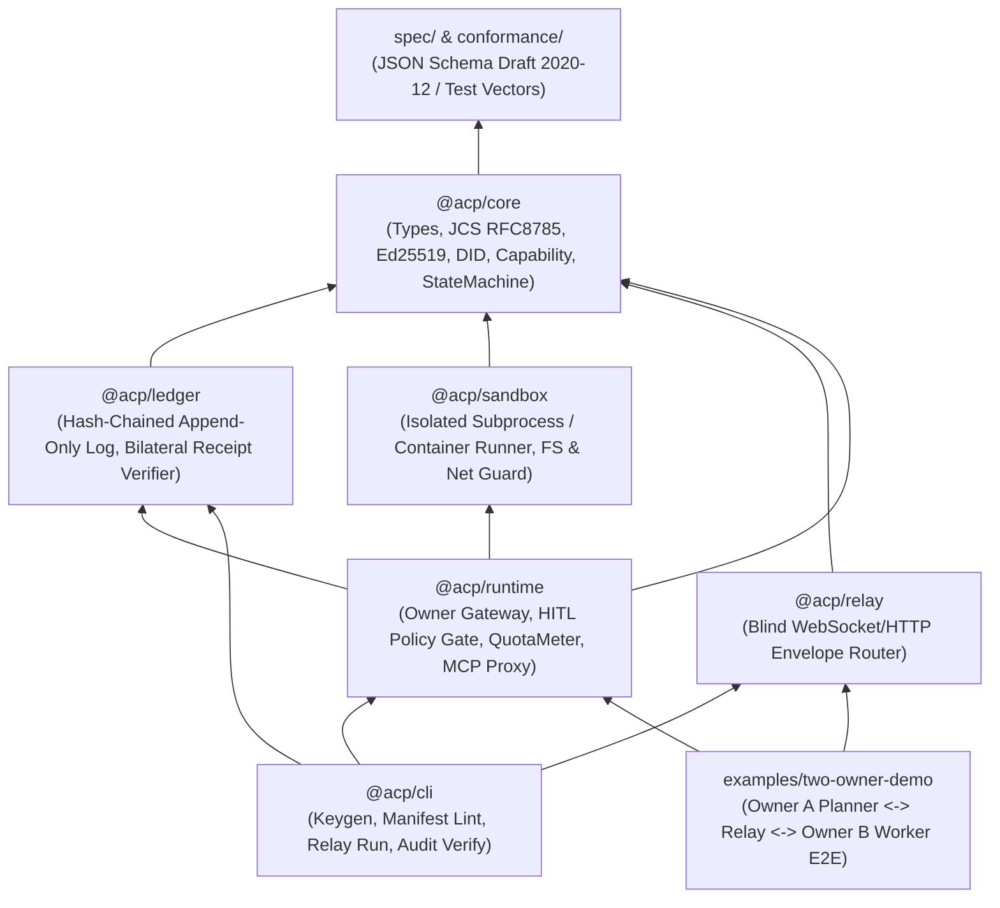

# REPO_STRUCTURE: Monorepo Layout, Stack, and MVP Roadmap

**English** | [日本語 (REPO_STRUCTURE.ja.md)](./REPO_STRUCTURE.ja.md)

**Conclusion**: The protocol specification (`spec/`) and the conformance test vectors (`conformance/`) sit at the top as the language-independent source of truth. The reference implementation (`packages/*`) is built with **TypeScript (Node.js 22 LTS + a pnpm workspace)** and a small dependency set. The first milestone (MVP / M1) is an **end-to-end demo in which two Owner Gateways, with different key pairs, complete one task over an untrusted Relay: contract, a capability-limited tool call, automatic acceptance, and a bilateral audit log**.

---

## 1. Package dependencies and monorepo layout

### 1.1 Package dependency graph (layer discipline)

Cycles are forbidden. A lower layer (`spec` to `core`) never references an upper layer (`runtime`, `relay`, `cli`).



### 1.2 Directory tree

```text
agent-collab-platform/
├── README.md                          # Project overview (one-screen summary)
├── ARCHITECTURE.md                    # Architecture, trust boundaries, and safety design
├── REPO_STRUCTURE.md                  # Repository layout, stack, and MVP plan (this document)
├── LICENSE                            # Apache-2.0 or MIT (an owner decision)
├── package.json                       # pnpm workspace root
├── pnpm-workspace.yaml
├── tsconfig.base.json
│
├── spec/                              # Language-independent protocol spec and JSON Schema
│   ├── README.md                      # Envelope, canonicalization, signatures, and state transitions
│   ├── task-manifest.schema.json      # TaskManifest schema (Draft 2020-12)
│   ├── capability-token.schema.json   # CapabilityToken schema (added in M0)
│   ├── envelope.schema.json           # SignedEnvelope / AckReceipt schema (added in M0)
│   ├── audit-entry.schema.json        # AuditLogEntry / UsageReceipt schema (added in M0)
│   └── examples/
│       └── sample-task-manifest.json  # Sample manifest for schema validation
│
├── conformance/                       # Language-independent implementation conformance vectors
│   ├── README.md                      # Vector spec (later checks Python/Go/Rust implementations)
│   ├── jcs-signing-vectors.json       # RFC 8785 canonicalization plus Ed25519 signature vectors
│   ├── capability-attenuation.json    # Valid attenuation cases and privilege-escalation rejections
│   └── state-transitions.json         # Valid and invalid state-machine transition vectors
│
├── packages/
│   ├── core/                          # @acp/core: pure-function core with no external I/O
│   │   ├── src/
│   │   │   ├── crypto/                # did:key, Ed25519 sign/verify, RFC 8785 JCS, SHA-256
│   │   │   ├── capability/            # CapabilityToken issue and attenuation checks
│   │   │   ├── contract/              # TaskManifest / TaskContract checks and the state machine
│   │   │   └── index.ts
│   │   └── test/
│   │
│   ├── ledger/                        # @acp/ledger: append-only hash-chain audit ledger
│   │   ├── src/
│   │   │   ├── store.ts               # JSONL / SQLite append store
│   │   │   ├── verifier.ts            # Bilateral signature and hash-chain integrity verifier
│   │   │   └── index.ts
│   │   └── test/
│   │
│   ├── sandbox/                       # @acp/sandbox: isolated execution adapter for worker tasks
│   │   ├── src/
│   │   │   ├── driver.ts              # SandboxDriver interface
│   │   │   ├── local-process.ts       # MVP: restricted temp directory and environment cutoff
│   │   │   ├── container.ts           # M2: Docker / OCI rootless container driver
│   │   │   └── index.ts
│   │   └── test/
│   │
│   ├── runtime/                       # @acp/runtime: the Gateway Runtime each owner runs
│   │   ├── src/
│   │   │   ├── gateway.ts             # Message send/receive and contract lifecycle
│   │   │   ├── hitl-gate.ts           # Approval gates (policy evaluation + ApprovalReceipt signature)
│   │   │   ├── mcp-proxy.ts           # MCP tool proxy narrowed by a CapabilityToken
│   │   │   ├── quota-meter.ts         # Token and API-call metering, and UsageReceipt issuance
│   │   │   ├── verifier.ts            # SHA-256, JSON Schema, and automatic checks on a delivery
│   │   │   └── index.ts
│   │   └── test/
│   │
│   └── relay/                         # @acp/relay: untrusted message relay
│       ├── src/
│       │   ├── server.ts              # Blind Relay over WebSocket / HTTP SSE
│       │   ├── memory-transport.ts    # In-memory bus for tests and single-machine checks
│       │   └── index.ts
│       └── test/
│
├── cli/                               # @acp/cli: development, operations, and audit CLI (`acp`)
│   ├── src/
│   │   ├── commands/
│   │   │   ├── keygen.ts              # Generate an Owner / Agent did:key pair
│   │   │   ├── validate.ts            # Validate a TaskManifest / schema
│   │   │   ├── approve.ts             # HITL approval signature command
│   │   │   └── audit-verify.ts        # Offline tamper check of an audit-log bundle
│   │   └── index.ts
│   └── package.json
│
├── examples/
│   └── two-owner-demo/                # MVP end-to-end demo (Owner Alice and Owner Bob)
│       ├── README.md
│       ├── alice-policy.json          # Requester owner HITL and authority policy
│       ├── bob-policy.json            # Worker owner acceptance and quota policy
│       └── run-demo.ts                # Script that runs the happy path and the blocked attacks
│
└── docs/
    ├── protocol-walkthrough.md        # Detailed message-sequence walkthrough
    └── security-model.md              # Threat model and operations guide
```

---

## 2. Stack choices and reasons

### 2.1 Adopted stack (MVP)

- **Language and runtime**: **TypeScript 5.x (strict mode) + Node.js 22 LTS**
  - **Reason**: Closest fit to the MCP SDK (`@modelcontextprotocol/sdk`), the A2A JS SDK, and the JSON Schema ecosystem, so the web surface, CLI, Relay, and Runtime can be built in one language.
- **Cryptographic primitives**: **Node.js built-in `node:crypto` (Ed25519 / X25519 / SHA-256)**
  - **Reason**: No native addons and no third-party cryptography libraries, which keeps the supply-chain surface small.
- **Schema validation**: **JSON Schema Draft 2020-12 (`ajv` v8)**
  - **Reason**: `spec/*.schema.json` can be distributed as language-independent files. A later Python (`jsonschema` / `pydantic`), Go, or Rust SDK can share the schemas and the `conformance/` vectors.
- **Package manager and tests**: **pnpm workspaces + Vitest (or Node.js built-in `node:test`)**
  - **Reason**: The dependency graph stays light, and CI and local runs stay fast.

### 2.2 Alternatives set aside for the MVP

| Alternative                                   | Why it is not the MVP choice                                                                                                                                                                                                                                           |
| :-------------------------------------------- | :--------------------------------------------------------------------------------------------------------------------------------------------------------------------------------------------------------------------------------------------------------------------- |
| **Python-only**                               | Popular for agent implementations, but a small Gateway daemon, a WebSocket Relay, and a strictly typed CLI distribute more coherently from one TypeScript/Node.js codebase. A Python SDK can be a thin client later, using `spec/` and `conformance/`, from M2 onward. |
| **Rust or Go for the core**                   | Better for binary distribution and speed, but slower while the protocol is still changing (schema edits and MCP experiments). Port it after the specification settles.                                                                                                 |
| **Requiring Protobuf / gRPC**                 | RFC 8785 (JCS) canonical JSON is easier to read in an audit log, to check directly against LLM output, and to debug from a browser or a CLI.                                                                                                                           |
| **Requiring a blockchain or smart contracts** | Gas, wallet management, and latency would block a five-minute local open-source demo. A bilateral signed hash chain already provides the non-repudiation this milestone needs.                                                                                         |

---

## 3. MVP scope (in scope / out of scope)

### 3.1 MVP goal

Prove, with running code and tests, that **agents belonging to two different owners (Alice and Bob) can safely delegate, run, automatically accept, and audit one task over an untrusted Relay, without sharing API keys or filesystems**.

### 3.2 What the MVP includes and excludes

| Area                            | In scope for the MVP (M0–M1)                                                                                                                           | Out of scope (M2 and later)                                                                                        |
| :------------------------------ | :----------------------------------------------------------------------------------------------------------------------------------------------------- | :----------------------------------------------------------------------------------------------------------------- |
| **Identity**                    | `did:key` (Ed25519 public key) and a local key-generation CLI                                                                                          | A distributed public directory, Web PKI / DNS (`did:web`), and reputation scores                                   |
| **Contract and state machine**  | `TaskManifest` validation, a two-signature `TaskContract`, and the basic state machine (`PROPOSE` through `SETTLED`)                                   | Multi-round price auctions, and simultaneous agreement among three or more parties                                 |
| **Authority (Capability)**      | One delegation hop (Requester to Worker), attenuation checks (tool name, argument schema, call cap, expiry), and no redelegation (`maxDepth: 0`)       | Chains of three or more hops (the data structure can represent them; M2 enables them)                              |
| **Approval (HITL)**             | JSON policy plus an owner signature through the CLI or a callback (`ApprovalReceipt`)                                                                  | A web GUI dashboard and mobile push notifications                                                                  |
| **Cost and quota**              | BYOK, a `QuotaMeter` hard cap on tokens and call counts, and a signed `UsageReceipt`                                                                   | A fiat or crypto payment plugin (Stripe, X Money, and similar)                                                     |
| **Isolation, transport, audit** | Local process isolation (a dedicated temp directory and an environment cutoff), a WebSocket/in-memory Relay, and a bilateral signed JSONL audit ledger | A Docker/WASM isolation driver (M2), and automatic anchoring to an external public log such as Sigstore Rekor (M3) |

### 3.3 MVP definition of done

`pnpm --filter @acp/two-owner-demo start` completes the MVP when **one happy path and three blocked attacks** all pass as deterministic tests.

1. **Happy path**:
   - Owner Alice (requester) signs a `TaskManifest` for "summarize the given documents and write a structured JSON report" and posts it to the Relay.
   - Owner Bob's (worker) Gateway passes HITL (`ApprovalReceipt`), sends `ACCEPT`, and the `TaskContract` is formed.
   - Bob's agent uses a read-only `CapabilityToken` granted by Alice (`docs/read` only, at most five calls) to fetch the documents through Alice's Gateway MCP proxy.
   - Bob `DELIVER`s an artifact (JSON with a SHA-256 hash) and a `UsageReceipt` whose consumed tokens are inside the budget.
   - Alice's Gateway checks `outputSchema` and the digest, moves `VERIFY_ACCEPT` to `SETTLED`, and `sealbridge audit-verify` reports `VALID` for both audit logs.
2. **Blocked attack 1 (Capability escalation)**:
   - The moment Bob (or an injected prompt) calls a forbidden `docs/delete` tool, or a sixth call past the cap, Alice's Gateway blocks it with `CAPABILITY_VIOLATION` and records the audit log.
3. **Blocked attack 2 (automatic stop on budget overrun)**:
   - The moment Bob's consumed tokens exceed the contract `maxOutputTokens`, Bob's Gateway `QuotaMeter` force-stops the run. It does not continue without permission.
4. **Blocked attack 3 (bad artifact or tampered message)**:
   - A message tampered on the Relay, or a delivery that fails `outputSchema`, is `VERIFY_REJECT`ed by Alice's Gateway verifier.

---

## 4. Milestones (M0–M3) and the implementation split

### 4.1 Milestone overview

- **M0: Spec and core primitives.** Freeze the schemas, JCS canonicalization, Ed25519 signatures, Capability attenuation checks, and a pure-function state machine.
- **M1: MVP end to end.** Ledger, Runtime Gateway, HITL gates, Blind Relay, the two-owner demo, and the blocked-attack tests.
- **M2: Hardened isolation and end-to-end encryption.** X25519 payload encryption, a Docker/OCI container sandbox driver, multi-hop Capability delegation, and a Python SDK.
- **M3: Ecosystem and settlement plugins.** A web HITL console, anchoring to an external transparency log (Sigstore Rekor and similar), and a payment / escrow plugin interface.

### 4.2 M0–M1 work packages

After the initial design is approved, implementation proceeds as WP-1 through WP-6, in this order.

| Task ID  | Package                                  | Work                                                                                                                                               | Acceptance criteria                                                                                                                                                     |
| :------- | :--------------------------------------- | :------------------------------------------------------------------------------------------------------------------------------------------------- | :---------------------------------------------------------------------------------------------------------------------------------------------------------------------- |
| **WP-1** | `spec/`<br>`conformance/`                | Remaining JSON Schemas (`capability-token`, `envelope`, `audit-entry`) and the conformance vectors                                                 | Every schema and sample JSON passes `npx ajv validate --spec=draft2020` with zero errors                                                                                |
| **WP-2** | `packages/core`                          | `did:key` generation, RFC 8785 JCS, Ed25519 sign/verify, the `CapabilityToken` attenuation verifier, and the `TaskContract` state machine          | Unit tests pass 100% of the `conformance/` vectors: tamper detection, expiry, out-of-scope tools, call-count overrun, delegation-depth overrun, and illegal transitions |
| **WP-3** | `packages/ledger`                        | An append-only log with a hash chain (`prevEntryHash`) and bilateral signatures (`actorSignature` + `counterSignature`), plus an offline verifier  | Tests detect a one-byte tamper, a reordered entry, a missing entry, and a missing signature on either side                                                              |
| **WP-4** | `packages/sandbox`<br>`packages/runtime` | Gateway Runtime, HITL policy evaluator, `ApprovalReceipt` signatures, the Capability MCP proxy, `QuotaMeter`, and the three-step artifact verifier | An unapproved external side effect, an out-of-scope Capability call, a quota overrun, and a schema-invalid artifact are all blocked at the Gateway                      |
| **WP-5** | `packages/relay`<br>`cli/`               | Blind Relay (in-memory and WebSocket) and the `acp` CLI (`keygen`, `validate`, `approve`, `audit-verify`)                                          | The Relay routes envelopes without holding any private key, and the CLI can verify an audit bundle                                                                      |
| **WP-6** | `examples/two-owner-demo`                | The two-owner end-to-end scenario for Alice and Bob (one happy path and three blocked attacks)                                                     | One command runs every scenario, exits `0`, and both audit-log verifications pass                                                                                       |

---

## 5. Layout when basing the work on existing OSS (detail in [`OSS_FORK_ANALYSIS.md`](./OSS_FORK_ANALYSIS.md))

The mapping below is for building on existing permissive-license (Apache-2.0 / MIT) projects, as well as for a from-scratch implementation.

### 5.1 Recommended hybrid (approach C: standard SDK dependencies plus a selective core fork)

- **Use as `package.json` dependencies, without a fork (prefer upstream tracking)**:
  - `@a2a-js/sdk` (`a2aproject/a2a-js`, Apache-2.0): AgentCard publication, JSON-RPC / HTTP+SSE task transport, and the persistence-store base
  - `@modelcontextprotocol/sdk` (`modelcontextprotocol/typescript-sdk`, MIT): MCP client and server base for tool calls
- **Strong candidate to fork or vendor into `packages/core`**:
  - `newtro/delegateos` (MIT, TypeScript): Ed25519 + RFC 8785 (`canonicalize`) + `ajv`, monotonically attenuating Capabilities (`DCT`), `TaskContract`, five acceptance engines (`VerificationEngine`), and MCP tool-authorization middleware, already covered by 374 tests. It can shorten the first `@acp/core` and `@acp/runtime` implementation. If adopted, the MIT license notice must be preserved at the repository root.
- **Candidates to study or port in part**:
  - `Cotal-AI/Cotal` (Apache-2.0, TypeScript): a HITL approval gate that can pause and resume through `checkpoint()`, and the design of the Claude Code / Codex harness connectors.
  - `GetBusbar/busbar` (Apache-2.0, Rust): a proxy boundary that never gives an agent a raw API key, and enforces a token budget cap (quota).

## M2/M3 delivery map (WP-7–WP-12)

| Work package                   | Implemented source                                                                            | Verification                                                                                                      |
| ------------------------------ | --------------------------------------------------------------------------------------------- | ----------------------------------------------------------------------------------------------------------------- |
| WP-7 adapters/discovery        | `packages/adapters/src/`, `packages/core/src/discovery.ts`, `packages/runtime/src/adapter.ts` | All five adapters complete signed two-owner sessions; exact HTTP usage; CLI wrapper parsing; credential isolation |
| WP-8 relay/invites             | `packages/relay/src/fetch.ts`, `index.ts`, `worker.ts`, `wrangler.toml.example`               | HTTP, SSE, long poll, WebSocket, registry signatures, expiry/tamper rejection, edge persistence                   |
| WP-9 approval/isolation        | `packages/runtime/src/approval-providers.ts`, `packages/sandbox/src/container.ts`             | Interactive streams, signed webhook, policy sensitive gates, OCI detection/fallback                               |
| WP-10 orchestrator/CLI         | `packages/runtime/src/session.ts`, `session-audit.ts`, `cli/src/network.ts`                   | Separate-owner key custody, protocol transitions, per-event AckReceipts and countersigned checkpoint              |
| WP-11 network conformance/demo | `conformance/network-collab.test.ts`, `examples/network-collab/run.mjs`                       | Actual TCP sessions and separate CLI processes; automatic fetch bridge under EPERM/EACCES                         |
| WP-12 onboarding/CI            | `README.md`, `.github/workflows/conformance.yml`                                              | Node 22 + pnpm frozen install, build, schema validation, tests, and the original demo on Ubuntu, macOS, and Windows |

Dependency direction is `adapters → runtime → relay/core/ledger/sandbox`;
`cli → adapters/runtime/relay` and the original examples remain supported.
The wildcard pnpm workspace includes `packages/adapters`; root tsconfig includes
its sources and the package has its own declaration-producing build.

New CLI commands: `relay start`, `worker start`, `delegate`, `discover`,
`invite create`. Existing `keygen`, `validate`, `approve`, `audit-verify`, and
`demo` retain their interfaces. `pnpm sealbridge` runs the source CLI; `node
cli/dist/index.js` and the package binary run the compiled CLI.

Cloudflare's default worker export is `packages/relay/src/worker.ts`; it routes
requests to the configured Durable Object. The Web fetch handler is also usable
without Node socket binding for local or embedded hosts. WebSockets are provided
by the Node entry point. Deployments and credentials remain owner-controlled.
